::: callout-note
**Sources for this page:** Petras Kundrotas's KB8029 teaching materials, "Databases of Sequence Information" (2026–2027) — this page covers its databases and worked examples, adapted for this book around linked records and biological questions, not copied verbatim; Wikipedia, [Biological database](https://en.wikipedia.org/wiki/Biological_database), [Sequence database](https://en.wikipedia.org/wiki/Sequence_database), [International Nucleotide Sequence Database Collaboration](https://en.wikipedia.org/wiki/International_Nucleotide_Sequence_Database_Collaboration), [GenBank](https://en.wikipedia.org/wiki/GenBank), [UniProt](https://en.wikipedia.org/wiki/UniProt), [RefSeq](https://en.wikipedia.org/wiki/RefSeq), [Accession number (bioinformatics)](https://en.wikipedia.org/wiki/Accession_number_(bioinformatics)), [Genome browser](https://en.wikipedia.org/wiki/Genome_browser), [UCSC Genome Browser](https://en.wikipedia.org/wiki/UCSC_Genome_Browser), [Ensembl genome database project](https://en.wikipedia.org/wiki/Ensembl_genome_database_project), [PubMed](https://en.wikipedia.org/wiki/PubMed), [PubMed Central](https://en.wikipedia.org/wiki/PubMed_Central), [MEDLINE](https://en.wikipedia.org/wiki/MEDLINE), [BioRxiv](https://en.wikipedia.org/wiki/BioRxiv), [Boolean search](https://en.wikipedia.org/wiki/Boolean_search) — CC BY-SA 4.0; NCBI, [GenBank overview](https://www.ncbi.nlm.nih.gov/genbank/), [How to submit data to GenBank](https://www.ncbi.nlm.nih.gov/genbank/submit/), [About RefSeq](https://www.ncbi.nlm.nih.gov/refseq/about/), [RefSeq FAQ](https://www.ncbi.nlm.nih.gov/books/NBK50679/), and the NLM [PubMed User Guide](https://pubmed.ncbi.nlm.nih.gov/help/) — public domain (US government work); EMBL-EBI Training, [The role of public databases](https://www.ebi.ac.uk/training/online/courses/bioinformatics-terrified/the-role-of-public-databases/), [Data sharing collaborations](https://www.ebi.ac.uk/training/online/courses/bioinformatics-terrified/the-role-of-public-databases/data-sharing-collaborations/), [What is ENA?](https://www.ebi.ac.uk/training/online/courses/ena-quick-tour/what-is-ena/), [The UniProt databases](https://www.ebi.ac.uk/training/online/courses/uniprot-quick-tour/the-uniprot-databases/), [UniProtKB](https://www.ebi.ac.uk/training/online/courses/uniprot-quick-tour/the-uniprot-databases/uniprotkb/) and [Export data from Ensembl](https://www.ebi.ac.uk/training/online/courses/ensembl-browsing-genomes/export-data/) — CC BY 4.0. The original worked records and search-result counts below were retrieved from the NCBI, UniProt, InterPro, RCSB, AlphaFold DB and IntAct APIs on 4 October 2026. The revised main notebook demonstrates selected retrieval, parsing and record checks. Building a complete database dossier belongs to the lab. The added INSDC comparison was verified on 2026-10-27, and the archive-history section cites the relevant provider notices. The UniProt protein-existence levels follow UniProt's [documentation](https://www.uniprot.org/help/protein_existence). Two figures are generated from the live databases rather than copied: the GenBank record head from NCBI efetch (public domain, US government work) and the genome-browser view from the UCSC [hgRenderTracks](https://genome.ucsc.edu/) service, both retrieved on 5 November 2026 and regenerated by `tools/builders/make_session03_record_figures.py`. The HBB transcript figure uses Ensembl GRCh38 coordinates retrieved the same day (EMBL-EBI, CC BY 4.0).

Additional reference material for Section 3.6: NLM, [What are accession numbers at NCBI?](https://support.nlm.nih.gov/knowledgebase/article/KA-03434/en-us){target="_blank" rel="noopener noreferrer"}; HGNC, [Frequently asked questions](https://www.genenames.org/help/faq/){target="_blank" rel="noopener noreferrer"}; Ensembl, [Stable identifiers](https://www.ensembl.org/info/genome/stable_ids/index.html){target="_blank" rel="noopener noreferrer"}; and EMBL-EBI Training, [Explore gene and transcript specific information](https://www.ebi.ac.uk/training/online/courses/ensembl-data-platform/accessing-navigating-ensembl/explore-gene-and-transcript-specific-info/){target="_blank" rel="noopener noreferrer"}. The explanations are written for this course.
:::

# Session 3: Biological Databases

::: {.callout-note appearance="simple"}
**Notebook:** [Session 3 — Biological Databases in code](notebooks/session03-databases-in-code.html){target="_blank"} — the code behind this page. [Download it](notebooks/session03-databases-in-code.ipynb){download=""} to run it yourself.
:::

::: {.callout-tip icon="false"}
## Naming things

> **Why do databases trust accession numbers more than gene names?** Ask the gene *Pokemon*, renamed *Zbtb7* in 2005 after Pokémon's owners objected.
:::

## Learning goals

By the end of this session you should be able to:

1.  choose appropriate DNA, RNA or protein databases for a biological question, connect records using identifiers, versions and cross-references, and trace individual claims to their sources and evaluate their supporting evidence;
2.  compare command-line or programmatic access, database-specific web pages and genome browsers, and use UCSC or Ensembl to retrieve genomic, transcript and protein sequences through one interface, recording the organism, assembly and versioned identifiers;
3.  find scientific literature through databases, scholarly search engines and AI-assisted tools; use PubMed as a worked example to construct and check queries, locate publications and available full text, and verify suggested references and claims against the original sources.

Rather than listing databases one by one, the reading uses human beta-globin (*HBB*) to connect genomic DNA, RNA transcripts and protein information. Several databases may help answer the same biological question, offering complementary records, annotations and evidence. The aim is to recognise the information needed and check what supports it.

{fig-alt="Connect DNA, RNA and protein records, choose a route to retrieve sequences, and trace claims to research studies." width="100%"}

## What is a biological database? {#what-is-a-biological-database}

A **biological database** is an organised collection of biological data that supports searching and retrieval. Its records may describe genes, transcripts, proteins or structures and contain sequences, annotations, identifiers and links to related information. These features help us find a record and connect it to other records.

**Database management software** handles storage, updates and retrieval, while **computer hardware** provides storage and computing power. A **database website** gives users an interface for searching and viewing records in a web browser. The website is one way to access the underlying data. Depending on the resource, downloads and programmatic interfaces provide other routes, as discussed later in this session.

{fig-alt="A website sends a search to database software, which retrieves organised records. Hardware provides storage and computing." width="100%"}

**We still need to check the evidence.** Inspect the underlying data and their quality, how an annotation was obtained, and whether cited experiments support the claim. Inclusion in a trusted database does not by itself establish that every annotation is correct. Search the literature for additional findings, and record accessions, sequence versions and retrieval dates so that the data used in an analysis can be checked again. [Behind database records](#behind-database-records) explains how experiments, analysis and curation contribute to this information.

### Further reading

- BBC Bitesize, [Information Systems](https://www.bbc.co.uk/bitesize/guides/zpdq7ty/revision/1){target="_blank" rel="noopener noreferrer"}, a short illustrated introduction to records and fields.

## Why coordinated, worldwide databases

### When data outgrow the lab

Downloading database releases for local searching has long been part of bioinformatics. Fixed local snapshots of external data remain useful for reproducible analysis. Some collections still fit on ordinary laboratory hardware. For example, the PDB Core archive, [about 1.5 TB as of 1 January 2026](https://www.rcsb.org/news/695ecade725cd43b223c4f37){target="_blank" rel="noopener noreferrer"}, would fit on a 4 TB hard drive. Other collections, such as the **Sequence Read Archive (SRA)**, with [more than 50 PB of unique data in April 2026](https://www.nlm.nih.gov/od/bor/SRA_NLM_BOR_Meeting_Summary_20260421.pdf){target="_blank" rel="noopener noreferrer"}, would require thousands of such hard drives, with a budget of tens of millions of Swedish kronor for the drives alone.[^session03-1]

[^session03-1]: As an illustrative baseline, 50 PB is 50,000 TB, requiring 12,500 drives of 4 TB nominal capacity. A 4 TB Seagate Expansion drive was advertised at [SEK 2,198 including VAT](https://www.proshop.se/Haarddisk-extern/Seagate-Expansion-Extern-Haarddisk-4TB-Svart/2976621){target="_blank" rel="noopener noreferrer"} on 24 October 2026, giving SEK 27,475,000 for those drives. The reported SRA total exceeds 50 PB. This comparison excludes additional capacity for backups, servers and operating costs, and uses individual retail prices rather than a bulk-purchase quotation.

Thus, keeping the entire archive locally is impractical for an ordinary research laboratory. Instead, public data centres maintain the full collections, while researchers retrieve the subsets of data needed for their particular questions or analyse entire datasets using shared computing infrastructure.

For nucleotide sequences, such shared infrastructure is provided by the **International Nucleotide Sequence Database Collaboration (INSDC)**. It connects NCBI in Bethesda, USA; EMBL-EBI in Hinxton, near Cambridge, UK; and DDBJ at the National Institute of Genetics in Mishima, Japan. These partners operate resources with different scopes. For example, NCBI provides GenBank and the Sequence Read Archive, while ENA brings reads, assembled sequences and annotations together within one resource. The collaboration preserves the data while providing several ways to find and retrieve them.

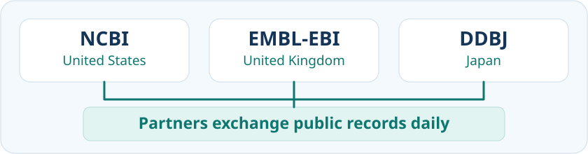{fig-alt="NCBI in the United States, EMBL-EBI in the United Kingdom and DDBJ in Japan exchange public records daily." width="100%"}

Researchers submit sequence data to one appropriate partner. Public records and updates are exchanged daily, and a shared archival sequence record keeps the same accession across the partner resources. As [NCBI's submission guide](https://www.ncbi.nlm.nih.gov/genbank/submit/){target="_blank" rel="noopener noreferrer"} explains, submitting the same data to all three is unnecessary. Finding that record through three websites provides alternative access to shared data, rather than three independent pieces of experimental evidence.

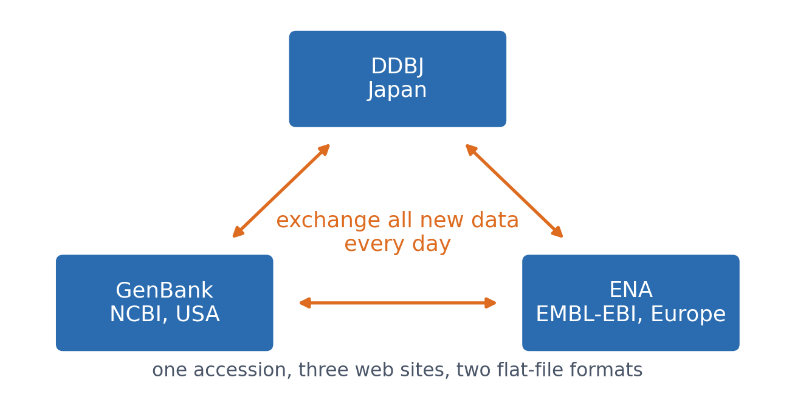{#fig-s03-insdc width=85%}

The partners use [common annotation standards](https://www.insdc.org/submitting-standards/feature-table/){target="_blank" rel="noopener noreferrer"}, while their web interfaces, search tools and downloadable formats can differ. Newly released data and updates may reach individual websites and search indexes at different times. Choosing between the services is therefore a question of which interface or access method suits the task, while the accession identifies the shared record.

Publicly released INSDC data are freely accessible, but a submission may remain confidential until its release date and controlled-access human data are excluded from the public exchange. An archived record preserves submitted data and annotations without necessarily collecting every later finding about that sequence.

### Connected records from one investigation {#connected-records-from-one-investigation}

An investigation produces several kinds of information, so a database needs more than a sequence record. Project and sample records describe the context of the work, while read and assembled-sequence records preserve different stages of its results. Following the links between these records helps us establish what a dataset represents and where its evidence came from. The [ENA quick tour](https://www.ebi.ac.uk/training/online/courses/ena-quick-tour/what-is-ena/how-is-ena-structured/){target="_blank" rel="noopener noreferrer"} introduces this organisation.

| Record type | Question it helps answer | Typical information |
|------------------|------------------|------------------------------------|
| Project or study, such as [BioProject](https://www.ncbi.nlm.nih.gov/bioproject/){target="_blank" rel="noopener noreferrer"} | What investigation produced these data? | The study's purpose and scope, submitting organisation, publications and links to datasets. |
| Sample, such as [BioSample](https://www.ncbi.nlm.nih.gov/biosample/docs/){target="_blank" rel="noopener noreferrer"} | What biological material was examined? | The organism, source material and relevant collection information. |
| Sequencing reads, held in a read archive | What individual sequencing observations are available? | DNA or RNA read sequences and quality information, linked to records describing the library, instrument and experiment. |
| Assembled sequences and annotations | What longer sequence was reconstructed, and which features were identified? | Sequences reconstructed from reads and descriptions of features such as genes. |

These are linked record types, not four separate databases with identical names at every partner. A project may contain several samples and sequencing runs, and an assembly may use data from several runs. Researchers reconstruct sequences before depositing an assembly, and the archive stores that result. Each related record has its own identifier, so following a cross-reference is different from viewing the same shared record through another partner's interface.

The course notebook starts with a [small comparison of one submitted human HBB mRNA record through NCBI and ENA](notebooks/session03-databases-in-code.html#insdc-two-interfaces){target="_blank" rel="noopener noreferrer"}. It checks the accession and version, organism and sequence before selected examples of transcript-field parsing and UniProt record checks. This illustrates how to recognise shared data even when their descriptions or page layouts differ.

### When archives and access routes change

Archives develop as sequencing methods and computing needs change. Trace Archive was a specialised read archive, chiefly associated with capillary sequencing such as Sanger sequencing. It stored chromatograms, the instrument signals displayed as coloured peaks, together with DNA sequences inferred from those signals and estimates of confidence in the identified bases. Newer read archives developed to manage high-throughput sequencing and now also accept capillary data. Their roles therefore overlap, even though their names and original designs differ.

An older publication may consequently point to a website that no longer works. Retain its record identifier and consult the provider's current retrieval instructions before concluding that the data have disappeared. NCBI's [Access Trace Data guide](https://www.ncbi.nlm.nih.gov/sra/docs/trace-data/){target="_blank" rel="noopener noreferrer"} shows how former Trace Archive data can be located through SRA. Check which files are available: access to read sequences and quality scores does not establish that every original signal recording remains downloadable.

::: {.callout-note collapse="true"}
### Optional example: the changing Trace Archive services

- **EMBL-EBI:** ENA [brought together the nucleotide sequence collection, Trace Archive and SRA in May 2010](https://www.embl.org/files/wp-content/uploads/EMBL-EBI_Scientific_Report-2010.pdf){target="_blank" rel="noopener noreferrer"}. [Trace searches and viewing through its website ended in February 2017](https://www.ebi.ac.uk/about/news/updates-from-data-resources/changes-trace-archive-ena/){target="_blank" rel="noopener noreferrer"}, while direct file downloads remained available at that time. Integration of a collection and retirement of an interface were separate events.
- **NCBI:** the separate [Trace Archive retired on 17 June 2022](https://ncbiinsights.ncbi.nlm.nih.gov/2021/12/17/trace-archive-retirement/){target="_blank" rel="noopener noreferrer"}. NCBI states that its former Trace Archive data were transferred to SRA.
- **DDBJ:** DTA had closed by 12 April 2023, as documented in its [official website history](https://github.com/ddbj/www/commit/22ae1138cfda4e6010ddc287493c4ad82d43344f){target="_blank" rel="noopener noreferrer"}. This is a documented upper limit, not a verified shutdown day. [DDBJ's current guidance](https://www.ddbj.nig.ac.jp/dta/index-e.html){target="_blank" rel="noopener noreferrer"} directs historical trace-data retrieval to SRA and new capillary submissions to DRA. It does not describe DTA simply becoming DRA.

A surviving example is [run SRR9451988](https://www.ebi.ac.uk/ena/browser/view/SRR9451988){target="_blank" rel="noopener noreferrer"}, linked to [experiment SRX6217698](https://www.ncbi.nlm.nih.gov/sra/SRX6217698){target="_blank" rel="noopener noreferrer"}. Its record describes a Trace conversion and a DNA library labelled HBB. The organism is olive baboon, *Papio anubis*, rather than the human HBB used in our main example. The label is a search clue, not proof that every read overlaps HBB. This optional example illustrates why checking the organism and available evidence remains necessary when the access route changes.
:::

### Further reading

- EMBL-EBI Training, [The role of public databases](https://www.ebi.ac.uk/training/online/courses/bioinformatics-terrified/the-role-of-public-databases/){target="_blank" rel="noopener noreferrer"}, a short introduction to the centres that maintain and share biological data.
- EMBL-EBI Training, [Data sharing collaborations](https://www.ebi.ac.uk/training/online/courses/bioinformatics-terrified/the-role-of-public-databases/data-sharing-collaborations/){target="_blank" rel="noopener noreferrer"}, connecting INSDC to collaborations for proteins, structures and other data.
- EMBL-EBI Training, [What is ENA?](https://www.ebi.ac.uk/training/online/courses/ena-quick-tour/what-is-ena/){target="_blank" rel="noopener noreferrer"}, an optional example explaining raw reads, assemblies and sequence annotation.
- EMBL-EBI Training, [How is ENA structured?](https://www.ebi.ac.uk/training/online/courses/ena-quick-tour/what-is-ena/how-is-ena-structured/){target="_blank" rel="noopener noreferrer"}, a short visual explanation of projects, samples, reads, assemblies and annotations.
- NCBI, [Access Trace Data](https://www.ncbi.nlm.nih.gov/sra/docs/trace-data/){target="_blank" rel="noopener noreferrer"}, optional practical guidance for following historical records into a current service.

## DNA, RNA and protein: connected records

The **central dogma of molecular biology** provides a familiar framework for connecting DNA, RNA and protein information. For a protein-coding gene, transcription copies DNA sequence information into RNA, and translation uses an mRNA's coding region to produce a polypeptide. Many RNAs function without being translated. Databases record these related biological objects and connect them through cross-references. A link helps us move between records, while the evidence attached to an annotation tells us how that claim is supported. The resources below are examples, not an exhaustive list. Specialist databases focus on particular information, while broader resources combine several kinds.

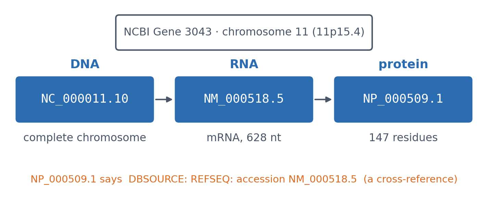{#fig-s03-levels width=90%}

### DNA-level data: genome to gene

DNA-level records describe genomic sequences and the features annotated along them. We can examine a **genome assembly**, a **chromosome**, a smaller **DNA region** or an individual **gene**, depending on what we want to learn.

A **genome assembly** is a reconstructed representation of an organism's DNA sequence. Its completeness depends on the available data and assembly quality. A **chromosome** carries part of the genome, and different chromosome types contain different DNA sequences and sets of genes. Examining a chromosome helps us ask which genes it contains, how they are arranged and whether a large deletion or rearrangement affects several genes. We can then focus on a smaller **DNA region** or an individual **gene**, as @fig-s03-dna-scales shows. These are different scales of genomic information.

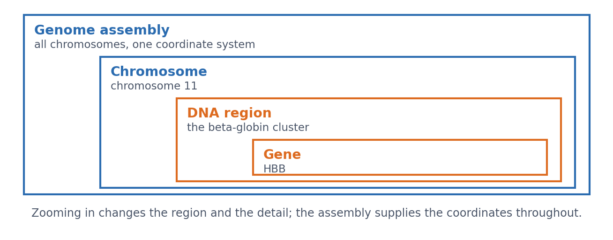{#fig-s03-dna-scales width=90%}

How much DNA we examine depends on the biological question. To work out which amino acids are encoded by *HBB*, we examine its coding sequence. To investigate how *HBB* activity is controlled, we also need to examine surrounding DNA. HBB belongs to the beta-globin cluster on chromosome 11, where noncoding regulatory sequences help control gene activity. The best-known of them is the **locus control region**, which governs the whole cluster from well outside any of the genes it controls — a concrete reason why a window drawn tightly around one gene can miss what decides its expression. Looking only at the coding sequence would omit this context. Within HBB itself, the genomic sequence also contains introns and untranslated parts of exons.

GenBank, ENA and Japan's DDBJ Annotated/Assembled Sequences preserve sequences deposited by researchers, from chromosome sequences to smaller DNA fragments. RefSeq maintains **reference sequences** that researchers use as common starting points for describing and comparing genomes, transcripts and proteins. A reference record contains the sequence, its identifier and annotations, such as the locations of genes or coding regions. Ensembl provides genome assemblies together with gene and transcript annotations. You may therefore find information about the same DNA region in several resources. Check what each record represents and how its annotations were obtained. Raw sequencing reads, an assembled sequence and an annotated reference are different kinds of data, even when they concern the same organism or gene.

#### Further reading

- NHGRI, [Chromosome](https://www.genome.gov/genetics-glossary/Chromosome){target="_blank" rel="noopener noreferrer"}, a short introduction to chromosomes and how they carry genetic information.
- NCBI, [Genome assembly glossary](https://www.ncbi.nlm.nih.gov/datasets/docs/v2/glossary/){target="_blank" rel="noopener noreferrer"}, explaining assemblies and their components.

### RNA-level data: sequence, function and expression

RNA-level resources describe the RNA products transcribed from DNA, including protein-coding and noncoding transcripts. They help us investigate both which RNA sequences exist and where those RNAs are detected or how abundant they are.

#### Transcript sequences {#transcript-sequences}

A transcript record describes an RNA sequence and its relationship to a gene. RefSeq and Ensembl provide reference transcripts and annotations, while GenBank, ENA and DDBJ preserve submitted RNA sequences. The mature transcript of a spliced gene contains joined exons, including untranslated regions where present. Its sequence therefore differs from the genomic region containing introns.

##### Further reading {.unnumbered}
- NCBI, [About RefSeq](https://www.ncbi.nlm.nih.gov/refseq/about/){target="_blank" rel="noopener noreferrer"}, introducing reference sequences and their annotations.

#### One gene, several transcripts {#one-gene-several-transcripts}

Different transcription starts, alternative splicing and alternative cleavage/polyadenylation can produce several RNA sequences from one gene. @fig-s03-transcript-routes illustrates these possibilities with a generic three-exon gene. Ordinary alternative splicing retains the genomic order of the selected exons. These mechanisms can occur together, and differences in untranslated regions can leave the encoded protein unchanged.

```{mermaid}
%%| label: fig-s03-transcript-routes
%%| fig-cap: "Schematic transcript possibilities for a generic three-exon gene, not a set of demonstrated HBB transcripts. Numbers denote exon order. Shorter end segments illustrate different start or processing sites. Coding boundaries are not shown."
flowchart TB
  G["Gene: three exons separated by introns"]
  G --> A["Baseline<br/>1 — 2 — 3"]
  G --> B["Different start<br/>shorter 1 — 2 — 3"]
  G --> C["Exon skipping<br/>1 — 3"]
  G --> D["Different 3′ end<br/>1 — 2 — shorter 3"]
```

#### Two transcripts, same gene?

Follow their links to the gene record. Transcripts assigned to the same gene share a linked gene identifier within the same organism, database and annotation release. For example, several human Ensembl transcript identifiers beginning with `ENST` can link to one gene identifier beginning with `ENSG`. Keep the separate transcript identifiers and versions when selecting sequences. Across databases, follow cross-references and check their context rather than compare identifier text alone. The notebook provides a [supplied-transcript parsing example](notebooks/session03-databases-in-code.html#hbb-transcript-checks){target="_blank" rel="noopener noreferrer"}; the lab asks you to investigate the biological relationships.

##### Further reading {.unnumbered}
- Ensembl, [Stable identifiers and versions](https://www.ensembl.org/info/genome/stable_ids/index.html){target="_blank" rel="noopener noreferrer"}, explaining how gene and transcript records are identified.

#### Noncoding RNA sequences and families {#noncoding-rna-sequences-and-families}

Noncoding RNAs are also transcripts, but function without encoding proteins. RNAcentral integrates noncoding RNA sequences from specialist resources. Rfam groups related structured RNAs and regulatory RNA elements into families using sequence and base-pairing information. A sequence record and a family record answer different questions. For example, Rfam's [RF00005](https://rfam.org/family/RF00005){target="_blank" rel="noopener noreferrer"} groups transfer RNAs (tRNAs). These help assemble proteins by delivering amino acids to ribosomes, including when HBB mRNA is translated into beta-globin. The connection to HBB is through protein synthesis: these tRNAs are not HBB transcripts.

##### Further reading {.unnumbered}
- [RNAcentral introduction](https://rnacentral.org/about-us){target="_blank" rel="noopener noreferrer"} and [Rfam introduction](https://docs.rfam.org/en/latest/about-rfam.html){target="_blank" rel="noopener noreferrer"}, distinguishing sequence integration from RNA families.
- NHGRI, [Transfer RNA (tRNA)](https://www.genome.gov/genetics-glossary/Transfer-RNA-tRNA){target="_blank" rel="noopener noreferrer"}, explaining its role in protein synthesis.

#### RNA expression {#rna-expression}

Expression data describe where RNA is detected and how abundant it is. A transcript sequence alone does not establish its abundance in a tissue. **GEO** (Gene Expression Omnibus at NCBI in the USA) and Japan's Genomic Expression Archive (**GEA**) preserve studies and their sample descriptions. For sequencing submissions to GEA, raw reads are deposited in DRA. Expression Atlas curates and analyses selected studies. Check whether measurements distinguish transcripts or report gene-level abundance, and compare samples, methods and units before interpreting differences.

Gene expression produces RNA and, for protein-coding genes, protein. Expression measurements concern these products, such as the amount of RNA detected in a sample. DNA sequence, DNA copy number and regulatory features are examined separately because they describe the genetic instructions and their regulation. RNA and protein abundance can differ because translation and protein degradation affect how much protein accumulates.

##### Further reading {.unnumbered}
- [Expression Atlas introduction](https://www.ebi.ac.uk/gxa/about.html){target="_blank" rel="noopener noreferrer"} and [GEA sequencing submissions](https://www.ddbj.nig.ac.jp/gea/submit-sequence-e.html){target="_blank" rel="noopener noreferrer"}, explaining expression results and their underlying data.

#### RNA written with DNA letters {#rna-written-with-dna-letters}

An RNA sequence can be written using U or represented with T, as in `AGCUUCGA` and `AGCTTCGA`. DDBJ explicitly uses the second convention for RNA records, including noncoding RNA. **Using T does not establish that a sequence is genomic DNA or that a physical cDNA copy was made.** Read the record's molecule type and annotations to identify what the sequence represents.

##### Further reading {.unnumbered}
- DDBJ, [Codes for nucleotide sequence](https://www.ddbj.nig.ac.jp/ddbj/sequence-e.html#code){target="_blank" rel="noopener noreferrer"}, the passage stating the T-for-U writing convention.

### Protein-level data: sequence, structure and function {#protein-level-data}

Protein-level records describe amino-acid sequences and connect them to structure, function and cellular context. Different resources specialise in these aspects, so we follow links between records and check the evidence for each annotation.

#### Amino-acid sequence and annotation {#what-is-known-about-the-protein}

A protein sequence tells us which amino-acid chain we are examining. Sequence records can also describe variants and link to the DNA or RNA records from which the sequence was derived. **UniProtKB** (discussed in more detail later in this session) and **NCBI Protein** are examples of resources providing protein sequences with annotations and cross-references.

For *HBB*, the reference transcript `NM_000518.5` links to protein `NP_000509.1` and UniProt entry `P68871`. A [small UniProt record check in the notebook](notebooks/session03-databases-in-code.html#uniprot-record-checks){target="_blank" rel="noopener noreferrer"} demonstrates how to inspect selected fields and cross-references in a structured response.

#### Three-dimensional structure {#is-there-a-structure}

A protein structure record may contain a model derived from experimental measurements or a computational prediction.

- **Experimental structures** are stored in the **Protein Data Bank (PDB)**. RCSB PDB, PDBe and Japan's PDBj provide different interfaces to this shared archive. Entry `2HHB` is human deoxyhaemoglobin, two alpha and two beta chains, determined by X-ray diffraction at **1.74 Å resolution** (Fermi et al. 1984). Resolution describes the experimental data: the smaller the number, the finer the detail the data could resolve.
- **Predicted models** are available through resources such as the **AlphaFold Protein Structure Database**. Its models include a per-residue confidence score, **pLDDT** (0-100). Higher values indicate greater confidence in the local predicted structure, rather than experimental confirmation. Very low confidence can have several causes, including intrinsic disorder (Session 12). The model for `P68871` in our retrieved example has a mean pLDDT of 97.

A resolution and a pLDDT are therefore not the same kind of number. Resolution describes experimental detail, whereas pLDDT estimates confidence in a prediction. Inspect the supporting data, methods and limitations even when two molecular pictures look similar. Session 6 examines protein structures, and Session 12 shows how AlphaFold predicts them.

##### Further reading {.unnumbered}
- [wwPDB archive access](https://www.wwpdb.org/ftp/pdb-ftp-sites){target="_blank" rel="noopener noreferrer"}, including RCSB PDB, PDBe and PDBj.
- [AlphaFold DB](https://alphafold.ebi.ac.uk/){target="_blank" rel="noopener noreferrer"}, providing predicted structures and confidence information.

#### Domains and families {#which-family-does-it-belong-to}

A protein domain is a compact part of a protein that can often fold into a stable structure on its own. Domains and their structural organisation are discussed further in [Session 6](session06.html#structural-domains). A protein family groups related proteins. **InterPro** (EMBL-EBI) combines domain, family and site annotations from specialist resources, including **Pfam**. Pfam's standalone website was retired in 2023, and its entries can be accessed through InterPro.

For example, InterPro identifies a globin domain in HBB and assigns the protein to the beta-type haemoglobin family. These are complementary descriptions of the same protein, so several annotations do not necessarily indicate several domains.

**SCOP (Structural Classification of Proteins)** classifies domains with known three-dimensional structures according to structural similarities and evolutionary relationships. Sequence-based domain matches and structural classifications provide related ways to investigate a protein.

##### Further reading {.unnumbered}
- [InterPro](https://www.ebi.ac.uk/interpro/){target="_blank" rel="noopener noreferrer"}, integrating protein family, domain and site signatures, including Pfam.
- [SCOP](https://scop.mrc-lmb.cam.ac.uk/){target="_blank" rel="noopener noreferrer"}, a classification of known protein structures and their domains.

#### Interactions and associations {#what-does-it-interact-with}

Interaction resources organise different kinds of evidence about relationships between proteins. They often present these relationships as networks, where **nodes** represent proteins and the lines between them, called **edges**, represent connections:

- **IntAct** (EMBL-EBI, part of the IMEx consortium) curates individual physical interactions from published experiments, such as that of *HBB* with HBZ (hemoglobin subunit zeta).
- **BioGRID** curates experimental physical and genetic interactions. Genetic interactions describe the effects of combined gene perturbations, rather than necessarily showing physical contact between proteins.
- **STRING** combines curated interactions, co-expression, conserved gene neighbourhood, predictions and text mining into one score per protein pair. It answers a broader question, "which proteins are functionally associated?", with a mixture of experimental and predicted evidence.
- **FunCoup** (Stockholm University, Sweden) combines several kinds of evidence to infer functional associations between genes and proteins.

The meaning of a network connection depends on the resource and its evidence. Two proteins might bind directly, occur in the same complex without touching, or contribute to the same biological process. A STRING association can therefore support a functional relationship without establishing physical contact. Check the evidence behind a particular connection before describing the proteins as binding partners.

##### Further reading {.unnumbered}
- [IntAct](https://www.ebi.ac.uk/intact/){target="_blank" rel="noopener noreferrer"} and [BioGRID introduction](https://wiki.thebiogrid.org/doku.php/aboutus){target="_blank" rel="noopener noreferrer"}, for curated interaction evidence.
- STRING, [What is a STRING network?](https://string-db.org/help/scores/){target="_blank" rel="noopener noreferrer"}, explaining the relationships represented by network connections.
- [FunCoup](https://funcoup.org/){target="_blank" rel="noopener noreferrer"}, for functional gene and protein association networks.

#### Abundance and location {#protein-abundance-and-location}

Knowing a protein sequence does not tell us how much protein is present or where it occurs. The **Human Protein Atlas** provides information about human proteins across tissues, cells and subcellular locations, including microscopy and abundance measurements. Microscopy can reveal which parts of a cell contain a protein. Comparing protein amounts requires suitable measurements and information about how the samples were analysed. RNA and protein measurements must also be distinguished because translation and protein degradation affect protein abundance.

##### Further reading {.unnumbered}
- [Human Protein Atlas introduction](https://www.proteinatlas.org/about){target="_blank" rel="noopener noreferrer"}, explaining its complementary resources and methods.

## Behind database records {#behind-database-records}

DNA, RNA and protein records describe different biological objects, but their information can come from several sources. Researchers submit experimental outputs and processed results, and databases may import information from other resources. An archival submission tells us who supplied the information. To understand a particular result or annotation, we also need to examine how it was obtained and what supports it.

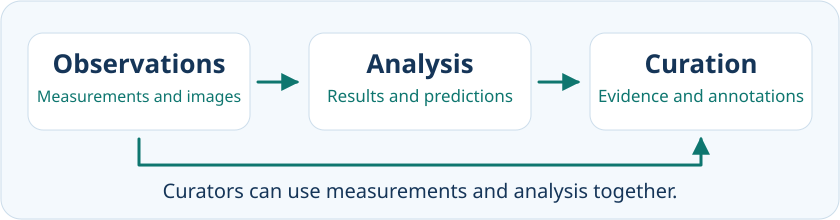{fig-alt="Observations support analysis, which produces results and predictions. Curators can assess both observations and analysed results when preparing annotations." width="100%"}

### Experiments generate raw data {#experiments-generate-raw-data}

Experiments produce measurements and observations that provide a starting point for analysis. Here, **raw data** means the original experimental output retained for the analysis being discussed. Instruments and acquisition software may already have performed some processing, so the term does not necessarily mean completely untouched data.

**Sequencing signals** may be changes in fluorescence or electrical current that software interprets as nucleotide letters. **Experimental images** can record cell appearance or fluorescent signals, while other instrument readings include absorbance measurements and mass spectra. **Phenotypic observations** describe observable characteristics, such as cell shape, growth or behaviour. These examples overlap because sequencing signals and images are also instrument outputs. They illustrate different forms in which experimental observations can be recorded.

The observations need their experimental context. The organism, sample, conditions, methods and measurement units help us interpret what was recorded and compare it with other work. This is why archives connect data files to [project, sample and experiment information](#connected-records-from-one-investigation). Data and their context together make it possible to check and reanalyse an investigation.

##### Further reading {.unnumbered}
- NHGRI, [DNA sequencing](https://www.genome.gov/about-genomics/fact-sheets/DNA-Sequencing-Fact-Sheet){target="_blank" rel="noopener noreferrer"} and [Phenotype](https://www.genome.gov/genetics-glossary/Phenotype){target="_blank" rel="noopener noreferrer"}, introducing sequence measurements and observable characteristics.
- EMBL-EBI Training, [How is ENA structured?](https://www.ebi.ac.uk/training/online/courses/ena-quick-tour/what-is-ena/how-is-ena-structured/){target="_blank" rel="noopener noreferrer"}, connecting sequencing data to their project and sample descriptions.

### Analysis produces results and predictions {#analysis-produces-results-and-predictions}

Analysis turns observations into interpretable results and can infer additional properties. Software can assemble sequence reads into longer sequences, calculate RNA-abundance estimates and translate a coding region into an amino-acid sequence. These are derived results. Computational translation establishes which amino-acid sequence the selected coding region encodes, but does not establish that the protein was detected experimentally.

Other analyses assign domains from sequence information or produce three-dimensional structural models. Some structural models are fitted to experimental measurements, while others are computational predictions. Both involve analysis, but their supporting evidence differs. We therefore need to know the method and input data behind the result, rather than treating every derived result as the same kind of prediction.

##### Further reading {.unnumbered}
- RCSB PDB-101, [Methods for determining structure](https://pdb101.rcsb.org/learn/guide-to-understanding-pdb-data/methods-for-determining-structure){target="_blank" rel="noopener noreferrer"}, explaining how measurements contribute to atomic models.

### Curation evaluates and connects information {#curation-evaluates-and-connects-information}

Curation assesses experimental findings and computational results, then organises them into useful records. Curators examine whether the evidence supports particular **annotations**, the descriptions of features or biological properties attached to a record. They compare findings across studies and consider whether different methods or conditions explain apparent disagreements. They also link related records and create or update annotations, recording uncertainty where necessary.

Curation is a process that can examine both experimental and computational information. A reviewed record can therefore contain experimentally supported findings alongside predictions or other interpretations. The review status tells us how the record has been assessed, while the evidence attached to an individual annotation tells us how that claim is supported.

##### Further reading {.unnumbered}
- EMBL-EBI Training, [Manual curation](https://www.ebi.ac.uk/training/online/courses/uniprot-exploring-protein-sequence-and-functional-info/where-does-the-data-come-from/functional-information/manual-curation/){target="_blank" rel="noopener noreferrer"} and [Data evidence](https://www.ebi.ac.uk/training/online/courses/uniprot-exploring-protein-sequence-and-functional-info/where-does-the-data-come-from/data-evidence/){target="_blank" rel="noopener noreferrer"}, explaining how experimental findings and computational analyses contribute to reviewed records.

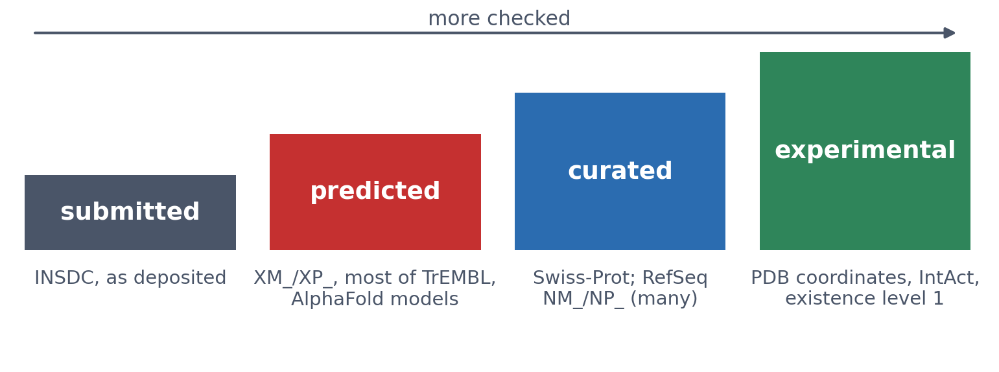{#fig-s03-evidence width=95%}

### HBB: results and supporting evidence {#hbb-results-and-evidence}

Human *HBB* illustrates how related records can contain information obtained in different ways. The [HBB transcript checks in the notebook](notebooks/session03-databases-in-code.html#hbb-transcript-checks){target="_blank" rel="noopener noreferrer"} start with the assembled, annotated RefSeq mRNA record `NM_000518.5`. We extract its annotated coding region, calculate the beta-globin amino-acid sequence and compare it with the translation stored in that same record. Agreement is an internal consistency check. It does not independently demonstrate that the protein was detected experimentally.

A globin-domain assignment provides another kind of information derived from sequence analysis. A three-dimensional model containing beta-globin may instead be fitted to experimental measurements or generated by structure prediction. These results can describe related biological molecules without originating from the same experiment. Their methods and supporting sources therefore need to be checked separately.

Curation helps connect transcript and protein records, annotations and relevant publications. When using a statement about *HBB*, identify the particular claim and follow its supporting evidence. A cross-reference helps us find a related record, but does not establish that both records have the same experimental basis. We next need identifiers to specify these records precisely and follow their connections.

## Finding records through names and identifiers {#identifiers-names-accessions-versions-and-cross-references}

To evaluate information in a database, we first need to find the relevant record. Biological names and symbols provide useful search terms. Record identifiers then allow us to specify what we selected, retrieve it again and follow its connections to other information.

Human *HBB*, the gene encoding beta-globin, will illustrate these steps.

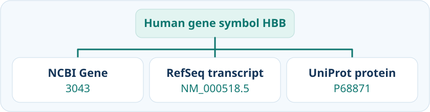{fig-alt="The human HBB gene symbol leads to NCBI Gene record 3043, RefSeq transcript NM_000518.5 and UniProt protein record P68871." width="100%"}

### Searching by name

A descriptive query such as `human hemoglobin beta` provides a useful starting point. Searching across the collections indexed by NCBI or EMBL-EBI can return gene records, nucleotide sequences, protein entries, expression studies and publications.

These results address different questions. A gene record can help us locate *HBB* in the genome. A protein entry can describe beta-globin's function. An expression study can provide measurements of RNA abundance under particular experimental conditions.

Before choosing a result, identify the kind of information needed. Search categories help us select an appropriate collection. The number of matches depends on the search service's coverage and interpretation of the query, so counts from different services are not directly comparable.

### Searching within a selected resource

Once we know what information we need, we can search within a suitable resource.

For a question about the human gene, **NCBI Gene** is a useful starting point. After searching, check the gene description and organism. The appropriate [human HBB gene record has Gene ID `3043`](https://www.ncbi.nlm.nih.gov/gene/3043){target="_blank" rel="noopener noreferrer"}. Its sections provide genomic context and links to transcripts, protein products and other information.

Expression displays require an additional check. A graph represents particular samples, methods and conditions. Follow its study and publication links to understand where the measurements came from.

For protein sequence and functional information, search **UniProtKB**. Organism filters help restrict results to *Homo sapiens*. A reviewed-entry filter selects entries that have undergone manual curation, but we must still check the protein name. Several human haemoglobin subunits can match a descriptive query.

The human beta-globin entry is [`P68871`](https://www.uniprot.org/uniprotkb/P68871/entry){target="_blank" rel="noopener noreferrer"}. After confirming its identity, examine the annotation relevant to the question and follow its supporting evidence. Review status describes the assessment of the entry. Individual annotations may have different kinds of supporting evidence. [EMBL-EBI's UniProtKB introduction](https://www.ebi.ac.uk/training/online/courses/uniprot-quick-tour/the-uniprot-databases/uniprotkb/){target="_blank" rel="noopener noreferrer"} explains this distinction.

UniProt's **protein-existence level** addresses evidence that a protein exists. The levels are 1, evidence at protein level; 2, evidence at transcript level; 3, inferred from homology; 4, predicted; and 5, uncertain. *HBB* (`P68871`) has level 1. This does not mean that every functional annotation or every residue in the displayed sequence has been experimentally confirmed. Check the evidence for the specific claim you intend to use. See [UniProt's explanation of protein existence](https://www.uniprot.org/help/protein_existence){target="_blank" rel="noopener noreferrer"}.

::: {.callout-note collapse="true"}
### Optional reading: how UniProt is organised

UniProt provides several datasets for different purposes:

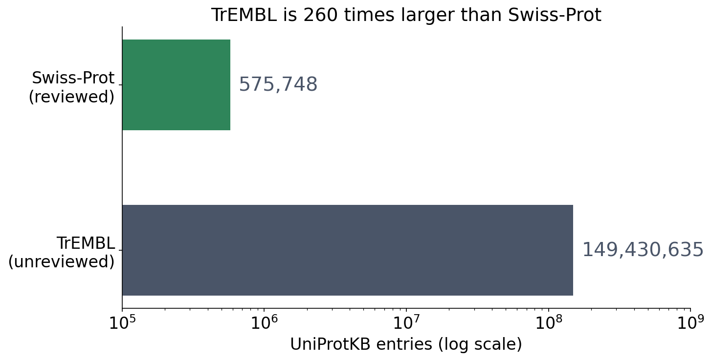{#fig-s03-uniprot-scale width=80%}

- **UniProtKB** combines protein sequences with functional annotations and cross-references. **Swiss-Prot** contains reviewed entries, while **TrEMBL** contains computationally annotated, unreviewed entries.
- **UniParc** archives distinct protein sequences and records their occurrence in source resources. It supports tracing sequence provenance and history.
- **UniRef** groups related sequences into clusters. UniRef100, UniRef90 and UniRef50 provide different clustering resolutions for tasks involving large sequence collections.

For the searches in this section, UniProtKB is the principal starting point. The archive and clustering datasets become useful when questions concern sequence history or collections of related sequences.

The [EMBL-EBI UniProt quick tour](https://www.ebi.ac.uk/training/online/courses/uniprot-quick-tour/the-uniprot-databases/){target="_blank" rel="noopener noreferrer"} provides an illustrated overview and optional explanations of each dataset.
:::

### Searching by an official gene symbol

Biological names can have alternative spellings and synonyms. An approved gene symbol provides a standardised term that resources can share.

For human genes, the **HUGO Gene Nomenclature Committee**, or **HGNC**, maintains approved symbols and descriptive names. The approved symbol for hemoglobin subunit beta is *HBB*, and its nomenclature record is `HGNC:4827`. An approved symbol supports communication and searching across resources. We should still specify the organism and check the selected record. [HGNC's explanation of approved nomenclature](https://www.genenames.org/help/faq/){target="_blank" rel="noopener noreferrer"} provides further background.

Searching for human *HBB* can lead to several identifiers:

- **`HGNC:4827`** identifies its HGNC nomenclature record.
- **`3043`** identifies its NCBI Gene record.
- **`ENSG00000244734`** identifies its Ensembl gene record.

These resources describe the same human gene from their respective perspectives.

Other identifiers lead to related biological objects. RefSeq `NM_000518.5` identifies an mRNA sequence, while `NP_000509.1` identifies its protein product. The submitted mRNA accession `V00497.1` can be retrieved through the INSDC partner interfaces at NCBI, ENA and DDBJ.

Thus, several identifiers may describe different records concerning the same gene, while other identifiers specify its transcripts, protein products or associated findings.

### Reading prefixes and suffixes

An identifier follows the conventions of the resource that issues it. Its first letters may indicate a record class, while characters at the end may identify a version or a protein isoform.

The examples in @tbl-s03-refseq illustrate several conventions.

::: {#tbl-s03-refseq}
| Resource | Pattern or example | What it tells us |
|------------------|------------------|------------------------------------|
| [RefSeq](https://www.ncbi.nlm.nih.gov/books/NBK50679/){target="_blank" rel="noopener noreferrer"} | `NM_000518.5`, `NP_000509.1` | `NM_` identifies mRNA and `NP_` protein. The number after the dot specifies the sequence version. |
| [Ensembl](https://www.ensembl.org/info/genome/stable_ids/index.html){target="_blank" rel="noopener noreferrer"} | `ENSG...`, `ENST...`, `ENSP...` | For human records, these identify genes, transcripts and proteins. A dot suffix gives the version of that object. |
| [INSDC read archives](https://www.ddbj.nig.ac.jp/news/en/2021-11-24-e.html){target="_blank" rel="noopener noreferrer"} | `SRR...`, `ERR...`, `DRR...` | Sequencing runs originating at NCBI, EMBL-EBI and DDBJ respectively. |
| [GEO](https://www.ncbi.nlm.nih.gov/geo/info/geo_paccess.html){target="_blank" rel="noopener noreferrer"} | `GSE...`, `GSM...` | A Series groups related samples in a study. A Sample record describes an individual sample. |
| [UniProtKB isoforms](https://www.uniprot.org/help/alternative_products){target="_blank" rel="noopener noreferrer"} | `P04150-2` | The suffix identifies a protein isoform. This example concerns the glucocorticoid receptor. |
| [UniProtKB features](https://www.uniprot.org/help/sequence_annotation#annotation_id){target="_blank" rel="noopener noreferrer"} | `VAR_002863`, `PRO_0000052976` | Identifiers for a natural sequence variant and a processed protein chain within the HBB entry. |
| [Rfam](https://rfam.org/family/RF00005){target="_blank" rel="noopener noreferrer"} / [Pfam](https://www.ebi.ac.uk/interpro/entry/pfam/PF00042/){target="_blank" rel="noopener noreferrer"} | `RF00005`, `PF00042` | An RNA family and a protein family or domain. These examples identify tRNAs and globins respectively. |

Selected identifier conventions across biological data resources.
:::

These conventions help us interpret unfamiliar records, but many identifiers contain little biological information. For example, NCBI Gene ID `3043` is useful because it specifies a record precisely.

The table also contains different kinds of suffix. UniProt's `-2` specifies an **isoform**, while RefSeq's `.5` specifies a **sequence version**. In Ensembl, versioning rules depend on whether the identifier refers to a gene, transcript or protein.

RefSeq also uses `NC_` for complete genomic molecules, `NR_` for noncoding RNA, and `XM_` / `XP_` for transcript / protein models generated by computational annotation. A prefix identifies the record class. Check the record's status and supporting evidence to assess particular annotations.

Post-translational modifications require further information. UniProt generally describes them using the modification type and its position in the protein sequence. They have no general accession-suffix convention. See [UniProt's explanation of modified residues](https://www.uniprot.org/help/mod_res){target="_blank" rel="noopener noreferrer"}.

### Recording the version used

Suppose a colleague reports, "I used HBB." That description leaves several possibilities. Was the input genomic DNA, an mRNA sequence or an amino-acid sequence? Which particular sequence was used?

{#fig-s03-record-anatomy width=100%}

For the RefSeq mRNA accession **`NM_000518.5`**, the suffix `.5` specifies sequence version 5. The protein accession **`NP_000509.1`** has its own sequence-version history.

Sequence versions help distinguish changes to the sequence itself. Updates to references or other annotations can occur without changing that suffix. Consequently, reproducing an analysis of annotations may also require the downloaded record and its release or retrieval date. [NLM's introduction to accession numbers](https://support.nlm.nih.gov/knowledgebase/article/KA-03434/en-us){target="_blank" rel="noopener noreferrer"} explains these distinctions.

A useful methods statement would be:

> The analysis used the human HBB RefSeq mRNA sequence NM_000518.5.

When reporting other data, retain the corresponding context. Genome coordinates require an assembly, such as GRCh38. Protein isoform analyses require the relevant isoform identifier. UniProt records sequence and entry versions separately from its accession.

### Following cross-references

A **cross-reference** connects a record to related information in another collection or resource. Websites commonly display these connections as clickable identifiers.

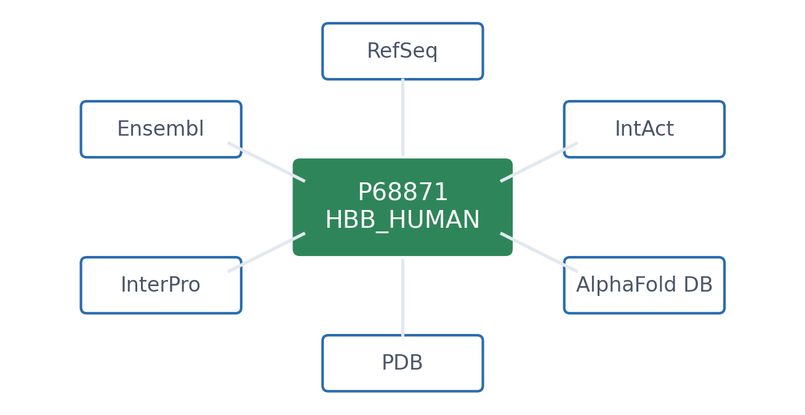{#fig-s03-uniprot-hub width=85%}

For example, the [UniProtKB beta-globin entry `P68871`](https://www.uniprot.org/uniprotkb/P68871/entry){target="_blank" rel="noopener noreferrer"} links to:

- [**NCBI Gene `3043`**](https://www.ncbi.nlm.nih.gov/gene/3043){target="_blank" rel="noopener noreferrer"}, describing the human gene that encodes beta-globin.
- [**RefSeq `NP_000509.1`**](https://www.ncbi.nlm.nih.gov/protein/NP_000509.1){target="_blank" rel="noopener noreferrer"}, providing a corresponding reference protein sequence.
- [**PDB `2HHB`**](https://www.rcsb.org/structure/2HHB){target="_blank" rel="noopener noreferrer"}, describing an experimentally determined haemoglobin complex containing alpha- and beta-globin chains.

These links let us follow relevant information without repeating a name search at each website.

Check what relationship each link represents. It may connect corresponding records, a gene and its product, or a protein and a larger complex containing it. A cross-reference establishes a connection between records. The destination still needs to be checked for its organism, record type and supporting evidence.

The [course notebook](notebooks/session03-databases-in-code.html#uniprot-record-checks){target="_blank" rel="noopener noreferrer"} demonstrates how to retrieve specified records and inspect their identifiers and connections programmatically.

### Further watching

EMBL-EBI's [**Explore gene and transcript specific information**](https://www.ebi.ac.uk/training/online/courses/ensembl-data-platform/accessing-navigating-ensembl/explore-gene-and-transcript-specific-info/){target="_blank" rel="noopener noreferrer"} contains a video demonstrating gene searching, gene and transcript identifiers, and cross-references to external resources.

While watching, consider which identifier specifies the gene, which specifies a transcript, and where an external cross-reference leads. The video uses Ensembl's newer data platform, so its page layout may differ from other Ensembl interfaces.

::: {style="position:relative;padding-bottom:56.25%;height:0;overflow:hidden;max-width:100%;margin-bottom:1em;"}
<iframe src="https://embl-ebi.cloud.panopto.eu/Panopto/Pages/Embed.aspx?autoplay=false&amp;captions=true&amp;id=36e2e908-ef4e-479d-90f1-b4ad00ab571d&amp;interactivity=all&amp;offerviewer=false&amp;showbrand=true&amp;showtitle=true" style="position:absolute;top:0;left:0;width:100%;height:100%;border:0;" allow="fullscreen" allowfullscreen loading="lazy" title="Ensembl gene and transcript identifiers and cross-references, EMBL-EBI">

</iframe>
:::

For a demonstration closer to the protein-search example, [**How to search UniProtKB**](https://www.ebi.ac.uk/training/online/courses/proteomics-an-introduction/proteomics-resources-at-the-ebi/uniprotkb/){target="_blank" rel="noopener noreferrer"} is a suitable alternative.

### Further reading

- NLM, [What are accession numbers at NCBI?](https://support.nlm.nih.gov/knowledgebase/article/KA-03434/en-us){target="_blank" rel="noopener noreferrer"}, a short explanation of accession formats, prefixes and sequence versions.
- HGNC, [Frequently asked questions](https://www.genenames.org/help/faq/){target="_blank" rel="noopener noreferrer"}, explaining approved gene symbols and descriptive names.
- Ensembl, [Stable identifiers](https://www.ensembl.org/info/genome/stable_ids/index.html){target="_blank" rel="noopener noreferrer"}, explaining identifier formats and the different versioning rules for genes, transcripts and proteins.

## Three ways into the data {#searching-know-your-level-predict-then-check}

Once you have an identifier, how you retrieve the record depends on what you want to do with it. You might read it on a database website, fetch it with a command or script, or explore its genomic context in a genome browser.

A **database record page** is convenient when you want to read one entry, download its sequence or follow its references. UniProt, for example, lets you inspect the beta-globin entry and the evidence behind its annotations. [UniProt beta-globin record](https://www.uniprot.org/uniprotkb/P68871/entry).

**Command-line or programmatic access** helps when a retrieval needs to be repeated or the result will feed into an analysis. A command can fetch a file, and a script can check and process what comes back. An application programming interface, or **API**, tells you how to request the data and which formats you can get.

A **genome browser** is useful when you want to know where something lies on a chromosome or how it relates to nearby features.

### What makes a genome browser different? {#genome-browsers-connected-views}

A transcript accession identifies one *HBB* record. In a genome browser, we can see where that transcript sits on a reference chromosome. We choose an organism and assembly, then look at the region around the gene. The DNA sequence, gene annotations and variants are arranged in **tracks** that share a coordinate ruler. In one window we can see *HBB* beside a neighbouring gene, line up a variant with an exon and open the records behind those features.

The choice of transcript matters. A variant can fall in an intron of one transcript and have a different annotation in another. The window on screen can also extend well beyond the sequence we need. Once we select a transcript, the browser can offer its genomic DNA, spliced sequence and encoded protein. The assembly and transcript give us a way to check what we’re looking at and what we’ve downloaded. [UCSC Genome Browser guide](https://genome.ucsc.edu/goldenPath/help/hgTracksHelp.html) · [Ensembl sequence export guide](https://www.ebi.ac.uk/training/online/courses/ensembl-data-platform/retrieving-ensembl-data/downloading-sequences/).

### Read the chromosome like a map {#read-the-chromosome-like-a-map}

We find human *HBB* on chromosome 11 in the UCSC Genome Browser. The assembly is **GRCh38**, which UCSC calls **hg38**. The coordinates above the tracks mark the window we’re looking at. When we zoom in, that window narrows, while the annotated transcript keeps its position on the same assembly. If we want to recreate this view later, the assembly, interval, strand, track and transcript accession are more informative than a screenshot alone. [Open the HBB region in UCSC](https://genome.ucsc.edu/cgi-bin/hgTracks?db=hg38&position=chr11%3A5225200-5227400).

At a closer scale, the transcript appears as blocks joined by lines. The blocks are exons, and the connecting lines mark introns. Thick parts of the blocks show the coding sequence and thin parts show untranslated regions. The small chevrons point left because *HBB* is transcribed from the reverse strand, toward lower reference coordinates. An overlapping feature can look like part of the same gene, but opening it reveals its own label and record. [UCSC Genome Browser guide](https://genome.ucsc.edu/goldenPath/help/hgTracksHelp.html) · [UCSC gene track conventions](https://genome.ucsc.edu/FAQ/FAQgenes.html).

### One transcript, four useful sequences {#one-transcript-four-sequences}

[A colleague asks for the sequence of human *HBB*.]{#hbb-sequence-example} We ask what they plan to do with it. They might want to examine DNA near a variant, see where two exons join, or compare beta-globin with another protein. A genome browser brings these related sequences together so you can inspect or download them from one place.

We start with the reference transcript `NM_000518.5`. If our colleague wants to look at an intronic variant, the **genomic span of this transcript** contains the site. Its **1,608 bases** cover the exons and the introns between them. The whole gene or the browser window can cover a wider interval, so the export coordinates matter.

If the question is which exons meet in the mature RNA, the **spliced transcript** joins them into a **628-base** sequence. It includes both untranslated ends. In a download labelled **cDNA**, the RNA sequence is written with DNA letters, so T appears where the RNA has U. If our colleague needs only the stretch from the start codon through the stop codon, the **coding sequence** has **444 bases**. The remaining **184 bases** of the spliced transcript belong to the untranslated regions.

For an amino-acid alignment, we’d send the linked **beta-globin protein** sequence, `NP_000509.1`. It has **147 amino acids**. The last triplet of the coding sequence signals termination and contributes no amino acid.

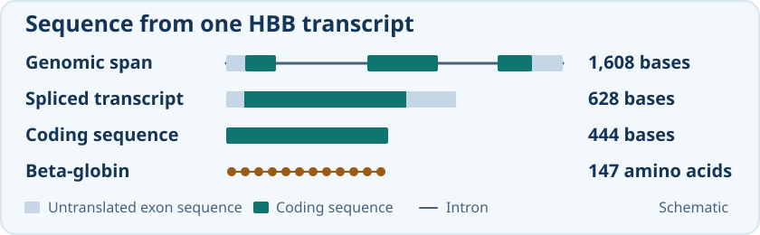{fig-alt="The HBB genomic span is 1,608 bases, the spliced transcript 628 bases, the coding sequence 444 bases and the beta-globin sequence 147 amino acids." width="100%"}

The FASTA header and sequence length help us tell which file we received. A genomic export can follow either the reference chromosome or the direction of transcription, depending on its settings. For an RNA or coding sequence export, the length helps us check whether the untranslated ends were included. [RefSeq transcript](https://www.ncbi.nlm.nih.gov/nuccore/NM_000518.5) · [RefSeq protein](https://www.ncbi.nlm.nih.gov/protein/NP_000509.1) · [Coding sequence and translation](https://www.ncbi.nlm.nih.gov/projects/CCDS/CcdsBrowse.cgi?DATA=CCDS7753&REQUEST=ALLFIELDS).

### The same region, different questions {#visible-tracks-and-customization}

When we open the *HBB* region in UCSC, several tracks are already visible. We first want to see where the exons lie, so we keep the curated RefSeq transcript on screen and hide the tracks we don’t need. The **Visible Tracks** group below the browser image shows which tracks are on. Where a track offers both modes, **dense** compresses it into one row, while **pack** keeps individual features labelled in a compact view. If we want to see how another annotation describes the transcripts, we can add GENCODE beside RefSeq. [UCSC track display controls](https://genome.ucsc.edu/goldenPath/help/hgTracksHelp.html#TRACK_CONFIG).

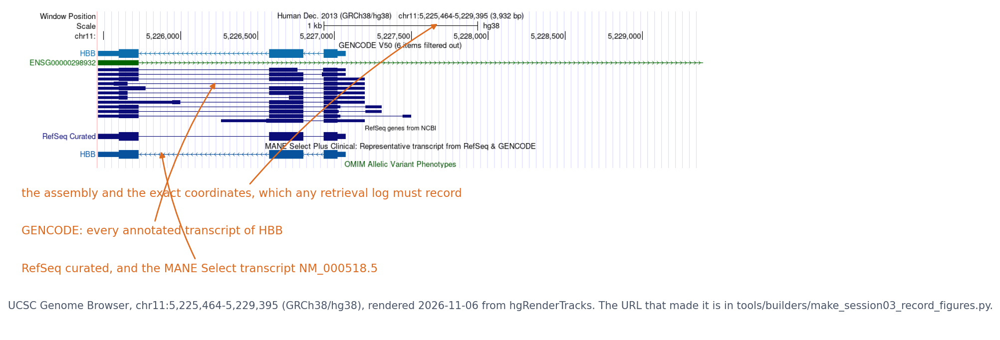{#fig-s03-ucsc width=100% fig-alt="The UCSC Genome Browser showing the HBB locus on chromosome 11, with GENCODE, RefSeq and MANE Select transcript tracks stacked under the coordinate ruler."}

The exon map gives us a reference point for our next question. Which parts of this region have been conserved across species? We stay at the same coordinates and add a conservation track, which lets us compare the signal over the exons and nearby DNA. A question about gene activity would bring in different tracks. RNA sequencing coverage can show where RNA was detected in a particular tissue, while a regulation track might show where DNA was accessible in a particular cell type. The track description tells us which species, tissue or assay contributed to the view.

In UCSC, these datasets are grouped by type, and **Track Search** helps us find one by name. Some tracks offer subtracks, filters or settings such as the vertical scale of a signal plot. In Ensembl, the **Track panel** lets us change which tracks are visible and find out what they contain. If something we expected is missing, its track may be hidden or filtered, or it may need a closer zoom. Tracks can also draw on the same dataset, which matters when we compare their annotations. [UCSC track settings](https://genome.ucsc.edu/goldenPath/help/hgTracksHelp.html#TRACK_CONFIG) · [Ensembl Track panel guide](https://www.ebi.ac.uk/training/online/courses/ensembl-data-platform/accessing-navigating-ensembl/visualising-data-on-the-genome-browser-app/).

We can now ask where a known single-base change falls in this region. Does it lie in an exon or in an intron of our reference transcript? We keep RefSeq visible and add the ClinVar single-nucleotide variants track.

### From a variant to its evidence {#from-a-variant-to-its-evidence}

With ClinVar lined up beside curated RefSeq, we can see two variants at different places in *HBB*. The first falls in a coding exon. In the transcript it is `NM_000518.5:c.20A>T`, a change that replaces glutamate with valine in beta-globin. The ClinVar record also gives `NC_000011.10:g.5227002T>A` on GRCh38. The letters look different because the `c.` description follows the transcript and the `g.` description follows the forward chromosome reference. *HBB* is on the reverse strand, so the letters in the two descriptions are complementary. [ClinVar record for the coding variant](https://www.ncbi.nlm.nih.gov/clinvar/314031330/) · [HGVS sequence numbering](https://hgvs-nomenclature.org/stable/background/numbering/).

The other variant, `NM_000518.5:c.93-21G>A`, falls in an intron, 21 bases before coding base 93. It’s the sort of change our colleague would need genomic DNA to locate. The reference spliced transcript omits that intron, but a change in the intron can alter where the cell splices the RNA. The ClinVar record takes us from the position in the browser to submissions and references. In Figure 3F of a study by Patsali and colleagues, we can see how the researchers measured normal and aberrantly spliced *HBB* RNA. That measurement addresses what happens to the transcript. [ClinVar record for the intronic variant](https://www.ncbi.nlm.nih.gov/clinvar/314097700/) · [Patsali and colleagues’ splicing study](https://haematologica.org/article/view/9137).

### Same locus, another browser {#same-locus-another-browser}

Our colleague opens Ensembl and finds *HBB* in the same region of chromosome 11. The controls look different, but the assembly, coordinates and strand tell us whether we’re looking at the same place. To compare our downloads, we also need to know whether the selected transcripts match.

The **MANE Select** label connects Ensembl transcript `ENST00000335295.4` to RefSeq transcript `NM_000518.5`. The pair has matching exon coordinates, coding regions and sequence. If our two files differ, we have somewhere to look for an explanation. One of us may have included introns, exported a wider region or used a different orientation. [Ensembl HBB Feature Explorer](https://www.ensembl.org/feature-explorer/GCA_000001405.29/gene:ENSG00000244734?view=transcripts) · [NCBI MANE project](https://www.ncbi.nlm.nih.gov/refseq/MANE/).

::: {.callout-note collapse="true"}
### Optional example: download first, process next {#download-first-process-next}

Our colleague also wants to save the beta-globin amino-acid sequence for an analysis. We already know its UniProt accession, so a single GNU Wget command saves the sequence as FASTA.

```bash
wget -O P68871.fasta https://rest.uniprot.org/uniprotkb/P68871.fasta
```

The file starts with a header marked by `>`, followed by the amino-acid sequence. This download contains one record. A search result or a larger collection can contain many, so checking the headers tells us what we received. A script can count or filter the records before they go into an analysis. [FASTA for P68871](https://rest.uniprot.org/uniprotkb/P68871.fasta).

The FASTA file is ready to use in a protein alignment. If our colleague also needs the organism and sequence length in a table, the same UniProt service can return the entry as JSON. Python can read those named fields directly.

```python
import json
from urllib.request import urlopen

url = "https://rest.uniprot.org/uniprotkb/P68871.json"
with urlopen(url, timeout=20) as response:
    entry = json.load(response)

print(entry["primaryAccession"])
print(entry["organism"]["scientificName"])
print(entry["sequence"]["length"])
```

The output is `P68871`, `Homo sapiens` and `147`. Those fields confirm which record came back. Keeping the file with its request URL, accession and retrieval date lets us trace the result later. The course notebook extends the example to annotations and cross-references. [JSON for P68871](https://rest.uniprot.org/uniprotkb/P68871.json) · [Notebook record check](notebooks/session03-databases-in-code.html#uniprot-record-checks){target="_blank" rel="noopener noreferrer"}.
:::

### Further reading

- UCSC, [Configuring the Genome Browser display](https://genome.ucsc.edu/goldenPath/help/hgTracksHelp.html#TRACK_CONFIG), explains how to change the tracks and the detail they display.
- EMBL-EBI Training, [Downloading sequences from Ensembl](https://www.ebi.ac.uk/training/online/courses/ensembl-data-platform/retrieving-ensembl-data/downloading-sequences/), shows how to choose genomic, transcript, coding and protein sequence exports.

## Finding scientific literature {#reading-literature-online}

Finding scientific literature starts with a biological question and a choice of search route. You can search a bibliographic database such as **PubMed**, use a scholarly search engine such as **Semantic Scholar**, or follow references and citing papers from a useful publication. These routes differ in coverage and how they rank results, so a search spanning several fields may benefit from more than one. AI tools offer another way to explore a question, as the short example below shows.

**PubMed is our worked example**, because it lets us practise constructing a query and checking how the search service interpreted it. PubMed provides citations and abstracts for biomedical publications. A citation identifies a paper, but access to its full text is a separate question. Follow links to **PubMed Central (PMC)** or the publisher, and check your university library's access if needed. A preprint or repository copy may also be available, but check which version you are reading.

A good habit for every database is to **predict what a query will return, run it, and check whether the result makes sense.** PubMed's Boolean operators make this easy, because they behave like operations on sets:

::: {#tbl-s03-pubmed}
| Query                    | Result count | Prediction                        |
|------------------------|------------------------|------------------------|
| `hemoglobin`             | 288,577      | —                                 |
| `malaria`                | 125,442      | —                                 |
| `hemoglobin AND malaria` | 4,458        | both terms present                |
| `hemoglobin OR malaria`  | 409,561      | 288,577 + 125,442 − 4,458 (union) |
| `hemoglobin NOT malaria` | 284,119      | 288,577 − 4,458 (difference)      |

PubMed queries combined with Boolean operators.
:::

**Quotation marks** request a phrase search. PubMed can map unquoted terms to subject headings and other variants through *Automatic Term Mapping*, so `hemoglobin beta` need not mean a simple search for both words anywhere. The query `"hemoglobin beta"` requests that phrase, but PubMed may ignore the quotation marks if the phrase is absent from its phrase index and display a warning. Check **Search Details** in the Advanced search history to see the actual query, and compare relevant results as well as counts. The optional third discussion notebook asks you to predict the counts for a new pair of terms before running the searches.

### AI-assisted literature discovery

AI can help turn an unfamiliar question into search terms, suggest related papers or produce a preliminary summary. For example, **Semantic Scholar** includes AI-generated summaries and recommendations, while **Elicit** supports finding and exploring papers from a research question. A general AI assistant can also help plan a search. Start with a specific question and ask for traceable sources, for example:

> Help me plan a literature search on the role of HBB variants in sickle-cell disease. Suggest synonyms and a database query. For any papers you suggest, provide a DOI or PMID and a source link. Distinguish the paper's reported findings from your interpretation, and mark references you cannot verify.

Use the suggestions as leads to investigate. Run the proposed query in PubMed or another suitable scholarly search service, then check one suggested paper's title, authors, year and DOI or PMID against its publication record. Next, open the paper and find the passage or result supporting a claimed finding. **A real reference and a supported claim are two separate checks**: an AI response can name a real paper but describe its findings incorrectly. If only the abstract was available, state that limit when describing what you checked.

Compare the AI suggestions with your database results, including dates and publication types, because the suggested list may miss relevant work. Record the search service, query and date, together with the AI tool and prompt if used. Apply these checks to one suggested reference and one claimed finding before using the result in your own work.

### Further watching

[*PubMed Overview*](https://www.youtube.com/watch?v=1otz5qrUbxo) (Johns Hopkins Welch Medical Library):

```{=html}
<div style="position:relative;padding-bottom:56.25%;height:0;overflow:hidden;max-width:100%;margin-bottom:1em;">
<iframe src="https://www.youtube.com/embed/1otz5qrUbxo" style="position:absolute;top:0;left:0;width:100%;height:100%;border:0;" allowfullscreen title="PubMed Overview, Welch Medical Library"></iframe>
</div>
```

### Further reading

- NLM, [PubMed User Guide](https://pubmed.ncbi.nlm.nih.gov/help/), especially phrase searching, Search Details and full-text access
- Wikipedia, [PubMed](https://en.wikipedia.org/wiki/PubMed), [PubMed Central](https://en.wikipedia.org/wiki/PubMed_Central) and [Boolean search](https://en.wikipedia.org/wiki/Boolean_search)
- Tool providers' introductions: [Semantic Scholar](https://webflow.semanticscholar.org/product) and [Elicit](https://support.elicit.com/en/articles/14757543-getting-started-with-elicit-which-workflow-should-i-use). These are examples to explore. Their own introductions explain the available features and any account requirements.

::: {.callout-note collapse="true"}
## Other resources worth knowing

These resources are not needed for this course, but you will meet them:

- **Variants:** dbSNP and ClinVar (NCBI; ClinVar adds clinical significance), the European Variation Archive (EMBL-EBI), and the GWAS Catalog, which records statistical associations between variants and traits from genome-wide association studies. OMIM (Johns Hopkins) is the classic reference for genes and Mendelian disease.
- **Cancer genomics:** TCGA, through NCI's Genomic Data Commons, and COSMIC (Sanger Institute) for somatic mutations in cancer.
- **Systems:** PRIDE (mass-spectrometry proteomics data), Reactome (curated pathways) and BioModels (computational models of pathways).
:::

## The course notebook

The [course notebook](notebooks/session03-databases-in-code.html){target="_blank" rel="noopener noreferrer"} demonstrates a small set of programmatic tasks starting from supplied accessions. You retrieve records, inspect returned fields, parse sequence information and check identifiers, molecule types and cross-references. Comparing an archival record through NCBI and ENA illustrates shared data behind different interfaces. These examples show how code can repeat and document a retrieval; they do not replace the biological investigation in the lab. Open it in [Google Colab](https://colab.research.google.com/github/ElofssonLab/kb8029-book/blob/main/notebooks/session03-databases-in-code.ipynb){target="_blank" rel="noopener noreferrer"} via the badge at the top of the notebook page.

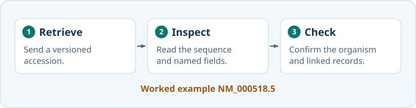{fig-alt="Retrieve a record, inspect its fields and confirm the organism and linked records." width="100%"}

::: {#lab-practice .callout-note collapse="true"}
## Optional practice for the lab

Use these ungraded HBB tasks to practise retrieving and checking database records. Work at your own pace and ask for help when needed. The assessed lab questions and submission requirements are provided separately in Canvas.

**Identifiers and evidence.** Open the human HBB gene record (NCBI Gene `3043`), RefSeq transcript `NM_000518.5`, protein `NP_000509.1` and UniProt entry `P68871`. Make a four-row table stating what each record represents, its identifier and version where applicable, and a cross-reference connecting it to another record. Explain why the symbol `HBB` alone does not specify the exact transcript sequence used. Then choose one biological claim in the UniProt entry, follow its evidence or reference, and briefly describe what supports that particular claim.

**Retrieval and record check.** Use either UCSC or Ensembl, with human GRCh38/hg38, and select one HBB protein-coding transcript. Retrieve three FASTA outputs through that resource:

- The genomic sequence spanning your selected transcript, with no additional flanking bases.
- The full spliced transcript/cDNA sequence, including its untranslated regions.
- The protein encoded by the selected transcript.

Keep a retrieval log with the resource and annotation source, organism, genome assembly, genomic interval and orientation, transcript/protein identifiers and versions, sequence types and lengths, and retrieval date. Use it to explain one difference between the genomic, transcript and protein outputs. Compare your log with another student's and check whether it contains enough information to reproduce the selections.
:::

## Check your understanding

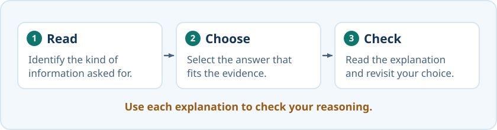{fig-alt="Read the question, choose the answer that fits the evidence, and review the explanation." width="100%"}

```{=html}
<div id="session03-quiz"></div>
<script>
renderQuiz("session03-quiz", [
  {
    question: "You find the same public INSDC sequence accession through NCBI, ENA and DDBJ. What does this tell you?",
    choices: [
      "The partner interfaces provide access to a shared archival record; this is not three independent experimental confirmations",
      "All three databases show every record in exactly the same file format",
      "Each database gives the same sequence a different accession number",
      "Only one of the three accepts new submissions"
    ],
    correctIndex: 0,
    explanation: "INSDC exchanges public records and updates daily, sharing accessions and annotation standards. Interfaces, downloadable formats and indexing times can differ. Viewing one shared record at three sites does not provide three independent pieces of experimental evidence."
  },
  {
    question: "You want to know which biological material was sequenced. Which linked record should you inspect first?",
    choices: [
      "The sample record, such as BioSample",
      "Only the assembled chromosome sequence",
      "Only the project title",
      "Only a protein structure record"
    ],
    correctIndex: 0,
    explanation: "The sample record describes the biological material. The project describes the investigation, while read and assembly records hold different stages of its sequence results. Library and instrument details belong in linked experiment information."
  },
  {
    question: "An older paper's Trace Archive link no longer works. What should you do first?",
    choices: [
      "Keep its identifier and consult the provider's current retrieval guidance",
      "Conclude that the underlying data have been deleted",
      "Submit the publication's data again as a new experiment",
      "Treat any record with a similar gene name as the same dataset"
    ],
    correctIndex: 0,
    explanation: "An archive or interface can close while records remain accessible through another service. Follow the identifier, then check the organism, record type and available files before reusing the evidence."
  },
  {
    question: "A protein sequence was calculated by translating an HBB coding sequence. Does this show that the protein was experimentally detected?",
    choices: [
      "No. It gives the encoded amino-acid sequence; protein detection requires experimental evidence",
      "Yes. Computational translation measures the protein directly",
      "Yes, provided the sequence appears in a reviewed database record",
      "Yes, provided a three-dimensional model can be predicted"
    ],
    correctIndex: 0,
    explanation: "Translation of a coding sequence is a calculation. It derives an amino-acid sequence but does not measure a protein in a sample. Review status and a predicted structure do not replace experimental evidence of protein detection."
  },
  {
    question: "You need to report exactly which transcript sequence you used for human HBB. Which identifier should you give?",
    choices: [
      "NM_000518.5: the accession with its version, which pins down one exact sequence",
      "HBB: the approved symbol, widely used across databases",
      "NM_000518: the version number is not needed",
      "3043: the NCBI Gene ID"
    ],
    correctIndex: 0,
    explanation: "The symbol and the Gene ID name the gene, not a sequence; the accession names a record, and only the version says which revision of its sequence you used."
  },
  {
    question: "Why isn't an accession number like NM_000518.5 a good universal 'name' for a gene, the way the approved symbol HBB is?",
    choices: [
      "It identifies a particular transcript record and sequence version; gene, transcript, protein and structure records are different objects connected by cross-references",
      "Accession numbers are randomly reassigned to different genes every year",
      "Accession numbers can only refer to proteins",
      "Official symbols have no governing body"
    ],
    correctIndex: 0,
    explanation: "A gene symbol names a gene in its organism context. An accession identifies a record, and a sequence version identifies a revision. Different related record types have different identifiers; exchanged INSDC archival records retain their accessions across partner interfaces."
  },
  {
    question: "A RefSeq record has the accession XP_011536997.1. What does the X tell you?",
    choices: [
      "It is a model protein record generated by computational annotation",
      "It has been confirmed by mass spectrometry",
      "It is a non-coding RNA",
      "It is a raw sequencing read submitted to GenBank"
    ],
    correctIndex: 0,
    explanation: "XM_/XP_ identify model RefSeq transcript/protein records. The prefix distinguishes the record class, but experimental support and curation must be checked separately. An NM_ or NP_ prefix alone does not establish that every annotation was manually reviewed or experimentally tested."
  },
  {
    question: "Which statement about UniProtKB's Swiss-Prot and TrEMBL is correct?",
    choices: [
      "They are two separate sections: Swiss-Prot entries are reviewed by curators, TrEMBL entries are annotated automatically, and an entry moves from TrEMBL to Swiss-Prot when it has been reviewed",
      "Swiss-Prot is a manually annotated subset of TrEMBL",
      "TrEMBL is more reliable because it has far more entries",
      "Swiss-Prot contains only human proteins"
    ],
    correctIndex: 0,
    explanation: "UniProtKB consists of a reviewed and an unreviewed section; reviewed entries are integrated into Swiss-Prot and leave TrEMBL. A reviewed entry can include both experimentally supported annotations and computational interpretations."
  },
  {
    question: "What provides the strongest evidence in UniProt that a protein has been experimentally observed?",
    choices: [
      "Protein-existence level 1: experimental evidence at protein level",
      "The entry is in UniProtKB at all",
      "A gene encoding it has been annotated in the genome",
      "An AlphaFold model exists for it"
    ],
    correctIndex: 0,
    explanation: "Protein-existence level 1 records experimental evidence at protein level. The other levels describe evidence at transcript level, inference from homology, prediction or uncertain existence. This classification concerns whether the protein exists, rather than experimental confirmation of every annotation."
  },
  {
    question: "PDB entry 2HHB was solved at 1.74 Å resolution; the AlphaFold model of the same protein has a mean pLDDT of 97. What is the difference between the two numbers?",
    choices: [
      "Resolution describes how much detail the experimental data on a real molecule could resolve; pLDDT is the prediction's own estimate of how reliable each part of the model is",
      "Both measure the same thing on different scales",
      "pLDDT measures how well the model fits experimental data",
      "Resolution is a prediction confidence, and pLDDT is an experimental measurement"
    ],
    correctIndex: 0,
    explanation: "An experimental structure and a predicted model are different kinds of evidence, and their quality measures mean different things."
  },
  {
    question: "IntAct and STRING both list proteins that 'interact' with a given protein. What is the main difference?",
    choices: [
      "IntAct curates physical interactions reported in published experiments; STRING combines experiments, co-expression, predictions and text mining into one association score",
      "STRING contains only experimentally verified physical interactions",
      "IntAct is a network predicted entirely by computer",
      "They contain exactly the same information"
    ],
    correctIndex: 0,
    explanation: "Always check what kind of evidence lies behind an 'interaction': a measured physical contact, or a functional association inferred from several sources."
  },
  {
    question: "Searching PubMed for hemoglobin returns 288,577 records and malaria 125,442; hemoglobin AND malaria returns 4,458. About how many should hemoglobin OR malaria return?",
    choices: ["409,561", "414,019", "120,984", "4,458"],
    correctIndex: 0,
    explanation: "288,577 + 125,442 &minus; 4,458 = 409,561: OR is the union of the two sets, and PubMed returns exactly that."
  },
  {
    question: "After searching PubMed for a quoted phrase such as \"hemoglobin beta\", what should you check?",
    choices: [
      "Search Details and any warnings, to see how PubMed interpreted the query",
      "Only the result count, because quotation marks always guarantee an exact phrase search",
      "Only the journal names, because quotation marks limit the search to journals",
      "Only the titles, because quotation marks automatically search the title field"
    ],
    correctIndex: 0,
    explanation: "Quotation marks request a phrase search. PubMed may ignore them if the phrase is absent from its phrase index, and unquoted terms may be expanded through Automatic Term Mapping. Check Search Details and any warnings to understand the search actually run."
  },
  {
    question: "Pfam's standalone website was retired in 2023. Where do you look up a Pfam family today?",
    choices: [
      "InterPro, into which Pfam was merged as one of its member databases",
      "UniProt only",
      "Pfam families no longer exist",
      "Rfam"
    ],
    correctIndex: 0,
    explanation: "InterPro integrates Pfam and over a dozen other family and domain resources; Rfam is the separate RNA-family resource."
  },
  {
    question: "InterPro gives HBB both a globin-domain annotation and a beta-type haemoglobin-family annotation. What does this mean?",
    choices: [
      "The annotations describe a region of the protein and the family it belongs to",
      "HBB must contain two separate globin domains",
      "The record must describe two different protein sequences",
      "Each annotation proves a separate experimental finding"
    ],
    correctIndex: 0,
    explanation: "One protein can contain a recognisable domain and belong to a protein family. Several annotations can describe the same globin region, so the number of annotations is not a count of domains."
  }
]);
</script>
```

## The lab

The lab follows the same path on other genes and proteins. It covers identifiers and genome builds, predicted and curated records, a reviewed UniProt entry and its protein-existence level, InterPro domains, an experimental structure and an AlphaFold model, complexes and networks, and a literature search. It ends with a **database dossier** for human myoglobin, in which you also say what kind of information each record holds.

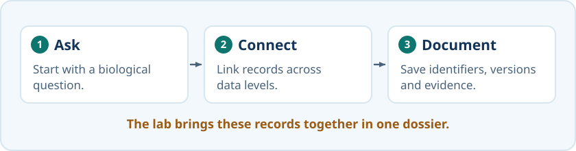{fig-alt="Start from a biological question, connect records and document their identifiers, versions and evidence." width="100%"}

### Submitting this lab

This lab is administered through Canvas, not through this book. See the course's Canvas page for the current worksheet, the deadline and how to submit.

## What's next

Session 4 picks up where the cross-references leave off. Once you can retrieve two related sequences, the next question is how to line them up and score how similar they are, and that is sequence alignment.

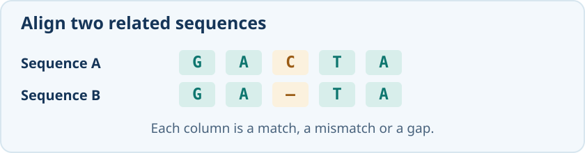{fig-alt="The aligned rows GACTA and GA–TA show a gap in the second row, opposite the C in the first row." width="100%"}