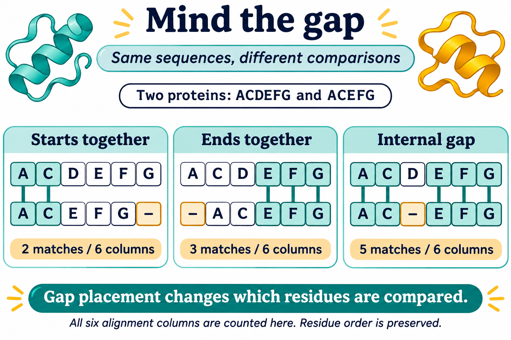
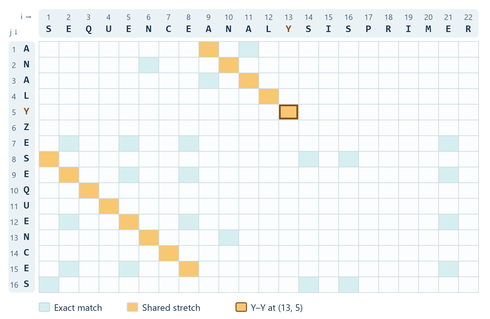
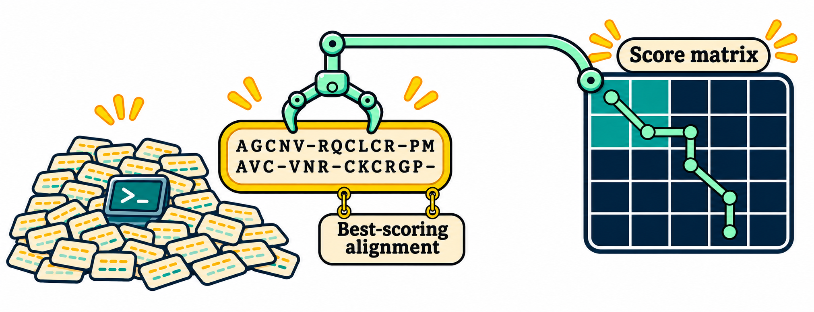
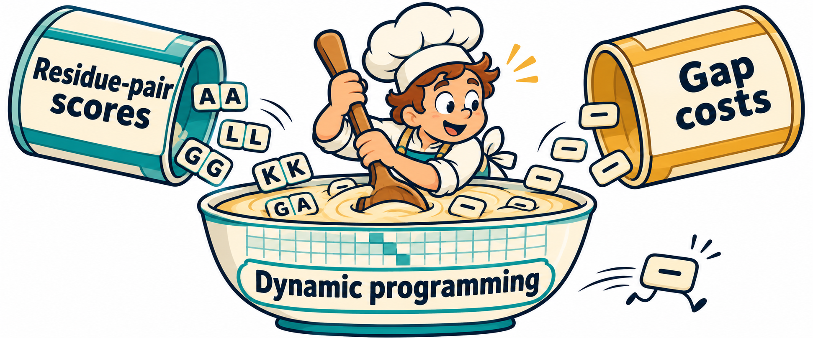
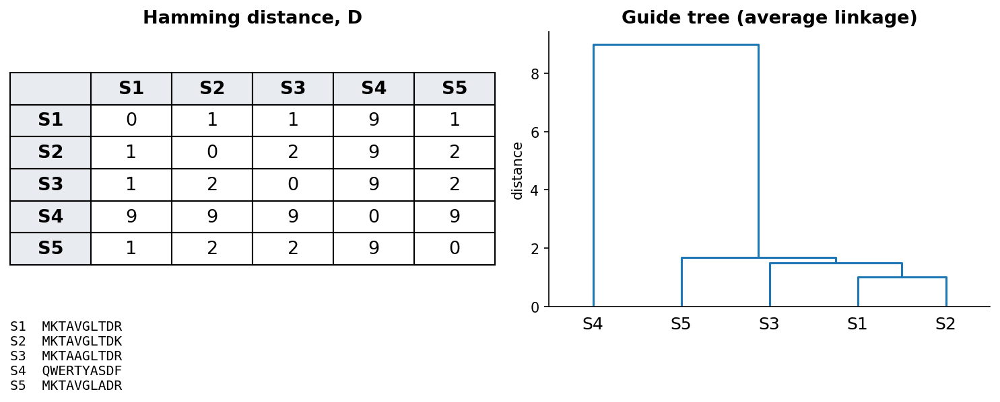

# Session 4: Sequence Alignment

::: {.callout-note appearance="simple"}
**Notebook:** [Session 4 — Sequence Alignment in code](notebooks/session04-alignment-in-code.html){target="_blank"} — the code behind this page. [Download it](notebooks/session04-alignment-in-code.ipynb){download=''} to run it yourself.

<!-- video-links: generated by tools/builders/make_video_links.py -->

**Lecture video:** the slides read aloud, with captions — [block 1](watch.html?v=session04-video-part1){target="_blank"} (20 min) · [block 2](watch.html?v=session04-video-part2){target="_blank"} (15 min) · [block 3](watch.html?v=session04-video-part3){target="_blank"} (21 min).
<!-- /video-links -->
:::

::: {.callout-note collapse="true"}
## Sources and figure provenance {.unnumbered .unlisted}

The worked examples in this chapter use illustrative protein
sequences and scoring rules. The accompanying lecture explores
them in more detail. Dayhoff, Schwartz & Orcutt
(1978), *Atlas of Protein Sequence and Structure*, pp. 345–352,
introduced the PAM matrices. Henikoff & Henikoff (1992), *PNAS*
89:10915–10919, introduced the BLOSUM matrices. Other background
sources include Wikipedia’s [Gap penalty](https://en.wikipedia.org/wiki/Gap_penalty),
[Standard score](https://en.wikipedia.org/wiki/Standard_score),
[Kullback–Leibler divergence](https://en.wikipedia.org/wiki/Kullback%E2%80%93Leibler_divergence),
[Sequence homology](https://en.wikipedia.org/wiki/Sequence_homology),
[Point accepted mutation](https://en.wikipedia.org/wiki/Point_accepted_mutation),
[BLOSUM](https://en.wikipedia.org/wiki/BLOSUM),
[Multiple sequence alignment](https://en.wikipedia.org/wiki/Multiple_sequence_alignment)
— CC BY-SA 4.0; the notebook's core algorithm code is adapted from Lukas
Käll's [*bibook*](https://github.com/statisticalbiotechnology/bibook)
— CC BY 4.0. The guide-tree worked-example figure was drawn for this book. The globin sequence logo is drawn for this
book from the Pfam Globin family (PF00042) seed alignment, via
[InterPro](https://www.ebi.ac.uk/interpro/entry/pfam/PF00042/) (CC0),
with [logomaker](https://logomaker.readthedocs.io/); sequence logos were
introduced by Schneider & Stephens (1990), *Nucleic Acids Research*
18:6097-6100; Wikipedia, [Sequence logo](https://en.wikipedia.org/wiki/Sequence_logo)
— CC BY-SA 4.0.

**Globin-relationship illustration.** The cartoon in @fig-s04-globin-relatives is an AI-generated course schematic of selected globin lineages. The ancestral animals are illustrative, rather than reconstructions of identified fossils. It shows selected globin lineages and omits additional genes, later duplications and intermediate animal lineages. The ancient origin of the alpha- and beta-globin lineages follows a [review of globin evolution](https://abc.gao-lab.org/reference/storz-jf-mpe-2012-globin.pdf){target="_blank" rel="noopener noreferrer"}; the basic relationships are explained in the [NCBI/NLM tutorial](https://www.nlm.nih.gov/ncbi/workshops/2023-08_BLAST_evol/ortho_para.html){target="_blank" rel="noopener noreferrer"}.

**Alignment illustrations.** The diagrams in @fig-s04-mind-the-gap and @fig-s04-alignment-avalanche are AI-generated educational schematics. The avalanche illustrates the growth in possible arrangements. The horizontal illustration in @fig-s04-dp-retrieves-alignment is
AI-generated. The gap-cost comparison in @fig-session04-gap-penalty
was drawn for this book using illustrative costs. The dot plot in
@fig-s04-dot-plot was drawn from the two example strings using exact
letter matches. The cooking illustration in
@fig-s04-alignment-ingredients was generated with ImageGen.

:::

::: {.callout-tip icon="false"}
## Homology

> Two sequences walk into a bar. The bartender asks: "Are you two related?"
>
> They answer: "Depends on your gap penalty."
:::

## Learning goals

Session 3 showed how to find DNA, RNA and protein sequences, identify what each record represents, and check its organism, version and supporting evidence. We now ask how to compare the sequences we retrieve. How similar are two proteins, and what can that similarity tell us about their evolutionary relationship? Answering requires deciding which residues to compare. Session 4 develops sequence alignment as a way to establish this correspondence, first between two sequences and then among several. By the end of this session you should be able to:

1.  explain homology, orthologs and paralogs, distinguish ancestry from sequence identity and similarity, and explain why comparing sequences requires alignment; construct simple global and local alignments using the Needleman–Wunsch and Smith–Waterman algorithms;
2.  explain how substitution scores and linear or affine gap penalties affect an alignment, describe the main steps in deriving PAM and BLOSUM matrices, and compare their assumptions, numbering and use;
3.  describe progressive multiple sequence alignment and the role of its guide tree, compare iterative and consistency-based approaches, and interpret conserved and variable positions using column entropy and sequence logos.

{#fig-s04-goals fig-alt="Three panels: align two sequences using global and local algorithms; explain PAM, BLOSUM and gap scoring; build and read multiple alignments using methods, entropy and sequence logos." width="100%"}

## Sequences make sense together {#homology-orthologs-and-paralogs}

### Why compare sequences?

In Session 3, we learned how to retrieve DNA, RNA and protein sequences. Retrieving a sequence gives us a starting point for a biological investigation. Suppose we obtain a protein sequence from a newly sequenced animal. We want to know whether it resembles beta-globin, myoglobin or another protein, which parts have remained conserved, and what its differences might mean.

**For these questions, sequence comparison is indispensable.** Comparing an unfamiliar sequence with sequences already studied connects it to existing knowledge about protein structure, function and evolution. It helps us move from a string of letters to biological hypotheses that we can investigate. [Pearson, PMC open-access article](https://pmc.ncbi.nlm.nih.gov/articles/PMC3820096/#S1){target="_blank" rel="noopener noreferrer"}.

Comparing several relatives provides another perspective. Some positions may have changed repeatedly, while others have remained almost unchanged. These **conserved positions** can help us identify regions important for a protein's activity or stability and guide experiments investigating the consequences of a sequence change. [Pearson, PMC open-access article](https://pmc.ncbi.nlm.nih.gov/articles/PMC3820096/#S5){target="_blank" rel="noopener noreferrer"}.

### Two ways to become relatives {#from-alignment-to-tree}

The human beta-globin gene has relatives both within our genome and in other species. To understand these relationships, we need to trace their origins. Genes can be **copied**, and species can **split**. These two events give rise to different relationships between the genes we find today.

**Paralogs** descend from different copies produced by **gene duplication**. The alpha- and beta-globin lineages arose this way from an ancestral haemoglobin gene, long before mammals evolved. The copies can subsequently retain similar roles or develop different properties. Human alpha-globin genes and the beta-globin gene **HBB** are therefore paralogs. [Globin evolution](https://abc.gao-lab.org/reference/storz-jf-mpe-2012-globin.pdf){target="_blank" rel="noopener noreferrer"}.

**Orthologs** descend from a corresponding ancestral gene after **species separation**. The matching alpha-globin genes illustrated for mouse and human are orthologs, as are the matching beta-globin genes. Both species inherited these lineages from their common ancestor. [NCBI/NLM tutorial](https://www.nlm.nih.gov/ncbi/workshops/2023-08_BLAST_evol/ortho_para.html){target="_blank" rel="noopener noreferrer"}.

These terms describe **relationships between pairs of genes**. Any alpha-beta pair is paralogous, whether the genes occur in the same species or different species. Thus **mouse alpha-globin and human beta-globin**, and **human alpha-globin and mouse beta-globin**, are both paralogous pairs: their histories trace back to the earlier duplication, not the later species separation. @fig-s04-globin-relatives illustrates these relationships for selected globin lineages.

{#fig-s04-globin-relatives fig-alt="Ancient haemoglobin gene duplication gives alpha- and beta-globin lineages before mammals. An extinct mammalian ancestor passes both lineages to mouse and human. Teal vertical links connect matching alpha genes and matching beta genes as orthologs. Two magenta diagonals connect mouse alpha with human beta, and human alpha with mouse beta, as paralogs across species. Black braces mark paralogs within each species." width="100%"}

### Shared ancestry and measurable resemblance

Orthologs and paralogs share an important property: they descend from a common ancestral gene. This shared evolutionary origin is called **homology**, and the related genes—and their corresponding protein sequences—are called **homologs**.

**Homology is qualitative: it describes a yes-or-no evolutionary relationship.** The genes or sequence regions being compared either descend from a common ancestral sequence or they do not. Our evidence may leave that relationship uncertain, but uncertainty does not make the sequences "partly homologous."

**Sequence resemblance is quantitative: sequences can be more or less alike.** We distinguish two useful descriptions of this resemblance:

- **Identity** concerns exact matches: the same nucleotide or amino acid at corresponding positions.
- **Similarity**, when comparing proteins, also recognises replacements between amino acids with related chemical properties. Leucine and isoleucine, for example, are different amino acids, but both have hydrophobic side chains. A replacement between them may preserve properties important for the protein. [EMBL-EBI Training](https://www.ebi.ac.uk/training/online/courses/foundations-protein-structure/fundamentals-of-protein-composition/the-peptide-bond-and-primary-structure/ss/){target="_blank" rel="noopener noreferrer"}.

Identity and similarity therefore describe resemblance that varies by degree. We can report "70% sequence identity," but **"70% homology" confuses measurable resemblance with shared ancestry**.

Sequence resemblance greater than expected by chance can provide strong evidence for homology. Conversely, relatives that have accumulated many changes may be difficult to recognise from their sequences alone. [Pearson, PMC open-access article](https://pmc.ncbi.nlm.nih.gov/articles/PMC3820096/#S2){target="_blank" rel="noopener noreferrer"}.

Recognising relatives also helps us choose useful biological comparisons. However, shared ancestry does not guarantee identical function: related proteins may retain similar activities or acquire different ones. Functional interpretations therefore require supporting evidence. [Pearson, PMC open-access article](https://pmc.ncbi.nlm.nih.gov/articles/PMC3820096/#S4){target="_blank" rel="noopener noreferrer"}.

To make these comparisons useful, we next need a consistent way to decide which sequence positions should be compared. That is the task of **sequence alignment**.

## Too many ways to line up {#why-alignment-needs-an-algorithm}

### Which residue goes where?

Counting matches is straightforward once we know which residues correspond.
Human and sperm whale myoglobins provide a simple starting example: two
sequences of the same length placed beneath one another. Equal length alone,
however, does not establish correspondence.

Insertions and deletions make the comparison more demanding. Introducing
**gaps** produces aligned rows of equal length while preserving residue
order. Gap placement changes which residues face one another, so the
identity and similarity we measure depend on the proposed alignment.

{#fig-s04-mind-the-gap fig-alt="Three arrangements of ACDEFG and ACEFG preserve residue order. Placing the shorter sequence's gap at the end, beginning or internally gives two, three or five exact matches, respectively, across six columns." width="100%"}

### Best according to which score?

An alignment is a hypothesis about residue correspondence. We compare
candidates using an **alignment score** that combines contributions from
aligned residue pairs with penalties for gaps. The aim is to find a
highest-scoring alignment under the chosen scheme. This optimum does not
by itself establish the true evolutionary history.

### 63 is only the beginning

Could we score every candidate and keep the best? Even **AGN and ADN**,
with just three residues each, have **63 possible gap-placement
arrangements** when residue order is preserved and columns containing two
gaps are excluded.

For two sequences of **100 residues each**, a conservative lower-bound
estimate is already about **$10^{59}$ possible alignments**. Exhaustively
scoring them is impractical.

{#fig-s04-alignment-avalanche fig-alt="Two three-residue protein sequences lead to a small stack representing 63 candidate alignments. A separate example with 100 residues per sequence leads to an avalanche of alignment cards overwhelming a computer, labelled approximately ten to the power fifty-nine as a conservative lower-bound estimate." width="100%"}

We therefore need **specialised alignment algorithms** that find a
best-scoring alignment efficiently. The next section shows how
these algorithms reuse work across many candidates.

[**Further reading**]{#alignment-further-reading}

- Jeffrey R. Chasnov, [Sequence alignment by brute force](https://www.math.hkust.edu.hk/~machas/mathematical-biology.pdf#page=108){target="_blank" rel="noopener noreferrer"},
  *Mathematical Biology*, Section 7.2, pp. 102–103, explains how the number
  of possible alignments grows and why exhaustive search becomes
  impractical. The mathematical derivation is optional.

## Dynamic programming {#sec-s04-dp}

We just saw how quickly the pile of possible alignments grows. So how
do we find the highest-scoring alignment in that pile?

The simplest way to see where two sequences might align is a **dot
plot**. It marks matching residues on a grid, where runs of matches
stand out as diagonals. The optional reading *Two diagonals in a dot plot*
shows how to read these patterns.

::: {#visualising-alignments-dot-plots .callout-note collapse="true"}
### Optional reading · Two diagonals in a dot plot

Put `SEQUENCEANALYSISPRIMER` across the top and
`ANALYZESEQUENCES` down the left. Each square compares a
pair of letters. Mark it when the letters match. For example, the
cell at column 13, row 5 compares Y with Y.

{#fig-s04-dot-plot fig-alt="Dot plot of SEQUENCEANALYSISPRIMER across 22 columns and ANALYZESEQUENCES down 16 rows. All 35 exact matches are shaded. Amber highlights ANALY at columns 9–13, rows 1–5 and SEQUENCE at columns 1–8, rows 8–15. An outline marks the Y–Y match at column 13, row 5." width="90%"}

The five consecutive matches in `ANALY` and the eight in
`SEQUENCE` make two clear diagonals. Other shaded cells
mark individual matches. This is how a dot plot makes shared
stretches easy to spot.

[Erik L. L. Sonnhammer and Richard Durbin’s DOTTER paper](https://sonnhammer.sbc.su.se/download/papers/1995_Gene_167%3AGC1-10.pdf){target="_blank" rel="noopener noreferrer"}
describes a dot-plot tool that can help distinguish stretches of
similarity from isolated matches.
:::

The main method we’ll use here is **dynamic programming**. It fills
the score matrix one cell at a time, using the best scores from
previously filled neighbouring cells. This lets us efficiently fish
an **optimal alignment** out of the pile, one with the highest score
under the rules we chose.

::: {#s04-bellman .callout-note collapse="true"}
### Optional reading · How dynamic programming got its name

Dynamic programming was formalised in the early 1950s by mathematician
Richard Bellman, who was working at RAND Corporation on optimal decision
processes. In his autobiography, he recalled wanting to concoct an
impressive name that would shield his work from US Secretary of Defense
Charles Wilson, whom he remembered as hostile to mathematical research.
His work involved decisions that changed over time and planning, hence
*dynamic* and *programming*. Here *programming* meant planning
decisions. Bellman especially liked *dynamic* because “it's impossible
to use the word dynamic in a pejorative sense”. He figured dynamic
programming was “something not even a Congressman could object to”.

[Bellman’s 1952 paper](https://pmc.ncbi.nlm.nih.gov/articles/PMC1063639/?page=1){target="_blank" rel="noopener noreferrer"}
introduces the method. The story is from his autobiography, quoted in
[Stuart Dreyfus’s account](https://pubsonline.informs.org/doi/pdf/10.1287/opre.50.1.48.17791){target="_blank" rel="noopener noreferrer"}.
:::

{#fig-s04-dp-retrieves-alignment fig-alt="On the right, a score matrix with a highlighted path extends a robotic claw to the left. The claw lifts one labelled best-scoring alignment above a pile of alternative alignments." width="100%"}

First, decide how much of the two sequences you want to align.
A **global alignment** includes both sequences from end to end.
A **local alignment** finds the best-scoring pair of stretches within
them.

Two flavours of dynamic programming have been developed for these
tasks. **Needleman–Wunsch** finds a global alignment, and
**Smith–Waterman** finds a local alignment. Let’s look at how each works.

### End to end with Needleman–Wunsch {#sec-s04-nw}

**How do two sequences line up from first residue to last?** The
Needleman–Wunsch algorithm finds a highest-scoring **global alignment**.
Every residue appears in the result, paired with another residue or with
a gap. Global alignment is useful when we expect correspondence along
most of both sequences, as with the two myoglobins introduced earlier.

#### Fill the grid one cell at a time

Put sequence $x$ across the columns and sequence $y$ down the rows. Cell $V(i,j)$
holds the best score for aligning the first $i$ residues of $x$ with the
first $j$ residues of $y$. The origin scores zero because both prefixes
are empty. Along the top row and left column, each new residue sits
opposite a gap. Subtract the gap cost at each step along these
boundaries.

For every interior cell, compare three extensions. A **diagonal** step
pairs two residues. A step **from the left** takes a residue from $x$ and
places a gap in $y$. A step **from above** takes a residue from $y$ and
places a gap in $x$. With a residue-pair score $s$ and a positive cost
$g$ per gap position, use the largest of these three totals.

$$
V(i,j)=\max\left\{
\begin{aligned}
& V(i-1,j-1)+s(x_i,y_j),\\
& V(i-1,j)-g,\\
& V(i,j-1)-g.
\end{aligned}
\right.
$$

For two sequences of 100 residues each, the algorithm fills 10,000
interior cells, each with three candidates. The grid lets us reuse a
score wherever the same pair of prefixes occurs.

#### Read the alignment backward

As we fill each cell, we remember which of the three neighbouring
cells gives the highest total after adding the residue-pair score
or subtracting the gap cost. We draw an arrow **from** that
predecessor **into** the cell we just filled. If several choices tie
for the highest score, we keep all their arrows.

To reconstruct a global alignment, start at the bottom right
and follow those arrows **backward** to the origin. Each step adds a
column to the left of the columns already recovered.

[**Further reading**]{#global-alignment-further-reading}

- Saul B. Needleman and Christian D. Wunsch, [A general method applicable to the search for similarities in the amino acid sequence of two proteins](https://bytes.usc.edu/cs270/docs/needleman-wunsch-1970.pdf){target="_blank" rel="noopener noreferrer"},
  *Journal of Molecular Biology* (1970), introduces the matrix method for comparing protein sequences.

### Find the best stretch with Smith–Waterman {#sec-s04-sw}

Two larger proteins may share one domain. The Smith–Waterman algorithm
finds a highest-scoring **local alignment** of the stretches that
correspond best under the chosen scores. Leading and trailing residues
can fall outside the alignment. Gaps within the aligned stretch still
carry their cost.

#### Give the score a fresh start

Set the top row and left column to **zero**, so
$V_{\mathrm{SW}}(i,0)=V_{\mathrm{SW}}(0,j)=0$. Fill each interior cell
with the same three extensions as before, adding **zero as a fourth
candidate**. Here $s(x_i,y_j)$ scores the residue pair and $g$ is the
positive cost of a gap position.

$$
V_{\mathrm{SW}}(i,j)=\max\left\{
\begin{aligned}
& V_{\mathrm{SW}}(i-1,j-1)+s(x_i,y_j),\\
& V_{\mathrm{SW}}(i-1,j)-g,\\
& V_{\mathrm{SW}}(i,j-1)-g,\\
& 0.
\end{aligned}
\right.
$$

When the extensions give no positive score, a zero allows a new
alignment to begin from that point.

#### Start at the peak, stop at zero

At the end of the fill, **start at the highest score anywhere in the
matrix**. Follow the stored arrows backward to the **first zero**.
A step that gives zero can leave an incoming arrow in that cell.
The traceback ends at the zero even when such arrows are visible.

[**Further reading**]{#local-alignment-further-reading}

- Temple F. Smith and Michael S. Waterman, [Identification of common molecular subsequences](https://dornsife.usc.edu/msw/wp-content/uploads/sites/236/2023/09/msw-042.pdf){target="_blank" rel="noopener noreferrer"},
  *Journal of Molecular Biology* (1981), sets out the local alignment recurrence and its traceback rule.

### A worked example {#sec-s04-try-traceback}

Use the same two protein sequences in both algorithms. Put
`AGCNVRQCLCRPM` across the columns and `AVCVNRCKCRGP`
down the rows.

We’ll use an **artificial scoring scheme**. Each exact match earns
**2** points. Pairing A with G scores **0**, pairing V with G costs
**2** points, and every other mismatch costs **1** point. Each gap
position costs **1** point.

::: {.content-visible when-format="html"}
Choose an **Algorithm**, then select **Fill matrix** or **Traceback**
from **View**. In traceback, follow the arrows backward. At a tie,
choose a **Tied predecessor**. The arrows you follow become darker,
and the recovered alignment columns appear below the grid.
:::

::: {#tbl-s04-lecture-dp}

::: {#s04-lecture-dp}

|  | 0 | A | G | C | N | V | R | Q | C | L | C | R | P | M |
| :---: | :---: | :---: | :---: | :---: | :---: | :---: | :---: | :---: | :---: | :---: | :---: | :---: | :---: | :---: |
| 0 | 0 | -1 | -2 | -3 | -4 | -5 | -6 | -7 | -8 | -9 | -10 | -11 | -12 | -13 |
| A | -1 | 2 | 1 | 0 | -1 | -2 | -3 | -4 | -5 | -6 | -7 | -8 | -9 | -10 |
| V | -2 | 1 | 0 | 0 | -1 | 1 | 0 | -1 | -2 | -3 | -4 | -5 | -6 | -7 |
| C | -3 | 0 | 0 | 2 | 1 | 0 | 0 | -1 | 1 | 0 | -1 | -2 | -3 | -4 |
| V | -4 | -1 | -1 | 1 | 1 | 3 | 2 | 1 | 0 | 0 | -1 | -2 | -3 | -4 |
| N | -5 | -2 | -2 | 0 | 3 | 2 | 2 | 1 | 0 | -1 | -1 | -2 | -3 | -4 |
| R | -6 | -3 | -3 | -1 | 2 | 2 | 4 | 3 | 2 | 1 | 0 | 1 | 0 | -1 |
| C | -7 | -4 | -4 | -1 | 1 | 1 | 3 | 3 | 5 | 4 | 3 | 2 | 1 | 0 |
| K | -8 | -5 | -5 | -2 | 0 | 0 | 2 | 2 | 4 | 4 | 3 | 2 | 1 | 0 |
| C | -9 | -6 | -6 | -3 | -1 | -1 | 1 | 1 | 4 | 3 | 6 | 5 | 4 | 3 |
| R | -10 | -7 | -7 | -4 | -2 | -2 | 1 | 0 | 3 | 3 | 5 | 8 | 7 | 6 |
| G | -11 | -8 | -5 | -5 | -3 | -3 | 0 | 0 | 2 | 2 | 4 | 7 | 7 | 6 |
| P | -12 | -9 | -6 | -6 | -4 | -4 | -1 | -1 | 1 | 1 | 3 | 6 | 9 | **8** |

:::

The dynamic-programming matrix for the worked protein pair. The
default view fills the Needleman–Wunsch matrix. In the interactive
version, use **Algorithm** to compare it with Smith–Waterman.

:::

```{=html}
<script>
renderDP("s04-lecture-dp", {
  mode: "step",
  modes: ["step", "traceback"],
  a: "AVCVNRCKCRGP",
  b: "AGCNVRQCLCRPM",
  match: 2,
  mismatch: -1,
  pairScores: { AG: 0, VG: -2 },
  gap: -1,
  columnFirst: true,
  incomingArrows: true,
  viewSelect: true,
  chooseAlignment: true
});
</script>
```

::: {#s04-traceback-results .callout-note collapse="true" appearance="simple"}
#### What you should see

**Needleman–Wunsch.** The bottom-right cell at column 13, row 12
scores **8**. Traceback first moves left, pairing the final M with
a gap, then diagonally, pairing P with P. Following the stored arrows
to the origin gives this optimal global alignment.

```text
x  AGCNV-RQCLCR-PM
y  AVC-VNR-CKCRGP-
```

At column 5, row 5, the predecessors above and to the left both have
score 3. Either gives 2 after the gap cost. The route above pairs
V with V in this stretch. The route to the left pairs N with N there
and yields another global alignment with score 8.

**Smith–Waterman.** The highest score is **9** at column 12, row 12.
Traceback starts with P paired with P and stops at the first zero,
at column 2, row 2. The last backward step recovers the first C–C
pair. This gives one optimal local alignment.

```text
x  CNV-RQCLCR-P
y  C-VNR-CKCRGP
```

The first two residues of each sequence and the final M of $x$ lie
outside the local alignment.
:::

### What is needed to align? {#sec-s04-alignment-scoring}

The algorithms used two ingredients. A **residue-pair score** tells
us what to add when two residues share an alignment column. A **gap
cost** tells us what to subtract when a column pairs a residue with
a gap.

{#fig-s04-alignment-ingredients fig-alt="A cartoon chef stirs a bowl labelled Dynamic programming. A tin labelled Residue-pair scores pours in pairs of amino-acid tiles. A second tin labelled Gap costs pours in dash tiles, and one dash runs away." width="100%"}

#### Score a pair of residues

A **substitution matrix** is a lookup table for the scores of all
residue pairs in a given scoring scheme. A simple matrix for the
20 standard amino acids has 20 rows and 20 columns. Each score
depends only on the two amino acids being paired. More sophisticated
scoring schemes can also take into account where the residues occur
in their respective sequences.

In the next subchapter, we’ll look at two widely used families of
substitution matrices, **PAM** and **BLOSUM**, and see how they use
statistics from different sets of related proteins to derive their
scores.

#### Decide what a gap costs {#sec-s04-gaps}

A **gap run** is a stretch of consecutive gaps in one row of the
alignment. Its cost can depend on its length and where it falls.

- A **linear gap cost** charges the same amount for every gap
  position. For a run of length $n$, the cost is $n$ times the
  cost per position. This is the rule we used in both matrices above.
- An **affine gap cost** charges $g_{\text{op}}$ to open a run and
  $g_{\text{ext}}$ for each additional position. A run of length $n$
  costs $g_{\text{op}}+(n-1)g_{\text{ext}}$. With a higher opening
  cost, one run is cheaper than several runs with the same total
  length.
- A **position-dependent gap cost** can make gaps more expensive
  in a protected region. For example, structural evidence can
  indicate positions where gaps would be unlikely.

{#fig-session04-gap-penalty fig-alt="Three panels compare the cost of placing three gaps in the same short sequence. Linear cost is 6 for one run or three. Affine cost is 6 for one run and 12 for three. A surcharge of 4 per gap position in the orange region increases the cost of one run from 6 to 18." width="100%"}

## Substitution matrices: PAM and BLOSUM {#sec-s04-matrices}

The other ingredient of the alignment score is the substitution score
$s(x_i, y_j)$. These scores are **log-odds scores**, the logarithms of
probability ratios from Session 1. Roughly, the score of residues $a$
and $b$ is the log of how often they are aligned in related proteins,
divided by how often they would pair by chance given how common each
residue is. A **positive** score therefore means that the pair is seen
more often among related sequences than expected by chance, and a
**negative** score that it is seen less often. Conservative
substitutions (K and R, I and V) consequently score positively.
Session 5's profiles use the same idea, one column at a time. Two
families of substitution matrices dominate, and they differ in the data
and the model they are built from:

- **PAM** (Point Accepted Mutations; Dayhoff, Schwartz & Orcutt, 1978)
  is based on **global** alignments of **closely related** proteins and
  uses an *explicit* evolutionary model. The sequences are arranged into
  phylogenetic trees, ancestral sequences are inferred, and
  substitutions are counted along the branches of the tree. Matrices for
  larger distances (PAM250) are then extrapolated from the one for very
  short distances. Three quantities do the work. The **frequency** of
  each amino acid says how often it occurs at all. Its **mutability**
  says how often it was seen to change, divided by how often it could
  have --- and the two do not track each other, which is the first
  surprise in Dayhoff's paper. Dividing an observed substitution rate by
  what chance alone would give is an **odds ratio**; taking its logarithm
  turns "rarer than chance" into a negative number and "commoner" into a
  positive one, which is why every substitution matrix holds log-odds
  rather than probabilities. Extrapolation is then matrix multiplication:
  PAM2 is PAM1 applied twice, PAM250 is PAM1 applied two hundred and
  fifty times.
- **BLOSUM** (BLOcks SUbstitution Matrix; Henikoff & Henikoff, 1992) is
  instead based on **local**, ungapped alignments of **distantly
  related** proteins. Substitution frequencies are counted directly from
  conserved blocks of real multiple alignments, with no phylogenetic tree
  and no extrapolation. Each BLOSUM matrix (BLOSUM45, BLOSUM62, BLOSUM80,
  ...) is therefore derived independently of the others.

The two families are easy to confuse, because their numbering runs in
*opposite* directions. A **higher** PAM number means a **more distant**
comparison, so PAM250 suits more divergent sequences than PAM100. A
**higher** BLOSUM number, in contrast, means a **closer** comparison, so
BLOSUM80 suits more similar sequences than BLOSUM45.

### The same two sequences, three times {#sec-s04-three}

Use the shorter exercise pair $x = \texttt{AWGHE}$ and
$y = \texttt{AWHEA}$ to compare scoring schemes. With match $+1$,
mismatch $-1$, and a gap score of $-1$, the best global alignment
is `AWGHE-` against `AW-HEA`, with score $2$. Now keep the same global
algorithm and use BLOSUM62 with a gap score of $-8$.

::: {#tbl-s04-awghe-blosum}
|       |   | A | W | H | E | A |
|---|---|---|---|---|---|---|
|       | **0** | -8 | -16 | -24 | -32 | -40 |
| **A** | -8 | **4** | -4 | -12 | -20 | -28 |
| **W** | -16 | -4 | **15** | 7 | -1 | -9 |
| **G** | -24 | -12 | 7 | **13** | 5 | -1 |
| **H** | -32 | -20 | -1 | 15 | **13** | 5 |
| **E** | -40 | -28 | -9 | 7 | 20 | **12** |

The same pair under BLOSUM62 with a gap penalty of $-8$. The traceback runs straight down the diagonal, so the alignment has no gaps in it at all.
:::

The alignment is therefore the unadorned one:

```
A W G H E
A W H E A
```

BLOSUM62 scores $s(\texttt{A},\texttt{A}) = 4$,
$s(\texttt{W},\texttt{W}) = 11$, $s(\texttt{G},\texttt{H}) = -2$,
$s(\texttt{H},\texttt{E}) = 0$ and $s(\texttt{E},\texttt{A}) = -1$, for a
total of $12$. The matrix knows that G against H and E against A are
substitutions a protein tolerates, and that neither is anywhere near bad
enough to be worth $-8$ to avoid. Same letters, same algorithm,
different answer: this is the argument for substitution matrices, made
on a matrix small enough to check by hand.

One more change, and again only one. Smith-Waterman's floor of zero,
applied to the same BLOSUM62 scores, gives a local alignment instead:

::: {#tbl-s04-awghe-local}
|       |   | A | W | H | E | A |
|---|---|---|---|---|---|---|
|       | 0 | 0 | 0 | 0 | 0 | 0 |
| **A** | 0 | **4** | 0 | 0 | 0 | 4 |
| **W** | 0 | 0 | **15** | 7 | 0 | 0 |
| **G** | 0 | 0 | **7** | 13 | 5 | 0 |
| **H** | 0 | 0 | 0 | **15** | 13 | 5 |
| **E** | 0 | 0 | 0 | 7 | **20** | 12 |

The same pair and the same BLOSUM62 scores under Smith-Waterman: negative values are floored at zero, and the traceback starts at the best cell anywhere in the matrix rather than in the bottom-right corner.
:::

The best cell is not the corner but the $20$ at $V(5,4)$, and tracing
back from it stops at the first zero:

```
A W G H E
A W - H E
```

The score is $4 + 11 - 8 + 8 + 5 = 20$. The ragged ends have been
dropped and the conserved core is what remains, which is the answer the
textbooks give for the full `HEAGAWGHEE` and `PAWHEAE` pair that these
two fragments were cut from.

Three runs of one algorithm over one pair of sequences, with a single
thing changed each time, and a different alignment every time.

::: {.callout-note .tryit icon="false"}
## Try it · the same pair, all three ways

This widget compares three settings on the shorter exercise pair. It
opens on `AWGHE` against `AWHEA` with identity scoring.

::: {.content-visible when-format="html"}
```{=html}
<div id="s04-try-three"></div>
<script>
renderDP("s04-try-three", {mode: "step", a: "AWGHE", b: "AWHEA",
                           match: 1, mismatch: -1, gap: -1,
                           controls: true, modes: ["step", "guess", "fill"]});
</script>
```
:::

::: {.content-visible when-format="pdf"}
*This box is interactive, and a printed page cannot press anything. Open
[course.bioinfo.se/dp.html](https://course.bioinfo.se/dp.html) which opens on this matrix.*
:::

Press *Fill all*. Then switch *Scoring* to BLOSUM62 and set *Gap* to $-8$, and
you have @tbl-s04-awghe-blosum. Then switch *Alignment* to local as well, and
you have @tbl-s04-awghe-local. **Three settings, three different alignments of
two sequences that never changed.**

When you can predict what each switch will do before you throw it, try *Fill it
in*, which hides the interior and marks what you type. That is the version of
this worth doing before the exam, where you will fill a matrix of about this
size by hand.

::: {.callout-note collapse="true" appearance="simple"}
## What you should see

Identity scoring gives `AWGHE-` against `AW-HEA`, score 2, with two gaps bought
to chase two exact matches. BLOSUM62 at $-8$ gives the ungapped `AWGHE` against
`AWHEA`, score 12, because G against H and E against A are substitutions a
protein tolerates and neither is worth $-8$ to avoid. Smith-Waterman on those
same scores gives `AWGHE` against `AW-HE`, score 20, read from the best cell
anywhere in the matrix rather than from the corner, with the ragged ends
dropped.

The first two runs use global alignment with different scores and
gap costs. The third uses the same BLOSUM62 and gap scores as the
second, with local boundaries, a zero candidate, and local traceback.
:::
:::

### Further reading

- Wikipedia, [Point accepted mutation](https://en.wikipedia.org/wiki/Point_accepted_mutation) and [BLOSUM](https://en.wikipedia.org/wiki/BLOSUM) — the full derivation of each matrix family, beyond the conceptual level above

## Is the score significant?

Once a substitution matrix and gap penalties are chosen, every
alignment gets a score. A high score alone, however, does not prove that
two sequences are homologous. The raw score depends on the sequence
lengths, the substitution matrix and the gap penalties, so there is no
universal threshold for "good enough". One intuitive way to calibrate it
is to compare the observed score with the scores of the same sequences
shuffled, or of unrelated sequences, aligned in the same way. If the
real score is far above almost all of them, chance is an unlikely
explanation.

For local alignments this comparison can be made precise. The best
scores of unrelated sequences follow a known statistical distribution,
an extreme-value distribution rather than a normal one. Database-search
tools use this distribution to estimate an **E-value**, the number of
hits this good expected by chance in a database of this size. Session 5
explains BLAST and E-values properly.

There is also a useful rule for how *long* an alignment has to be before
it can mean anything. Each aligned pair of residues carries a certain
amount of information, measured in bits, which depends on the
substitution matrix used; this is its **relative entropy**. Multiply it
by the number of aligned residues and you have the information in the
whole alignment. Roughly thirty bits are needed before an alignment is
convincing on its own. The consequence is practical: a matrix built for
distant relatives carries less information per residue, so detecting a
distant homologue needs a *longer* alignment, not merely a better score.

Shuffling also gives the simplest statistic of all. The **Z-score** of an
alignment is how many standard deviations its score lies above the mean
of the shuffled ones. It is easy to compute and easy to over-trust: it
assumes the shuffled scores are normally distributed, and for local
alignments they are not, which is exactly what the next section is about.

### Further reading

- Wikipedia, [Extreme value theory](https://en.wikipedia.org/wiki/Extreme_value_theory), in its general statistical form, beyond its use here

## Multiple sequence alignment

So far we have aligned two sequences, but a protein family usually has
many members, and aligning more than two sequences at once is harder
than it looks. Exact dynamic programming extends to $N$ sequences, but
its cost grows exponentially with $N$, so it becomes impractical for
more than a few short sequences. Practical methods therefore combine
three ideas:

- **Progressive alignment** builds a **guide tree** from all pairwise
  distances, aligns the closest pair first, and then adds sequences (or
  already aligned groups) one at a time. Early decisions are never
  revisited, so an early mistake can persist (ClustalW is the classic
  example).
- **Iterative refinement** starts from a progressive alignment and
  repeatedly re-aligns parts of it, keeping the changes that improve the
  score (as in MUSCLE and MAFFT).
- **Consistency** uses the agreement among all the pairwise alignments
  as extra information. If A aligns with B and B with C at a position, a
  multiple alignment in which A also matches C there is preferred (as in
  T-Coffee).

Real tools often combine several of these ideas, and which works best
depends on the number, length and divergence of the sequences.

The guide tree for progressive alignment is built by the kind of
hierarchical clustering used on any distance matrix. Every sequence
starts as its own cluster, the closest pair of clusters is merged
repeatedly, and the process stops once only one cluster remains. The
merge order *is* the order in which the sequences are aligned. The
figure shows a small worked example: five toy sequences that are almost
identical except for sequence 4, their pairwise Hamming-distance matrix,
and the resulting guide tree. Sequence 4 merges in only at the very last
step, which reflects how clearly it differs from the other four.

{#fig-session04-guidetree-worked-example width=90%}

A guide tree is only an *ordering device* for the alignment and not
necessarily a phylogenetic tree. It is usually built by a quick method
(UPGMA) that assumes all lineages evolve at the same rate, so a
fast-evolving sequence can end up in the wrong place. The third
discussion problem shows such a case. To infer how the sequences are
actually related, we need a method built for phylogeny. The two kinds
of tree look alike but answer different questions:

::: {#tbl-session04-guide-vs-phylo}
|  | Guide tree | Phylogenetic tree |
|------------------|------------------------|------------------------|
| Question | In which order should the sequences be aligned? | How are the sequences related by descent? |
| Built from | Quick pairwise distances, often before any alignment | A multiple alignment, with an evolutionary model |
| Typical method | UPGMA (equal rates assumed) | Neighbour joining, maximum likelihood |
| What it is | A computational shortcut | A hypothesis about evolution |
| Branch lengths | Not meant to be read | The amount of change |

A guide tree and a phylogenetic tree.
:::

## Reading a multiple alignment: entropy and sequence logos {#reading-an-alignment-entropy-and-sequence-logos}

A multiple alignment of a whole family is too large to read row by row,
so we need a way to summarise it. What matters is how each **column**
varies. A position where every sequence has the same residue has been
conserved through evolution, usually because it matters for structure or
function. A position with many different residues, in contrast, is free
to change.

Session 1's **entropy** puts a number on this variation. For the residue
frequencies $p_a$ in a column, the entropy is

$$
H = -\sum_a p_a \log_2 p_a
$$

It is 0 bits for a fully conserved column and at most
$\log_2 20 \approx 4.32$ bits for a protein column where all 20 amino
acids are equally common ($\log_2 4 = 2$ bits for DNA). The column's
**information content** is the distance from that maximum,
$\log_2 20 - H$, so it is high for conserved columns and near zero for
variable ones. (This is the simple version, which assumes that all amino
acids are equally common in the background. Logo programs often correct
for background frequencies and for small samples.)

A **sequence logo** (Schneider & Stephens 1990) turns these numbers into
a picture by drawing each column as a stack of letters. The height of
the stack is the column's information content, and the height of each
letter within the stack is its frequency. A tall stack with one big
letter is therefore a conserved position, and a low stack of many small
letters is a variable one. In the logo below, gaps also lower the stack,
because the height is multiplied by the fraction of sequences that have
a residue in that column.

The logo of the Pfam globin family, 73 globins from bacteria, plants,
worms, insects and vertebrates, shows how few positions are conserved
across the whole family:

{#fig-session04-globin-logo width=100%}

Only two columns are identical in all 73 sequences. One is **His92**
(F8, the "proximal" histidine, whose side chain binds the haem iron), and
the other is **Phe42** (CD1, which packs against the haem). A third,
**His63** (E7, the "distal" histidine, on the oxygen-binding side of the
haem), is His in 73% of the sequences. The average column carries only
1.2 bits. The rest of the fold is held together by positions that stay
hydrophobic (the black L, V, I and F stacks, often with several residues
sharing a column) rather than by identical residues. An alignment can
therefore point to the residues a protein cannot do without. It also
shows how the same globin fold is kept even though most pairs of
sequences in this alignment share fewer than 20% of their residues.

**A motif without a family: signal peptides.** Logos are not only for
families of homologs. Many proteins that are secreted, or that end up in
a membrane or in an organelle of the secretory pathway, begin with a
**signal peptide**. This short N-terminal sequence, typically 15-30
residues long, sends the new chain into the secretory pathway, and it is
cut off once it has done its job. The signal peptides of unrelated
proteins share no ancestor and cannot be aligned residue by residue, but
they share a design. The first collections, of a few dozen sequences
around 1980, already showed a positively charged N-terminus, then a
hydrophobic stretch, then a more polar end. The three parts are now
called the **n-region**, the **h-region** and the **c-region**. We can
draw the design as a logo if we line the signal peptides up on the one
position they all have, the **cleavage site**, instead of aligning them
by homology:

{#fig-session04-sp-logo width=100%}

The logo shows two kinds of signal. In the h-region no column is
conserved, but every column leans the same way, towards hydrophobic
residues and above all leucine. What matters there is a property of a
whole stretch, not a residue at a given position. Near the cut, in
contrast, two single positions stand out. Positions −3 and −1 carry
small, uncharged residues (mostly alanine, also glycine and serine),
while position −2, between them, is free. This is the **(−3, −1)
rule**, found in 1983 in a collection of 78 signal peptides (von Heijne,
[*Eur. J. Biochem.* 133:17](https://febs.onlinelibrary.wiley.com/doi/pdf/10.1111/j.1432-1033.1983.tb07424.x)).
The enzyme that cuts, signal peptidase, needs small side chains at these
two positions. The positively charged n-region is blurred in the logo,
because signal peptides differ in length, so the left-hand columns mix
residues from different regions. It is clearest in bacteria (K and R).

Like a family's logo, this description can be turned into a score
(Session 5's PSSM). In 1986, von Heijne built a position weight matrix
for positions −13 to +2 around the cleavage site
([*Nucleic Acids Res.* 14:4683](https://pmc.ncbi.nlm.nih.gov/articles/PMC311474/?page=1)).
The signal peptide comes back several times in the course. Session 7
compares this weight matrix with a neural network, Session 8 uses the
hydrophobicity of the h-region as a feature, and Session 11 lets
recurrent networks find the regions by themselves.

Two practical notes apply to logos. With few sequences, the frequencies
are noisy and a column can look conserved by chance, so logo programs
often apply a small-sample correction. Closely related sequences are
also over-represented in most alignments, so real tools weight the
sequences as well.

A multiple alignment is therefore more than a picture, because each
column gives a distribution of amino acids. Session 5 turns these
distributions into position-specific scores.

### Further reading

- Wikipedia, [Multiple sequence alignment](https://en.wikipedia.org/wiki/Multiple_sequence_alignment) — additional methods and applications, e.g. profile HMMs, which Session 5 picks up in full
- von Heijne and Abrahmsén (1989), [Species-specific variation in signal peptide design](https://www.sbc.su.se/gunnar/gvhpapers/FEBS244-439.pdf), *FEBS Letters* 244:439–446, compares signal-peptide regions across species.
- Wikipedia, [Sequence logo](https://en.wikipedia.org/wiki/Sequence_logo); Schneider & Stephens (1990), "Sequence logos: a new way to display consensus sequences," *Nucleic Acids Research* 18:6097-6100

## The course notebook

`notebooks/session04-alignment-in-code.ipynb` implements Needleman-Wunsch
and Smith-Waterman from scratch, adapted from Lukas Käll's open-access
[*bibook*](https://github.com/statisticalbiotechnology/bibook) (CC BY
4.0). It starts with amino-acid sequences and a simple identity scoring
scheme, in which a match scores +1 and any mismatch or gap −1. This is
the $V(i,j)$ recurrence above, with the identity matrix standing in for
$s(x_i, y_j)$.

Rather than presenting a finished matrix, the notebook fills a small
worked example one cell at a time, with the reasoning printed out. The
example is a real HBB fragment aligned against a hypothetical mutated
variant of it. You then complete a partially filled matrix yourself
before the real one is revealed, and the traceback is walked through in
the same step-by-step way. Both halves of the algorithm thus appear as a
sequence of small decisions rather than as a finished picture.

The notebook then replaces the flat identity scheme with a real
substitution matrix, the PAM250 matrix from the "Substitution matrices"
section above, loaded from Biopython rather than typed in by hand. With
it, the notebook compares global and local alignment of two real globin
fragments (from HBB and myoglobin) that share one conserved motif but
differ elsewhere. This makes two things directly visible: the practical
difference between the two algorithms, and the effect of a graded
substitution matrix compared with a flat identity scheme. Open it in
[Google Colab](https://colab.research.google.com/github/ElofssonLab/kb8029-book/blob/main/notebooks/session04-alignment-in-code.ipynb)
via the badge at the top of the notebook page to edit and run it
yourself.

## Check your understanding

The questions below give immediate feedback and cover the sections
above. They are in the same style as the course's live in-class
peer-instruction quizzes, and the full question bank is in
`quizzes/session04.md` in the repository.

```{=html}
<div id="session04-quiz"></div>
<script>
renderQuiz("session04-quiz", [
  {
    question: "In a sequence logo of a protein family, one column is a single tall letter about 4.3 bits high. What does that tell you?",
    choices: [
      "Almost every sequence has the same residue there (entropy near 0), so the position is conserved",
      "The position is the most variable one in the family",
      "The column is mostly gaps",
      "The residue is the most common amino acid in proteins"
    ],
    correctIndex: 0,
    explanation: "Stack height is the information content, log2(20) - H. A height near log2(20) = 4.32 bits means entropy near 0: one residue in every sequence."
  },
  {
    question: "Human haemoglobin and human myoglobin arose from an ancient gene duplication within the same genome. What relationship do they have?",
    choices: ["Orthologs", "Paralogs", "Analogs", "They are not homologous"],
    correctIndex: 1,
    explanation: "Paralogs are homologs separated by a gene duplication; orthologs are homologs separated by a speciation event. Paralogs can also sit in different species, if the duplication came before the speciation."
  },
  {
    question: "For two sequences of length around 100, why is it infeasible to try every possible alignment and keep the best one?",
    choices: [
      "The number of possible alignments grows so fast (around 10^59 for n=100) that exhaustive search is impossible",
      "Computers cannot store sequences longer than 100 characters",
      "Substitution matrices are only defined for sequences shorter than 50 residues",
      "Alignment scores are undefined once gaps are allowed"
    ],
    correctIndex: 0,
    explanation: "The real number is around 10^59 possible alignments for n=100 &mdash; dynamic programming avoids ever checking most of them."
  },
  {
    question: "Which changes let Smith–Waterman recover a local alignment?",
    choices: [
      "The boundaries start at zero, zero competes when filling each cell, and traceback goes from the highest-scoring cell to the first zero",
      "The substitution matrix is replaced with a different one",
      "The gap penalty is changed from linear to affine",
      "The matrix's rows and columns are transposed"
    ],
    correctIndex: 0,
    explanation: "The zero boundaries and fourth candidate allow the alignment to begin within the sequences. Traceback from the maximum ends when it reaches zero."
  },
  {
    question: "With an affine gap penalty g(n) = g_open + (n-1) &times; g_ext, using g_open = -10 and g_ext = -1, what is the total penalty for a single gap of length 4?",
    choices: ["-13", "-40", "-11", "-4"],
    correctIndex: 0,
    explanation: "-10 + (4-1) &times; (-1) = -10 - 3 = -13."
  },
  {
    question: "Which pairing correctly describes how PAM and BLOSUM numbering relate to evolutionary distance?",
    choices: [
      "A higher PAM number means a more distant comparison; a higher BLOSUM number means a more similar comparison",
      "A higher PAM number means a more similar comparison; a higher BLOSUM number means a more distant comparison",
      "Both a higher PAM number and a higher BLOSUM number mean a more distant comparison",
      "Neither PAM nor BLOSUM numbering relates to evolutionary distance"
    ],
    correctIndex: 0,
    explanation: "The two families' numbering runs in opposite directions &mdash; a common source of confusion."
  },
  {
    question: "Human alpha-globin and mouse beta-globin come from different species. Are they orthologs?",
    choices: [
      "No: they are paralogs, because what separates them is the duplication of the ancestral globin gene into alpha and beta, which happened before human and mouse diverged",
      "Yes: genes from different species are always orthologs",
      "Yes, because both are haemoglobin subunits",
      "They are not homologous at all"
    ],
    correctIndex: 0,
    explanation: "Orthology and paralogy are defined by the event at the node that separates the two genes in a gene tree: speciation gives orthologs, duplication gives paralogs."
  },
  {
    question: "Why is a guide tree for progressive alignment not automatically a phylogenetic tree?",
    choices: [
      "It is an ordering device built by a quick method (often UPGMA) that assumes equal rates of evolution; a fast-evolving sequence can be placed wrongly",
      "Guide trees are always identical to phylogenetic trees",
      "Guide trees are built from the final alignment, so they cannot be wrong",
      "Phylogenetic trees cannot be built from distances"
    ],
    correctIndex: 0,
    explanation: "Neighbour joining, which allows unequal rates, or likelihood methods are used for phylogeny; the third discussion problem shows UPGMA getting a tree wrong."
  },
  {
    question: "Two proteins align with a high raw score. Why is that alone not enough to call them homologous?",
    choices: [
      "The raw score depends on sequence length, substitution matrix and gap penalties; it must be compared with the scores expected for unrelated sequences, which is what an E-value does",
      "Because high scores are always produced by chance",
      "Because alignment scores cannot be compared at all",
      "Because only identical sequences are homologous"
    ],
    correctIndex: 0,
    explanation: "Shuffled or unrelated sequences give a background distribution of scores; for local alignment it is an extreme-value distribution, the basis of BLAST's E-values (Session 5)."
  },
  {
    question: "Aligning AWGHE with AWHEA under BLOSUM62, the best alignment contains two gaps when the gap cost is -1, and none at all at -8. What does that show?",
    choices: [
      "A gap is only taken when the matches it buys are worth more than it costs, so where the alignment changes depends on the substitution matrix and the gap cost together",
      "BLOSUM62 does not allow gaps once the cost is below -7",
      "Gaps are never optimal in a global alignment",
      "The traceback always runs down the diagonal when BLOSUM62 is used"
    ],
    correctIndex: 0,
    explanation: "The gapped alignment still wins at -7, scoring 14, and loses at -8, where the ungapped one scores 12. Nothing about the sequences changed; only the price of a gap did. The Try it box in the gap-penalty section walks the cost down one step at a time."
  }
]);
</script>
```

## The lab

The lab has four steps, all reached through
[`notebooks/session04-lab.ipynb`](https://course.bioinfo.se/notebooks/session04-lab.ipynb){download=''}:

1. **By hand**. Fill in a small Needleman–Wunsch matrix for two globin
   fragments using BLOSUM62. Trace back an optimal alignment to the
   empty-prefix cell at (0,0), then calculate percent identity and
   percent similarity. Use every alignment column in the denominator
   and count residue pairs with positive BLOSUM62 scores for similarity.
2. **In code**. Compare the alignment score, identity and similarity
   after changing the gap score, and inspect the effects of using a
   different substitution matrix. Calculate one affine-gap example by
   hand and interpret a supplied shuffle comparison. An optional HMMER
   search introduces live E-values.
3. **In code**. Build a progressive alignment of three short globin
   windows. Align the third sequence against the columns of the first
   aligned pair, then use a small example to see how a new gap column
   propagates through the existing rows.
4. **By hand, then in code**. Calculate column entropy and read the
   sequence logo from the included Pfam globin seed alignment
   PF00042.29. Map conserved columns to mature HBB and UniProt positions.

Use your results to answer the ten-question Session 4 lab quiz in Canvas.

### Submitting this lab

This lab is administered through Canvas, not through this book. See the
course's Canvas page for the current quiz, the deadline and how to
submit.

## What's next

Sequence alignment infers which residues correspond from the sequences
alone, and Session 6 asks the same question directly in 3D, with
structure alignment. Before that, Session 5 takes up two problems that
this session leaves open. First, exact dynamic programming such as
Needleman-Wunsch does not scale to searching a new sequence against an
entire database, and that is what BLAST's heuristic is for. Second, once
we have many aligned sequences rather than two, we can build a *profile*
from them.
