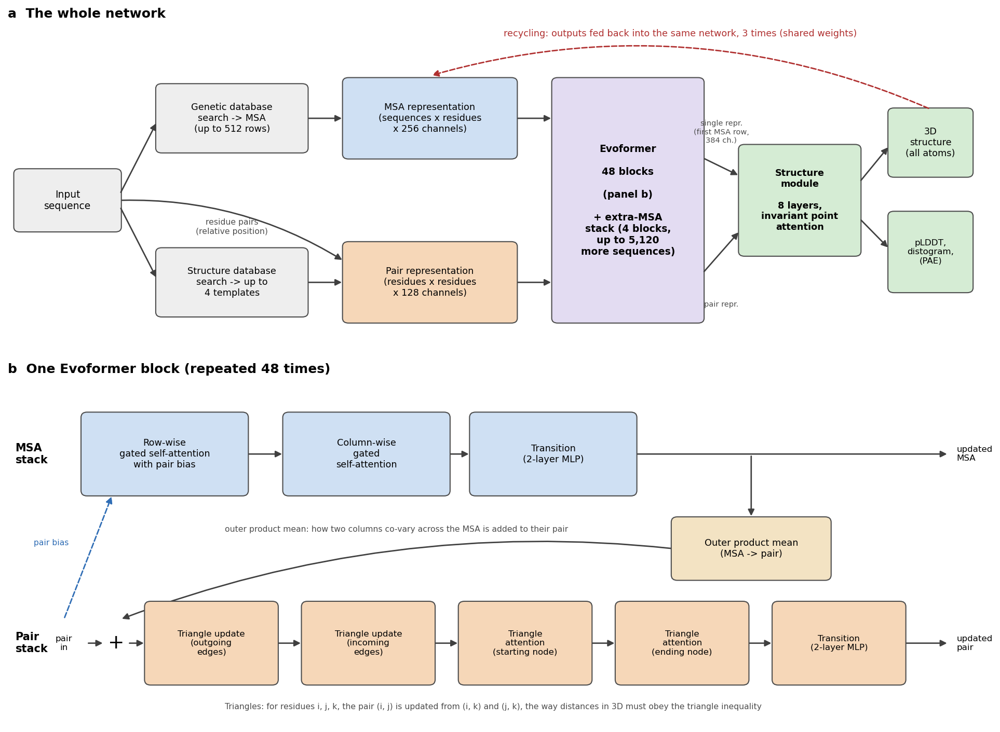
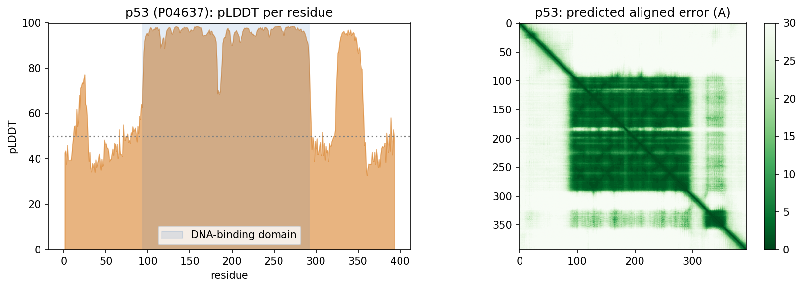
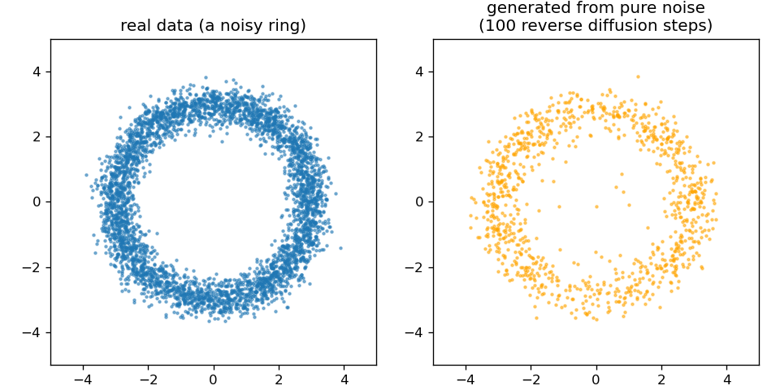
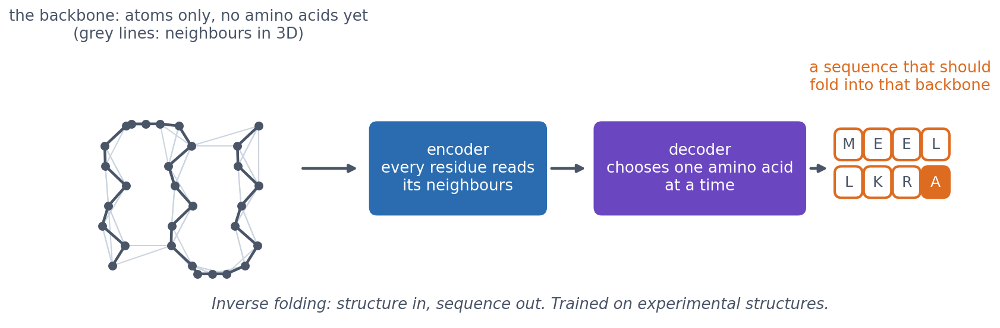
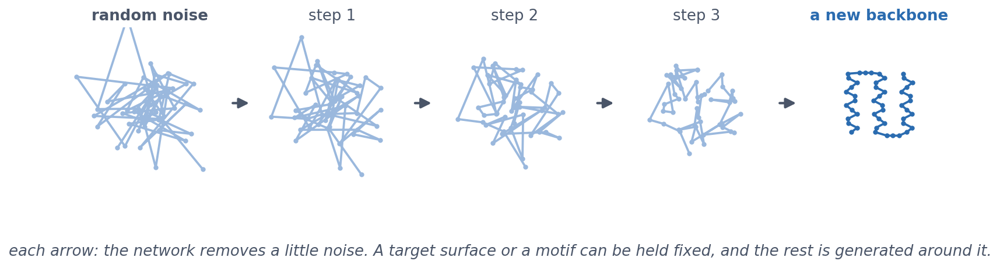
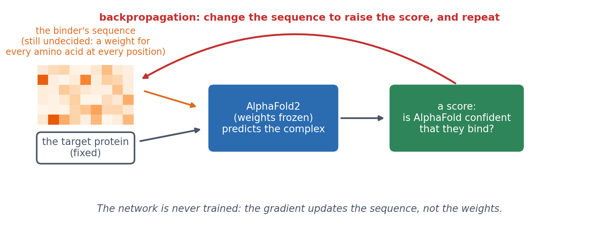

::: callout-note
**Sources for this page:** Arne Elofsson's AlphaFold lecture (*AlphaFold 2026, undervisning*) and diffusion-models lecture (`slides/Diffusion models (undervisning).pdf`), which this page follows; every paper named below is the primary source for its numbers, cited where it is used. Data and models are fetched live from the RCSB PDB, the [AlphaFold Protein Structure Database](https://alphafold.ebi.ac.uk/) (CC BY 4.0) and the ESM Atlas API. All figures were drawn or computed for this course, and every number from our own code was read back from the notebook's output. The "four regions" heuristic in @sec-s12-complexes is taken from the lecture; it has not yet been published as a paper.
:::

# Session 12: AlphaFold and Generative Models of Protein Structure

::: {.callout-tip icon="false"}
## A solved problem

> Protein folding was a 50-year-old problem. Then AlphaFold solved it, and created 200 million new ones.
:::

## Learning goals

By the end of this session you should be able to:

- explain why a protein folds, why its structure is worth predicting, and how a predicted model is scored against an experimental structure (RMSD, TM-score, lDDT);
- explain why long-range information is essential for structure prediction, and how evolutionary covariation provided it;
- describe what AlphaFold2 represents internally (an MSA representation and a residue-pair representation that update each other, and a geometry-aware structure module) and why attention and pair representations suit proteins;
- interpret pLDDT and PAE correctly, and explain why confidence is not the same as correctness;
- explain why complexes are harder than single chains, and why a confident complex model does not show that two proteins interact in the cell;
- explain at a high level what a diffusion model does and what AlphaFold3 changed;
- say what current structure predictors cannot tell us.

In Session 6 we treated structure as the answer, and we learned to inspect and compare it. Now we ask how that answer can be predicted from sequence. This session closes the course, and nearly every earlier session contributes a piece to it:

::: {#tbl-s12-ideas}
| From | Idea used in modern structure prediction |
|------------------------------------|------------------------------------|
| Sessions 4-5 | alignments and profiles: the evolutionary record of a family |
| Session 6 | structure comparison (TM-score), distance and contact maps, conformational states |
| Session 7 | nonlinear models, and secondary structure from local sequence |
| Session 8 | honest evaluation on proteins unlike the training data |
| Session 9 | training deep networks |
| Session 10 | pairwise maps treated as images, residual networks, invariance |
| Session 11 | attention and protein language models |

Where the ideas of modern structure prediction come from in this course.
:::

The session starts from one question: **what information is missing if we try to predict a residue's structure from its local sequence alone?** The answer is the contacts and interactions with residues far away in the sequence. The rest of the session is therefore about where this long-range information comes from, how AlphaFold2 learned to use it, and what we can trust in the result.

## The starting point: from sequence to structure {#sec-s12-start}

This section brings everyone to the same starting point: what a protein structure is, why a protein folds, why we want to predict structures, how a prediction is judged, and how it was done before deep learning. Session 6 introduced protein structure; here we add what is needed for prediction.

### A protein is a chain that folds

A protein is a chain of amino acids joined by peptide bonds. Every residue contributes the same repeating **backbone** (N, Cα, C), and one of 20 different **side chains**, which are small or large, charged, polar or hydrophobic. Session 6 described a structure at four levels: the **primary** structure is the sequence; the **secondary** structure is the local shape of the backbone, mainly α-helices and β-strands; the **tertiary** structure is the 3D fold of the whole chain; and the **quaternary** structure is how several chains pack together, as in the four chains of haemoglobin.

The task of this session is the step from the first level to the third, from a line of letters to a 3D object (@fig-session12-sequence-to-structure):

{#fig-session12-sequence-to-structure width="100%"}

### Why a protein folds

A chain of amino acids in water does not stay a floppy string. Three effects drive it into a compact fold:

- **The hydrophobic effect.** Hydrophobic side chains (such as leucine, valine and phenylalanine) disrupt the hydrogen bonds between the water molecules around them. The chain therefore collapses so that most of them are buried in a **core**, while polar and charged side chains stay on the surface. This is the main driving force of folding, and it is visible in @fig-session12-sequence-to-structure.
- **Hydrogen bonds in the backbone.** The backbone's NH and C=O groups form regular hydrogen bonds with each other: between residues $i$ and $i + 4$ in an α-helix, and between neighbouring strands in a β-sheet. That is why secondary structure exists at all.
- **Tight packing.** In the core, side chains fit together like a three-dimensional puzzle, so which residues can sit next to each other is constrained.

The folded state, the **native structure**, is only slightly more stable than the unfolded chain, because the gains from burying hydrophobic groups and forming hydrogen bonds are almost cancelled by the loss of the chain's freedom. Small changes, such as one mutation, can therefore unfold a protein or change its shape.

### Two classic observations: Anfinsen and Levinthal

**Anfinsen: the sequence determines the structure.** In the 1950s and 1960s, Christian Anfinsen unfolded the enzyme ribonuclease in the test tube with urea, which breaks the non-covalent interactions, and a reducing agent, which breaks its four disulphide bonds. When he removed the chemicals slowly, the enzyme refolded into its active shape on its own, with the right disulphide bonds out of 105 possible pairings (Anfinsen 1973, [*Science* 181:223](https://doi.org/10.1126/science.181.4096.223); Nobel Prize 1972). No cell and no template were needed: **for many small proteins the sequence alone determines the native structure**. This is what makes structure prediction possible in principle. It is not a law for every protein: some need chaperones or a binding partner to fold, some switch between states, and intrinsically disordered regions have no single fold.

**Levinthal: folding is not a random search.** Cyrus Levinthal pointed out in 1969 that a protein cannot find its structure by trying every conformation. Suppose each residue of a 100-residue protein can take only three backbone conformations. That gives $3^{100} \approx 5 \times 10^{47}$ conformations of the chain. Even at $10^{13}$ conformations per second, trying them all would take about $5 \times 10^{34}$ seconds, far longer than the age of the universe (about $4 \times 10^{17}$ seconds). Yet real proteins fold in microseconds to seconds. This is **Levinthal's paradox**. Its resolution is that folding is not a random search: local structure, such as a helix, forms quickly, and every step that buries more hydrophobic groups lowers the free energy, so the chain is guided downhill towards the native state, as on the slopes of a funnel. For prediction, the paradox has a practical lesson: a computer cannot find the structure by trying every conformation either, so every method needs a smarter way to search.

### Why predict structures?

A protein's structure explains its function. In β-globin, residue 6 is a glutamate on the surface. In sickle-cell disease, it is replaced by a valine, a hydrophobic residue on the surface that makes haemoglobin molecules stick to each other. Structures show where a drug can bind, which mutations will damage a protein, and how proteins fit together in complexes.

Structures are, however, slow and expensive to determine experimentally, by X-ray crystallography, nuclear magnetic resonance (NMR) or cryo-electron microscopy (cryo-EM): a single structure can take months or years. The PDB holds about **260,000** experimental structures, against about **150 million** protein sequences in UniProt (Session 3), so fewer than one in 500 known proteins has an experimental structure. Predicting structures from sequence fills that gap.

### What a prediction is, and how it is judged

A structure predictor takes a sequence, often together with an alignment of its relatives (Sessions 4-5), and returns 3D coordinates for its atoms: a **model**. The model is judged by comparing it with an experimental structure that the predictor has not seen:

- **RMSD** (Session 6) is the average distance between corresponding atoms after superposition, in Å. It is easy to understand, but one misplaced loop or domain can make it large.
- **TM-score** (Session 6) runs from 0 to 1 and is dominated by the well-placed part of the model. Above about 0.5 the fold is usually right.
- **lDDT** (local distance difference test) checks, for every residue, how many of the distances to its neighbours within 15 Å are reproduced in the model, within tolerances of 0.5 to 4 Å. It needs no superposition, so a domain that has rotated as a whole does not spoil the score of the residues within it. AlphaFold's confidence score, **pLDDT** (@sec-s12-af2), is its own prediction of this score.

Since 1994 the **CASP** experiments (Critical Assessment of Structure Prediction; Moult et al. 1995, [*Proteins* 23:ii](https://doi.org/10.1002/prot.340230303)) have run this comparison as a blind test every two years: groups predict structures that have been solved but not yet released, and independent assessors score the models (lDDT: Mariani et al. 2013, [*Bioinformatics* 29:2722](https://doi.org/10.1093/bioinformatics/btt473)).

### How structures were predicted before deep learning

Four classical approaches dominated structure prediction until about 2018. Each is still in use, and each contributed an idea that AlphaFold builds on.

**Homology (comparative) modelling: copy a relative.** If a related protein of known structure exists, a **template**, the sequence is aligned to it (Sessions 4-5), the template's backbone is copied for the aligned residues, and the loops and side chains are rebuilt (for example with MODELLER; Šali & Blundell 1993, [*J. Mol. Biol.* 234:779](https://doi.org/10.1006/jmbi.1993.1626)). This works because structure is far more conserved than sequence: proteins with more than about 30% sequence identity almost always share the same fold (Chothia & Lesk 1986, [*EMBO J.* 5:823](https://doi.org/10.1002/j.1460-2075.1986.tb04288.x)). The model is only as good as the alignment, and it gets worse as the identity falls. Without a template, the method has nothing to copy.

**Threading (fold recognition): find a fold that fits.** Many proteins have a fold that is already known even when no relative can be found by sequence. Threading places ("threads") the sequence onto each known fold in turn and scores how well it fits, for example whether hydrophobic residues end up buried and which residue pairs come into contact (Jones, Taylor & Thornton 1992, [*Nature* 358:86](https://doi.org/10.1038/358086a0)). It finds templates that sequence search misses, and the profile-profile methods of Session 5 later took over the same role.

**Fragment assembly: build from pieces of known structures.** For a new fold there is no template, but local sequence still biases local structure (Session 7). Rosetta (Simons et al. 1997, [*J. Mol. Biol.* 268:209](https://doi.org/10.1006/jmbi.1997.0959)) therefore cuts the sequence into overlapping windows of 3 and 9 residues, and for each window collects fragments of known structures with a similar local sequence. It then assembles the chain by **Monte Carlo** search: it repeatedly replaces one fragment by another and keeps the change if the energy goes down (and occasionally even if it goes up, so that the search does not get stuck). The energy is **knowledge-based**: it rewards what is common in known structures, such as buried hydrophobic residues and paired β-strands. Thousands of such models, called decoys, are built, and the best-scoring ones are kept. Rosetta gave the first convincing predictions of new folds in CASP, but mainly for small proteins of up to about 100 residues. It grew into the main tool for protein *design*, for which David Baker shared the 2024 Nobel Prize in Chemistry (@sec-s12-af3).

**Molecular dynamics: simulate the physics.** The most direct approach computes the forces on every atom of the protein and the surrounding water, and moves the atoms according to Newton's laws, in time steps of about $2 \times 10^{-15}$ seconds. Folding takes microseconds to seconds, so a simulation needs $10^{9}$ to $10^{15}$ steps. With Anton, a computer built for this purpose, Lindorff-Larsen et al. (2011, [*Science* 334:517](https://doi.org/10.1126/science.1208351)) folded twelve small, fast-folding proteins of 10 to 80 residues to their native structures. Molecular dynamics shows *how* a protein moves and folds, but it is far too slow to predict the structures of ordinary proteins, and its force fields are approximations.

What these methods had in common was the difficulty of getting the **long-range** contacts right, between residues far apart in the sequence. Templates supply them when they exist; fragment assembly and physics have to find them by search. The next section is about where long-range information came from instead.

## Where does long-range structural information come from? {#sec-s12-af1}

Dill & MacCallum ([*Science* 338:1042](https://doi.org/10.1126/science.1219021), 2012) summarised fifty years of work on protein folding as three questions, the last of which is "can we devise a computer algorithm to predict protein structures from their sequences?" Three generations of methods have answered it.

### Three generations of structure prediction

1.  **Physics and templates (1970s onwards).** Homology modelling, threading, fragment assembly and molecular dynamics (@sec-s12-start). CASP showed steady progress for proteins with templates, and little for the rest.
2.  **Contact prediction (2011-2019).** Coevolution in large protein families gave long-range contacts, then distances, cleaned up by deep networks (below).
3.  **End-to-end learned geometry (2020).** AlphaFold2 learned the whole path from alignments to atoms.

What all these approaches lacked was long-range information. Local sequence is not enough, because the same ten residues can be a strand in one protein and a helix in another (Session 7's chameleon sequences).

### Coevolution: long-range restraints from evolution

The second generation found this long-range information in evolution. If two residues touch, a mutation in one is often compensated by a mutation in the other, so across a large family of homologs the two residues **co-evolve**. The idea is old. In 1994 two groups around Chris Sander, then at EMBL in Heidelberg, tested it: Ulrike Göbel, Chris Sander, Reinhard Schneider and Alfonso Valencia measured correlated mutations in alignments of many protein families and found that the most correlated pairs of positions were in contact more often than expected by chance (Göbel et al. 1994, [*Proteins* 18:309](https://doi.org/10.1002/prot.340180402)), as did Shindyalov, Kolchanov & Sander (1994, [*Protein Eng.* 7:349](https://doi.org/10.1093/protein/7.3.349)). The signal was real, but too weak to fold a protein: most of the predicted pairs were wrong. Three developments made it work two decades later:

1.  **Better statistics: direct couplings.** Simple correlation between two alignment columns, such as their mutual information, is misled in two ways. **Phylogeny**: closely related sequences share many residues simply because they descend from a common ancestor, which makes unrelated columns look correlated. **Indirect couplings**: if residue A touches B and B touches C, then a change in A is often compensated in B, and the change in B in C. A and C therefore change together as well, although they never touch. In a fold, each residue has several neighbours, so such chains of contacts are everywhere, and correlation alone cannot tell a true contact from a pair connected through intermediates.

    **Direct coupling analysis** (DCA; Weigt et al. 2009, [*PNAS* 106:67](https://doi.org/10.1073/pnas.0805923106); Morcos et al. 2011, [*PNAS* 108:E1293](https://doi.org/10.1073/pnas.1111471108)) solves this by fitting *one* statistical model to the whole alignment at once, instead of testing each pair of columns on its own. The model gives each sequence a probability from a field for every residue at every position and a **coupling** for every pair of residues at every pair of positions. It is the maximum-entropy model (Session 1) that reproduces the single-column and column-pair frequencies of the alignment. Because all the couplings are fitted together, the A-C correlation is already explained by the A-B and B-C couplings, and the A-C coupling itself stays near zero. Ranking pairs by the strength of their direct coupling, not by their correlation, raises the fraction of correct contacts from 0.49 to 0.73 in the CheY example below.

    **The idea had been shown a decade earlier, and was barely noticed.** Alan Lapedes and colleagues at Los Alamos identified both problems, phylogeny and indirect couplings, in 1999, and showed on model protein sequences how indirect correlations arise and how a global model separates them from direct ones (Lapedes, Giraud, Liu & Stormo 1999, [*IMS Lecture Notes* 33:236](https://doi.org/10.1214/lnms/1215455556)). The paper appeared in a statistics lecture-note series that few biologists read. In a 2002 manuscript they fitted the same maximum-entropy model to real protein alignments and showed that it predicts contacts better than simple correlation, and also the effects of combined mutations. That manuscript was not published in a journal and appeared only on arXiv in 2012 (Lapedes, Giraud & Jarzynski, [arXiv:1207.2484](https://arxiv.org/abs/1207.2484)), after DCA had made the idea famous. What changed between 1999 and 2011 was mostly the second development below: there were finally enough sequences for the model to work.

    Because these pairwise couplings capture epistasis, the same kind of model also predicts mutation effects better than an independent profile (EVmutation; Hopf et al. 2017, [*Nat. Biotechnol.* 35:128](https://doi.org/10.1038/nbt.3769)). These are the interactions Session 9 measured in GB1, now learned from an alignment.

2.  **Bigger families.** Sequence databases grew far faster than structure databases, so families became large enough for the statistics (hundreds to thousands of effective sequences).

3.  **Machine learning on top.** Contacts are not independent pixels. Helices give bands, and strand pairs give lines along or across the diagonal, so a network that looks at a whole neighbourhood of the map (Session 10's convolution) can clean up the noisy coevolution signal. In the notebook, 3 × 3 windows centred on real contacts show only 146 of the 256 possible patterns. When the centre pair is in contact, a neighbouring pair is in contact 23-42% of the time, against a base rate of 3.0%. The first discussion problem asks you to read these patterns, which are exactly what a learned **pair representation** exploits.

The figure shows this progress on one protein, the bacterial response regulator CheY, using an alignment of 11,084 homologs. For each method, the 128 highest-scoring residue pairs (L = 128, the length of the protein) are plotted over the true contacts. Precision rises from 0.49 (mutual information) to 0.73 (DCA), 0.89 (a deep-learning contact predictor) and 0.99 (the contacts in the AlphaFold2 model):

![Contact prediction for CheY (PDB 3CHY), computed in the notebook. Upper triangle: each method's 128 highest-scoring residue pairs (sequence separation of at least 6), blue if the pair is a true contact, red if not. Lower triangle, grey: the true contacts (Cβ atoms within 8 Å). The deep-learning panel uses the contact head of the ESM-2 language model (650M parameters), a stand-in for the contact predictors of 2017-2019, whose software no longer installs. Mutual information's false positives cluster in blocks, from phylogeny and conservation; DCA's are scattered.](figs/session12-contact-progress.png){#fig-session12-contact-progress width="100%"}

The next step was from contacts to **distances**. AlphaFold 1 (Senior et al. 2020, [*Nature* 577:706](https://doi.org/10.1038/s41586-019-1923-7)) and trRosetta (Yang et al. 2020, [*PNAS* 117:1496](https://doi.org/10.1073/pnas.1914677117)) predicted distance distributions between residue pairs with deep residual networks, and they folded proteins by minimising against these distributions. The blind CASP assessments show how sudden the change was:

{#fig-session10-casp-contacts width="80%"}

From CASP9 to CASP11 (2010-2014), contact precision stayed around 20-27%. It then reached 47% in CASP12 (2016) and more than 70% in CASP13 (2018). In CASP14, AlphaFold2 made contacts a by-product of predicting the whole structure directly.

::: {.callout-note collapse="true"}
#### Our own lineage: from PconsC to fold-and-dock

The Stockholm group (this course's teachers) contributed to this generation:

- **PconsC2** (Skwark, Raimondi, Michel & Elofsson, 2014, [*PLoS Comput Biol* 10:e1003889](https://doi.org/10.1371/journal.pcbi.1003889)) used "a deep learning approach to identify protein-like contact patterns", namely random forests applied iteratively over an 11 × 11 window of first-round predictions. It helped most for β-sheet proteins.
- **PconsFold** (Michel et al., 2014, [*Bioinformatics* 30:i482](https://doi.org/10.1093/bioinformatics/btu458)) folded proteins from these contacts, improving model TM-scores by 33% over EVfold. **PconsC3** (2017) predicted accurate contacts for "more than 4000" Pfam families of unknown structure.
- **RaptorX-Contact** (Wang et al. 2017, [*PLoS Comput Biol* 13:e1005324](https://doi.org/10.1371/journal.pcbi.1005324), Session 10) treated the whole contact map as an image for a deep residual network. **PconsC4** (Michel, Menéndez Hurtado & Elofsson, 2019, [*Bioinformatics* 35:2677](https://doi.org/10.1093/bioinformatics/bty1036)) made this fast and "hassle-free", with no GPU needed.
- **AlphaFold 1** (Senior et al. 2020, first shown at CASP13 in 2018; [*Nature* 577:706](https://doi.org/10.1038/s41586-019-1923-7)) and **trRosetta** (Yang et al., 2020, [*PNAS* 117:1496](https://doi.org/10.1073/pnas.1914677117)) predicted **distance distributions** (and, in trRosetta, orientations) instead of binary contacts. They folded by minimising against them. By CASP13 most single-domain proteins could be predicted "quite accurately".
:::

::: {.callout-note collapse="true"}
#### Docking before AlphaFold

Historically, complexes were predicted by docking separately determined or modelled components, whereas modern models predict the chains and their interface jointly. The older route is summarised here for reference.

Docking asks how two proteins of known structure fit together. It followed its own path, along the same three routes as structure prediction.

- **Shape and physics.** Katchalski-Katzir et al. (1992, [*PNAS* 89:2195](https://doi.org/10.1073/pnas.89.6.2195)) put both proteins on a 3D grid. They scored shape complementarity for every relative translation at once with the fast Fourier transform (FFT), and they sampled the rotations exhaustively. This became the standard engine, and later methods refined it:

  - **GRAMM** used low-resolution grids that tolerate errors in the structures (Vakser 1995, [*Protein Eng* 8:371](https://doi.org/10.1093/protein/8.4.371));
  - **ZDOCK** added electrostatics and desolvation (Chen, Li & Weng 2003, [*Proteins* 52:80](https://doi.org/10.1002/prot.10389)).

  All of them generate thousands of candidate poses, so the hard part is ranking them. This is the ranking problem again.

- **Data.** **HADDOCK** drives docking with experimental information, such as mutations or NMR data, marking the interface residues (Dominguez, Boelens & Bonvin 2003, [*J Am Chem Soc* 125:1731](https://doi.org/10.1021/ja026939x)).

- **Templates.** Complexes can also be modelled from a related complex of known structure. Templates "are available to model nearly all complexes of structurally characterized proteins" (Kundrotas, Zhu, Janin & Vakser 2012, [*PNAS* 109:9438](https://doi.org/10.1073/pnas.1200678109)). Petras Kundrotas, the first author, teaches on this course.

**CAPRI**, the Critical Assessment of PRedicted Interactions, has been docking's CASP since 2001 (Janin et al. 2003, [*Proteins* 52:2](https://doi.org/10.1002/prot.10381)). DockQ was developed to score its models (Basu & Wallner 2016, [*PLoS One* 11:e0161879](https://doi.org/10.1371/journal.pone.0161879)). Until 2018 the picture was clear. Targets with a template were predicted "very good to excellent", but for 11 difficult targets without one, "medium and high quality models \[were\] submitted for only 3" (Lensink et al. 2019, CASP13-CAPRI, [*Proteins* 87:1200](https://doi.org/10.1002/prot.25838)).

**Coevolution across an interface.** Residues in contact between two proteins co-evolve too, provided we can pair up which sequence in one family interacts with which sequence in the other. This is easy for bacterial proteins encoded next to each other, but hard in general. Ovchinnikov, Kamisetty & Baker (2014, [*eLife* 3:e02030](https://doi.org/10.7554/eLife.02030)) and Hopf et al. (2014, [*eLife* 3:e03430](https://doi.org/10.7554/eLife.03430)) used such paired alignments to predict interfaces. Combined with folding, this idea led to fold and dock:

- **Fold and dock.** Joining the alignments of two proteins lets the folding machinery predict how they bind. Pozzati et al. (2022, [*Bioinformatics* 38:954](https://doi.org/10.1093/bioinformatics/btab760)) did this with trRosetta, and their PconsDock score separated correct from incorrect models 98% of the time. With AlphaFold2 the same idea became FoldDock (@sec-s12-complexes), and folding and docking had become one problem.
:::

#### Further reading

- Dill & MacCallum (2012), [The protein-folding problem, 50 years on](https://doi.org/10.1126/science.1219021)
- Lapedes, Giraud & Jarzynski (written 2002, posted 2012), [Using sequence alignments to predict protein structure and stability with high accuracy](https://arxiv.org/abs/1207.2484)
- Morcos et al. (2011), [Direct-coupling analysis of residue coevolution captures native contacts across many protein families](https://doi.org/10.1073/pnas.1111471108)
- Skwark et al. (2014), [Improved contact predictions using the recognition of protein like contact patterns](https://doi.org/10.1371/journal.pcbi.1003889)

## How AlphaFold2 combines the course's ideas {#sec-s12-af2}

AlphaFold2 (Jumper et al. 2021, [*Nature* 596:583](https://doi.org/10.1038/s41586-021-03819-2)) was "the first computational method that can regularly predict protein structures with atomic accuracy even in cases in which no similar structure is known". At CASP14, its median backbone accuracy was 0.96 Å, against 2.8 Å for the next best method. It is trained end to end to map **sequence-derived, evolutionary and template information** (the target sequence, an alignment of its homologs, and optionally structures of relatives) to atomic coordinates. This distinguishes it from single-sequence methods such as ESMFold, which we meet below.

### The data flow

{#fig-session12-af2-simple width="100%"}

AlphaFold2 carries two representations through the whole network:

- the **MSA representation**, with a vector for every residue of every aligned sequence;
- the **pair representation**, with a vector for every pair of residues. It is a learned, much richer version of the contact and distance maps above (and of the distance map of β-globin in Session 6).

The **Evoformer** updates both representations, many times over. Three of its operations carry the main ideas:

- **MSA attention.** Within each aligned sequence, residues attend to each other (Session 11's attention, biased by the current pair representation). Within each column, sequences attend to each other, so the network learns which homologs are informative for each position.
- **MSA → pair.** For every pair of columns, the way the two columns vary together across the family updates the pair representation. This is a learned version of coevolution.
- **Triangle updates.** Pair (*i*, *j*) is updated with information passing through every third residue *k*. Residue-pair relationships are not independent: if *i* is close to *k* and *j* is close to *k*, that constrains how *i* and *j* can be related. The authors were inspired by geometric constraints such as the triangle inequality on distances, but the updates are learned operations, not rules that enforce it.

The paper's own figure shows how these operations fit together in one Evoformer block (panel a). Read it from left to right. The MSA representation (top row; *s* sequences × *r* residues × *c* channels) passes through row-wise attention, which is biased by the pair representation (the arrow from below), column-wise attention and a **transition**, a small feed-forward network applied to each vector. The **outer product mean** then sends what the alignment shows down to the pair representation (bottom row). This passes through the four triangle operations and its own transition. Every step adds its result to its input (the ⊕ symbols), the residual connections of Session 11's Transformer. The block is repeated 48 times, each with its own weights. Panels b and c show the pair representation as the edges of a graph, and which edges each triangle update combines to update the edge *ij*:

, Fig. 3a-c (panels d-f left out), under a [CC BY 4.0](https://creativecommons.org/licenses/by/4.0/) licence.](figs/session12-evoformer-jumper2021.png){#fig-session12-evoformer width="100%"}

The **structure module** then builds coordinates. Each residue is a rigid **frame** (the position and orientation of its backbone). **Invariant point attention** reasons about these frames in 3D in a way that does not depend on how the whole protein happens to be rotated or translated. This is the invariance idea of Session 10, now in three dimensions. Finally, **recycling** runs the whole network again with its own outputs as extra inputs, which refines the prediction a few times.

In short, AlphaFold2 kept the ingredients of the second generation (alignments, coevolution, contacts, distances, physical plausibility) and turned each into a learnable operation inside one network, trained on the final coordinates.

::: {.callout-note collapse="true"}
#### For reference: AlphaFold2 in detail

{#fig-session12-af2-architecture width="100%"}

The numbers below are from the paper and its Supplementary Information.

**1. Inputs.** Three kinds of information go in.

- **An MSA.** Genetic databases are searched for homologs. At inference the network reads a representation of 512 rows: cluster centres of the alignment, plus template information added as extra rows. Up to 5,120 further sequences enter through a lighter **extra-MSA stack** (4 blocks, with a cheaper "global" column attention).
- **Templates.** Up to 4 structures of related proteins, found in the PDB. Only two of the five released models use them, and the network works well without them.
- **The sequence itself**, including the relative position of every pair of residues along the chain.

These are embedded into two representations that are carried through the whole network:

- the **MSA representation**: one 256-number vector for every residue in every sequence (sequences × residues × 256);
- the **pair representation**: one 128-number vector for every pair of residues (residues × residues × 128). This is a learned, much richer version of @sec-s12-af1's contact and distance maps.

**2. The Evoformer: 48 blocks.** Each block updates both representations and lets them talk to each other. In order (figure, panel b):

1.  **Row-wise gated self-attention with pair bias.** Within each aligned sequence, every residue attends to every other residue (Session 11's attention). The attention weights get a bias from the pair representation: what the network currently believes about residues i and j steers how much they attend to each other.
2.  **Column-wise gated self-attention.** Within each column, every sequence attends to every other sequence. The network learns which homologs are informative for this position.
3.  **MSA transition.** A small two-layer network applied to every vector.
4.  **Outer product mean.** For every pair of columns (i, j), the outer product of their vectors is averaged over all sequences and added to pair (i, j). This is the learned version of coevolution: how two columns vary together across the family.
5.  **Triangle multiplicative updates**, "outgoing" and "incoming" edges. Pair (i, j) is updated from the pairs (i, k) and (j, k) for every third residue k. In the authors' words, "many constraints must be satisfied including the triangle inequality on distances. On the basis of this intuition, we arrange the update operations on the pair representation in terms of triangles".
6.  **Triangle self-attention**, around the starting node and around the ending node. The same triangle idea with attention: pair (i, j) attends to all pairs (i, k), with a bias from pair (j, k).
7.  **Pair transition.** A two-layer network on every pair vector.

Every step is added to its input (residual connections, Session 10's ResNet idea) and uses layer normalisation. Dropout is applied during training. The MSA Transformer (Rao et al. 2021) used the same row-and-column attention at about the same time. The idea of learning directly from raw alignments had been explored in rawMSA (Mirabello & Wallner, 2019, [*PLoS One* 14:e0220182](https://doi.org/10.1371/journal.pone.0220182)).

**3. The structure module: 8 layers.** It turns the representations into coordinates. Its input is the pair representation, plus a **single representation**: the first row of the MSA representation (the target sequence), projected to 384 numbers per residue.

- Each residue is a **rigid frame**: the position and orientation of its backbone N, Cα and C atoms, as a rotation and a translation. All frames start at the origin with the same orientation, which the authors call "black hole initialisation".
- **Invariant point attention (IPA)** updates the single representation. It is attention that combines three terms: the residue vectors, the pair representation, and 3D points attached to each residue's current frame. Because distances between points do not change when the whole protein is rotated or moved, the result is **invariant** to global rotations and translations. The network cannot cheat by learning where proteins usually sit in space.
- After each layer, every frame is updated by a small rotation and translation. The 8 layers share their weights, like 8 steps of one refinement.
- Finally, 7 torsion angles per residue (backbone ω, φ, ψ and side-chain χ1-χ4) are predicted and turned into all-atom coordinates.

**4. Recycling.** The whole network is run again with its own outputs fed back as extra inputs: the predicted structure, the pair representation and the first MSA row. At inference it runs 4 times, that is, 3 recycles, with the same weights. Each pass refines the last.

**5. Training.**

- **The main loss is FAPE**, frame aligned point error. Every atom is compared with the true structure in the local frame of every residue, and errors are clamped at 10 Å. Unlike a global RMSD, this penalises wrong local geometry everywhere, and it cannot be satisfied by a mirror image.
- **Auxiliary losses** keep the intermediate representations meaningful:
  - a **distogram** head predicts binned residue-residue distances from the pair representation (64 bins, 2-22 Å): AlphaFold 1's output, now just a side task;
  - a **masked-MSA** head predicts residues hidden in the alignment (15%), like Session 11's BERT;
  - a **pLDDT** head learns to predict the model's own local accuracy (50 bins);
  - fine-tuning adds penalties for impossible geometry, such as clashes and bad bond lengths.
- **Data.** PDB structures released before 30 April 2018. The network was then used to predict about 350,000 sequences from Uniclust30, and these predictions were added to the training data (**self-distillation**).
- **Scale.** Training used crops of 256 residues, then 384 in fine-tuning, on 128 TPU v3 cores: about a week of initial training plus about four days of fine-tuning in the simplified protocol described in the paper.
- **PAE** was added by a further short fine-tuning, to the "pTM" models, with a head that predicts the aligned error between every pair of residues (64 bins, 0-31.5 Å).

**6. Five models.** Five networks were trained with different random seeds, two with templates and three without. All five are run, and the predictions are ranked by pLDDT.
:::

#### Further watching

[*Highly accurate protein structure prediction with AlphaFold*](https://www.youtube.com/watch?v=92j-7b-sRPw) (Simon Kohl, DeepMind), a detailed walk through AlphaFold2's architecture:

```{=html}
<div style="position:relative;padding-bottom:56.25%;height:0;overflow:hidden;max-width:100%;margin-bottom:1em;">
<iframe src="https://www.youtube.com/embed/92j-7b-sRPw" style="position:absolute;top:0;left:0;width:100%;height:100%;border:0;" allowfullscreen title="Highly accurate protein structure prediction with AlphaFold, Simon Kohl"></iframe>
</div>
```

### Confidence: pLDDT and PAE

A predicted structure is only useful if we know how far to trust it. AlphaFold2's confidence measures are therefore as important as the structure itself, and they answer two different questions:

- **pLDDT** (0-100, per residue) asks *how trustworthy is the local structure around this residue?* Above 90 is very high, 70-90 confident, and below 50 very low.
- **PAE** (predicted aligned error, per pair of residues) asks *if I align the model on residue (or region) A, how certain is the position of B relative to A?* Low PAE within a domain and high PAE between two domains means that each domain may be right while their relative orientation is unknown. This matters for multi-domain proteins, for flexible regions and, below, for complexes.

**Low pLDDT means low confidence, not necessarily disorder.** Intrinsic disorder is one common reason, but other reasons are too little evolutionary information, several conformational states, an uncertain domain orientation, or simply the limits of the model. Moreover, **confidence is not correctness**, because a confidence score is the model's own estimate, learned from its training data. The second discussion problem tests how well pLDDT tracks the real error. Checking this on famous proteins is harder than it looks, because well-studied proteins are likely to have close relatives in the training data (Session 8).

**In the notebook.** The AlphaFold DB model of human β-globin (mean pLDDT 97.2) matches the crystal structure 4HHB with TM-score 0.988 and RMSD 0.51 Å. For p53, 30% of the residues have pLDDT below 50. The DNA-binding domain averages 95.3, while the N-terminal transactivation region (47.6) and the C-terminus (45.8) are not confident. For p53 that low confidence matches biology, since these regions are known from experiments to be intrinsically disordered:

{#fig-session12-p53-plddt-pae width="100%"}

**For fun:** in [*Protein Fighter*](https://proteinfighter.solab.org/), a game from Sergey Ovchinnikov's lab, the health bar is the fighter's pLDDT and the small map under it is its PAE.

**Scale and tools.** AlphaFold predicted almost the entire human proteome (Tunyasuvunakool et al. 2021, [*Nature* 596:590](https://doi.org/10.1038/s41586-021-03828-1)), and the AlphaFold Database made predicted structures available for essentially every protein in UniProt (Varadi et al. 2024, [*NAR* 52:D368](https://doi.org/10.1093/nar/gkad1011)). **ColabFold** (Mirdita et al. 2022, [*Nat Methods* 19:679](https://doi.org/10.1038/s41592-022-01488-1)) replaced the slow alignment search with MMseqs2 and put AlphaFold in a Colab notebook. **ESMFold** predicts from a single sequence, using the ESM-2 language model (Session 11) instead of an alignment. In the notebook it predicts Ephrin-A5 in seconds, with TM-score 0.941 against the crystal structure (1SHW). In 2024, Demis Hassabis and John Jumper shared half of the [Nobel Prize in Chemistry](https://www.nobelprize.org/prizes/chemistry/2024/summary/) "for protein structure prediction", and the other half went to David Baker "for computational protein design".

**Known limits** (lecture). AlphaFold cannot tell whether a sequence folds at all, or how a mutation changes the structure. It may or may not find alternative conformational states. The arrangement of domains in large flexible or repeated proteins is often arbitrary. It "does not know what a membrane is". In a protein-DNA complex it can place another protein where the DNA should be.

## From single chains to interactions {#sec-s12-complexes}

### Complexes are harder

AlphaFold2 was trained on single chains, yet it can predict complexes when the chains are given together (FoldDock; Bryant, Pozzati & Elofsson 2022, [*Nat Commun* 13:1265](https://doi.org/10.1038/s41467-022-28865-w)). Later, AlphaFold-Multimer (Evans et al. 2021, [bioRxiv](https://doi.org/10.1101/2021.10.04.463034)) was retrained on complexes. Complexes are harder than single chains for four reasons:

1.  **Paired evolutionary information helps interfaces.** Residues in contact across an interface co-evolve too, if the alignments of the two families can be paired (which sequence interacts with which).
2.  **Interfaces need their own confidence.** AlphaFold-Multimer introduced **ipTM**, a confidence score for the interfaces, and FoldDock's **pDockQ** combines the interface pLDDT with the number of interface contacts. A model is compared with the true complex using **DockQ**, which runs from 0 to 1, with at least 0.23 counting as acceptable.
3.  **Interface confidence is harder than chain confidence.** Each chain can be right while their relative placement is wrong, which is exactly what the PAE between chains shows.
4.  **A plausible complex is not evidence of interaction.** A structure predictor can suggest **how** two supplied molecules could interact. It does not establish **whether** they interact in the cell, or when. That is one of the most important messages of this session.

Predicted complexes can still lead to biology when they are combined with other evidence. All-against-all modelling of 14 fertilisation proteins pointed to "a pentameric complex involving sperm IZUMO1, SPACA6, TMEM81 and egg JUNO, CD9" at the egg-sperm fusion synapse (Elofsson et al. 2024, [*eLife* 13:RP93131](https://doi.org/10.7554/eLife.93131)).

### The ranking problem

Generating a good model has become easier than *knowing* which of your models is good. In short, **sampling quality is not ranking quality**, as two examples show:

- **Antibody-antigen complexes** have no coevolution between the partners. On 110 complexes unseen in training, sampling 200 models per complex raised the average DockQ of the *best* model "from below 0.3 to above 0.5". The models' own confidence, however, often "cannot identify the best predicted structures", so the top-ranked model is much worse than the best one (Fromm, Ludaic & Elofsson 2026, [*Bioinformatics* 42:btag136](https://doi.org/10.1093/bioinformatics/btag136)).
- **Confidence depends on what you include.** Trimming a full-length construct to its interacting domains raises ipTM "even though the structure prediction of the interaction is unchanged". **ipSAE** counts only residue pairs with good PAE, and it separates true from false complexes better (Dunbrack 2025, [bioRxiv](https://doi.org/10.1101/2025.02.10.637595)).

The common thread is Session 8's lesson on a grand scale. Performance on examples similar to the training data says little about genuinely new ones, and confidence scores do not always know the difference.

### When can a complex prediction be trusted? A practical heuristic

How, then, can we decide when to trust a complex prediction? The lecture sorts protein interactions into four regions. This is a heuristic for thinking about the question, not an established classification:

::: {#tbl-s12-regions}
| Region | Character | Example | Current methods |
|------------------|------------------|------------------|------------------|
| I, tractable | Stable interfaces, strong coevolution | Obligate heterodimers (Ephrin-A5:EphB2) | Work well |
| II, ambiguity and competition | A plausible interface is easy; the right partner or stoichiometry is hard | Proteasome paralogs; Izumo1 and its competing partners | Struggle to rank the correct partner |
| III, missing coevolution | No joint selective pressure | Antibody-antigen, host-pathogen | AlphaFold3-class models help, partly through memorisation |
| IV, missing context or dynamics | Transient, conditional, disordered | p53 transactivation domain binding MDM2 | Static structure prediction is the wrong tool |

Four regions of protein-protein interactions, by how well current methods handle them (a heuristic).
:::

The lab tests this heuristic. Each group makes one AlphaFold3 Server prediction per region and checks whether the model's confidence tracks how hard each problem really is.

**What the scores do not tell you.** pLDDT is the confidence in the local structure, PAE the confidence in the relative position of two parts, and ipTM or ipSAE the confidence in an interface. All of them are the model's own estimates for the chains it was given. None of them shows that the proteins actually bind, that they bind each other rather than a competitor that was left out, or that the predicted complex is the one formed in the cell. A confident interface is a candidate hypothesis, to be tested with other evidence.

#### Further reading

- Jumper et al. (2021), [Highly accurate protein structure prediction with AlphaFold](https://doi.org/10.1038/s41586-021-03819-2)
- Bryant, Pozzati & Elofsson (2022), [Improved prediction of protein-protein interactions using AlphaFold2](https://doi.org/10.1038/s41467-022-28865-w)
- Fromm, Ludaic & Elofsson (2026), [Evaluating deep learning based structure prediction methods on antibody-antigen complexes](https://doi.org/10.1093/bioinformatics/btag136)

## Generative structure modelling {#sec-s12-af3}

### Diffusion in one page

The newest structure predictors are generative models, and most of them are built on diffusion. A **diffusion model** learns to generate data by learning to remove noise, in three steps:

1.  **Forward process.** Real data are noised by adding a little Gaussian noise step by step, until only noise is left. This step needs no learning.
2.  **Training.** A network is shown a noisy example and its step number, and it is trained to predict the noise that was added.
3.  **Generation.** Starting from pure noise, the network is applied many times, and each step removes a little noise.

{#fig-session12-toy-diffusion width="70%"}

The idea goes back to Sohl-Dickstein et al. (2015). Ho, Jain & Abbeel ([arXiv:2006.11239](https://arxiv.org/abs/2006.11239), 2020) made it practical, and it is behind image generators such as DALL-E. Two relatives deserve one sentence each. **Flow matching** learns a smooth path from noise to data and needs fewer steps. A **variational autoencoder** generates data by decoding samples from a learned low-dimensional space. The third discussion problem asks whether a diffusion model learns a distribution or memorises its training examples.

### AlphaFold3: what changed

AlphaFold3 (Abramson et al. 2024, [*Nature* 630:493](https://doi.org/10.1038/s41586-024-07487-w)) brings diffusion into structure prediction. It predicts "the joint structure of complexes including proteins, nucleic acids, small molecules, ions and modified residues". Conceptually, four things changed:

- **Broader chemistry.** Its published model was designed to represent proteins, nucleic acids, ligands, ions and modified residues jointly, with residues, nucleotides and single ligand atoms all as tokens.
- **A pair-focused trunk.** The **Pairformer** replaces the Evoformer. It works mostly on the pair representation and much less on the alignment.
- **Generative coordinates.** A **diffusion module** replaces the structure module. It starts from random atom positions and denoises them, conditioned on the trunk.
- **All atoms at once.** The model works on all atoms at once, which is what lets it handle any molecule made of atoms.

Diffusion brings sampling into structure prediction, and this has two consequences. First, many seeds can be tried, which brings back the ranking problem above. Second, the model can **hallucinate** plausible-looking structure in regions that should be disordered, which the authors had to counter in training. At CASP16, "AlphaFold3 performs slightly better for protein complexes. However, when massive sampling is applied to AlphaFold2, the difference disappears" (Elofsson 2026, [*Proteins* 94:154](https://doi.org/10.1002/prot.70044)).

### One structure, or many? Predicting ensembles

Every predictor so far returns **one** structure for a sequence. A protein in a cell is not one structure: it breathes, its loops move, its domains swing, and many proteins switch between distinct states, as haemoglobin switches between T and R (Session 6). This is the limit noted above: AlphaFold may or may not find an alternative state, and nothing in its output says which state it has given you, or how likely that state is. Molecular dynamics (@sec-s12-start) simulates the motion honestly but is far too slow for routine use, so a line of work tries instead to make a predictor produce an **ensemble**, a set of structures with roughly the right proportions.

Three examples show the range of approaches:

- **AFsample** (Wallner 2023, [*Bioinformatics* 39:btad573](https://doi.org/10.1093/bioinformatics/btad573)) changes nothing in the network and simply samples it hard: dropout (Session 9) is left switched **on** during prediction, which makes each run differ, and about 6,000 models are generated per target instead of the default 25. It was the top-ranked method in the protein-assembly category of CASP15, where it raised the average DockQ from 0.41 to 0.55 against AlphaFold-Multimer on identical input.
- **AlphaFlow** (Jing et al. 2024, [arXiv:2402.04845](https://arxiv.org/abs/2402.04845)) retrains AlphaFold itself as a generative model, using flow matching (the diffusion relative mentioned above), so that running it repeatedly draws different structures from a distribution rather than returning the same answer.
- **BioEmu** (Lewis et al. 2025, [*Science* 389:eadv9817](https://doi.org/10.1126/science.adv9817)) aims directly at the physics. It is trained on more than 200 milliseconds of molecular-dynamics simulation together with structures and measured protein stabilities, and it generates thousands of independent structures per hour on one GPU, reproducing relative free energies to about 1 kcal/mol. It is, in effect, a learned shortcut for molecular dynamics.

The same caution applies as everywhere in this session, and more strongly. A set of models is only an ensemble if the *proportions* are right, and that is much harder to check than a single structure: a predictor can produce variety without producing the right variety.

#### Where the field is in 2026 (optional, and will age quickly)

AlphaFold3 was released without training code, so **open reproductions** followed quickly:

- **Boltz-1**: fully open (MIT licence).

- **Boltz-2**: adds binding-affinity prediction, approaching free-energy perturbation while being "at least 1000× more computationally efficient".

- **Chai-1**: can run without alignments.

- **Protenix**.

- **OpenFold3**: preview release.

- **RoseTTAFold All-Atom** (Krishna et al. 2024, [*Science* 384:eadl2528](https://doi.org/10.1126/science.adl2528)) is an independent architecture.

- **RNA.** Ten methods were benchmarked on RNAs and RNA complexes not seen in training. AlphaFold3 and Boltz-1 lead, but "accuracy depends greatly on similarity to the training set", and the methods "recognize recurring motifs rather than generalize to novel RNA folds" (Ludaic & Elofsson 2026, [*NAR* 54:gkag813](https://doi.org/10.1093/nar/gkag813)).

The field moves fast, and three systems from 2026 show three different ways of moving beyond AlphaFold3.

- **ESMFold2** (Candido et al. 2026, [bioRxiv](https://doi.org/10.64898/2026.06.03.729735); Biohub; MIT licence, open weights). It joins a large protein language model, ESMC (the successor to Session 11's ESM-2), to an AlphaFold3-style diffusion structure module, and the whole model has about 6.6 billion parameters. The original ESMFold was built for single chains, whereas ESMFold2 predicts complexes of proteins, nucleic acids and ligands, from single sequences or with an optional alignment. The authors report that it "exceeds the performance of established methods for biomolecular complex prediction across benchmarks, including for the interactions of antibodies with their targets" (Candido et al. 2026). The notebook runs it on five complexes, one per region plus a second, modern antibody case, with five seeds each (figure). For every complex, the seed with the highest ipTM is a good model (DockQ 0.61-0.85). For the 1996 D1.3 antibody, however, three of five seeds put the antibody in the wrong place. Moreover, no single ipTM threshold separates right from wrong across complexes, since correct Fab : MHC-I models (ipTM 0.73) score below wrong D1.3 models (0.78).

  {#fig-session12-esmfold2-regions}

- **IsoDDE**, the Isomorphic Labs Drug Design Engine (Isomorphic Labs 2026, [technical report](https://doi.org/10.5281/zenodo.19699685)), is proprietary and comes from DeepMind's drug-discovery sister company. The company claims:

  - on the Runs N' Poses protein-ligand benchmark, more than double AlphaFold3's accuracy for the ligands least similar to the training data;
  - on 334 new antibody-antigen complexes, 2.3 times AlphaFold3 and 19.8 times Boltz-2 at high accuracy (DockQ \> 0.8);
  - binding-affinity predictions that can beat physics-based free-energy methods;
  - binding pockets found from sequence alone.

  There is no code, no model and no independent test, so these are claims, not results. Notice where the claimed gains are: on the examples unlike the training set, where AlphaFold3 is weakest.

- **OpenDDE (company version)** (2026, [GitHub](https://github.com/aurekaresearch/OpenDDE), Apache licence), developed by Aureka Research, is an open-source, all-atom biomolecular foundation model. It turns co-folding into a scalable engine for structure prediction, design and optimisation in drug discovery. Its developers report higher performance on antibody-antigen complexes.

- **OpenDDE (single-developer version)** (2026, [GitHub](https://github.com/contact-ajmal/opendde), MIT licence) is a community project by a single developer, not affiliated with Isomorphic Labs. It is not a new model. Instead, it chains existing open tools behind one web interface:

  - AlphaFold3 for complexes;
  - P2Rank for pockets;
  - Boltz-2 for affinity;
  - ImmuneBuilder for antibodies;
  - ChEMBL and RDKit for known ligands;
  - a language-model assistant.

  It has no benchmarks of its own. What it shows is what an "engine" is: a pipeline of separate models, each of which can, and should, be evaluated on its own.

The contrast between open and closed systems matters for science. Open tools such as ESMFold2, Boltz-2 and OpenFold3 can be tested by anyone, on data they have never seen. A closed system, in contrast, can only be judged by what its owners choose to report.

### Designing new proteins

The same generative machinery can also run in reverse, from a desired structure to a new sequence. A typical design pipeline has four steps:

1.  **RFdiffusion** (Watson et al. 2023, [*Nature* 620:1089](https://doi.org/10.1038/s41586-023-06415-8)) generates a new backbone, for example one that binds a chosen target surface;
2.  **ProteinMPNN** (Dauparas et al. 2022, [*Science* 378:49](https://doi.org/10.1126/science.add2187)) designs a sequence for that backbone;
3.  **AlphaFold2 or ESMFold** refolds the designed sequence, to check that it folds into the intended structure;
4.  **experiments** test whether it does, and whether it works. Refolding is only a computational consistency check, not experimental validation. Hundreds of RFdiffusion designs were characterised in the lab, including an influenza-haemagglutinin binder whose cryo-EM structure was "nearly identical to the design model".


**ProteinMPNN: a sequence for a given backbone.** This is **inverse folding**, the opposite of the prediction problem: the structure is given and the sequence is the unknown. ProteinMPNN treats the backbone as a graph in which each residue is linked to its nearest neighbours in space. An **encoder** lets every residue gather information from its neighbours, and a **decoder** then chooses the amino acids one position at a time, each conditioned on those already chosen, as a language model writes text (Session 11). On natural backbones it recovers 52.4% of the native sequence, against 32.9% for the physics-based Rosetta, and it rescued designs that had previously failed in the laboratory.

{#fig-session12-design-mpnn width="100%"}

::: {.callout-note collapse="true"}
#### Optional: autoencoders and variational autoencoders

An **autoencoder** is a pair of networks: an encoder compresses an input into a small vector, the *latent* representation, and a decoder reconstructs the input from it. Training minimises the reconstruction error, so the latent vector has to keep whatever matters. A **variational autoencoder** (VAE) adds one idea: the encoder outputs a *distribution* rather than a point, and training pushes those distributions towards a standard Gaussian. Sampling a random vector from that Gaussian and decoding it then produces a *new* example, which is why a VAE is a generative model, like the diffusion models earlier in this section.

ProteinMPNN is an encoder-decoder of this family, but not a VAE: it has no latent Gaussian to sample from. Its randomness comes from the decoder, which samples each amino acid from the probabilities it predicts, so running it again on the same backbone gives a different sequence. A *sampling temperature* controls how varied those sequences are, exactly as for a language model.
:::

**RFdiffusion: a new backbone out of noise.** Where does the backbone in step 1 come from? RFdiffusion applies the diffusion idea of this section to protein coordinates. It starts from a cloud of randomly placed residues and removes the noise step by step, using a version of the RoseTTAFold structure predictor fine-tuned for the purpose, until a plausible backbone is left. Parts of the problem can be held fixed while the rest is generated around them: a target protein's surface, so that the new backbone binds it, or a functional motif such as a binding site, so that the new protein presents it on a stable scaffold. Hundreds of its designs have been made and tested, including an influenza-haemagglutinin binder whose experimental cryo-EM structure was "nearly identical to the design model".

{#fig-session12-design-rfd width="100%"}

**BindCraft: designing with the gradient of a structure predictor.** A third approach uses no design network at all. AlphaFold2 is differentiable, like every network in this course, so we can ask it the question of Session 9 in reverse. In training, the gradient tells us how to change the *weights* to lower the loss, with the input fixed. Here the weights are **frozen** and the *input* is optimised instead: the binder's sequence starts undecided, as 20 numbers at every position, one per amino acid, which start out equal, AlphaFold2 predicts the complex with the target, a score measures how confident it is that the two bind, and backpropagation changes the sequence to raise that score. Repeating this gives a sequence that AlphaFold is as confident about as it can be made to be. The idea began as **hallucination** (Anishchenko et al. 2021, [*Nature* 600:547](https://doi.org/10.1038/s41586-021-04184-w)), which optimised a sequence until a predictor was confident that it folded into *something*. BindCraft (Pacesa et al. 2025, [*Nature* 646:483](https://doi.org/10.1038/s41586-025-09429-6)) turned it into a pipeline for binders, with experimental success rates of 10-100% and no high-throughput screening, against targets including cell-surface receptors, allergens and Cas9.

{#fig-session12-design-bind width="100%"}

A warning that belongs to the whole section: all three methods optimise against a *predictor*. A design that a network is confident about is a hypothesis, which is why every paper above ends in the laboratory.

#### Further reading

- Abramson et al. (2024), [Accurate structure prediction of biomolecular interactions with AlphaFold 3](https://doi.org/10.1038/s41586-024-07487-w)
- Watson et al. (2023), [De novo design of protein structure and function with RFdiffusion](https://doi.org/10.1038/s41586-023-06415-8)
- Dauparas et al. (2022), [Robust deep learning-based protein sequence design using ProteinMPNN](https://doi.org/10.1126/science.add2187)
- Pacesa et al. (2025), [One-shot design of functional protein binders with BindCraft](https://doi.org/10.1038/s41586-025-09429-6)
- Lewis et al. (2025), [Scalable emulation of protein equilibrium ensembles with generative deep learning](https://doi.org/10.1126/science.adv9817) (BioEmu); Wallner (2023), [AFsample](https://doi.org/10.1093/bioinformatics/btad573); Jing et al. (2024), [AlphaFlow](https://arxiv.org/abs/2402.04845)
- Elofsson & Ben-Tal (2026), [What will be the future of computational biology for macromolecules in the era of AI?](https://doi.org/10.1371/journal.pcbi.1014467)

#### Further watching

[*Flow-Matching vs Diffusion Models explained side by side*](https://www.youtube.com/watch?v=firXjwZ_6KI) (AI Coffee Break with Letitia), used in the diffusion lecture:

```{=html}
<div style="position:relative;padding-bottom:56.25%;height:0;overflow:hidden;max-width:100%;margin-bottom:1em;">
<iframe src="https://www.youtube.com/embed/firXjwZ_6KI" style="position:absolute;top:0;left:0;width:100%;height:100%;border:0;" allowfullscreen title="Flow-Matching vs Diffusion Models explained side by side"></iframe>
</div>
```

## The course in one line

Modern structure prediction combines alignment and evolution with neural networks, attention, pair representations and geometry. The scientific warning that goes with it is that **a model is a hypothesis with confidence estimates, not an experiment.**

## Check your understanding

```{=html}
<div id="session12-quiz"></div>
<script>
renderQuiz("session12-quiz", [
  {
    question: "Why do residues that are in contact in 3D tend to co-evolve across a protein family?",
    choices: [
      "A mutation at one residue that disturbs the contact is often compensated by a mutation at its partner, so the two change together",
      "Residues in contact are always identical",
      "Coevolution only happens in disordered regions",
      "Contacts are copied from a template structure"
    ],
    correctIndex: 0,
    explanation: "Direct coupling analysis then separates these direct couplings from the indirect correlations that run through chains of contacts."
  },
  {
    question: "In real contact maps, a neighbouring pair is in contact 23-42% of the time when the centre pair is, against a base rate of 3%. Which methods exploited this first?",
    choices: [
      "Predictors that look at a neighbourhood of the map: PconsC2's random forests over an 11x11 window, then deep residual CNNs",
      "Mutual information between single columns",
      "BLAST",
      "Secondary-structure predictors"
    ],
    correctIndex: 0,
    explanation: "A contact map is an image with strong local structure: Session 10's point, used by PconsC2 (2014), RaptorX-Contact (2017) and AlphaFold 1 (2018)."
  },
  {
    question: "An AlphaFold model has pLDDT above 90 in two domains but high predicted aligned error (PAE) between them. What should you conclude?",
    choices: [
      "Each domain is probably correct, but their relative placement is not reliable",
      "Both domains are wrong",
      "The whole model is correct",
      "The protein is intrinsically disordered"
    ],
    correctIndex: 0,
    explanation: "pLDDT is local; PAE measures the confidence in relative positions."
  },
  {
    question: "About 30% of p53's residues have pLDDT below 50 in the AlphaFold DB. What is the most likely explanation?",
    choices: [
      "Those regions are intrinsically disordered in the free protein; the DNA-binding domain itself is predicted with pLDDT ~95",
      "AlphaFold failed because p53 is too long",
      "p53 has no homologs",
      "The model was built without an alignment"
    ],
    correctIndex: 0,
    explanation: "Low pLDDT means low confidence. For p53 it matches regions known from experiments to be disordered (the transactivation domain folds only when bound to partners such as MDM2, Region IV); for other proteins low confidence can have other causes."
  },
  {
    question: "What did AlphaFold3 change compared with AlphaFold2?",
    choices: [
      "A Pairformer replaces the Evoformer, and a diffusion module generates raw atom coordinates, so ligands, nucleic acids and ions can be modelled",
      "It stopped using attention",
      "It predicts only secondary structure",
      "It no longer needs any training data"
    ],
    correctIndex: 0,
    explanation: "The diffusion module starts from random atom positions and denoises them, conditioned on the Pairformer's representation."
  },
  {
    question: "For antibody-antigen complexes, the best of 200 AlphaFold3 models has much higher DockQ than the top-ranked one. What does this show?",
    choices: [
      "Generating a correct model is easier than recognising it: the confidence score (ranking) is the bottleneck",
      "More sampling never helps",
      "Antibodies cannot be modelled at all",
      "DockQ is a poor measure"
    ],
    correctIndex: 0,
    explanation: "Fromm, Ludaic and Elofsson (2026); learned rankers and interface-specific scores such as ipSAE address this."
  },
  {
    question: "In the four-regions framework, why is an antibody-antigen complex (Region III) harder than an obligate heterodimer (Region I)?",
    choices: [
      "Antibody and antigen have not co-evolved, so the alignments carry no coevolutionary signal about the interface",
      "Antibodies are too large for AlphaFold",
      "Antigens are always disordered",
      "Region III complexes have no crystal structures"
    ],
    correctIndex: 0,
    explanation: "Without coevolution, the model must rely on learned structural patterns, and gains partly trace to memorisation."
  },
  {
    question: "How do RFdiffusion and ProteinMPNN divide the work of designing a new protein?",
    choices: [
      "RFdiffusion generates a new backbone by denoising; ProteinMPNN designs a sequence that should fold into it",
      "ProteinMPNN predicts structures, RFdiffusion aligns sequences",
      "Both only predict natural protein structures",
      "RFdiffusion designs the sequence and ProteinMPNN the backbone"
    ],
    correctIndex: 0,
    explanation: "Designs are then checked by refolding the sequence with AlphaFold2 or ESMFold, a computational consistency check, not experimental validation."
  },
  {
    question: "In the CheY contact maps on this page, mutual information reaches top-L precision 0.49 and DCA 0.73 from the same alignment. What does DCA do differently?",
    choices: [
      "It fits one global model to the whole alignment, which separates direct couplings from indirect correlations passed along chains of contacts",
      "It uses a larger alignment",
      "It uses the crystal structure",
      "It only looks at conserved columns"
    ],
    correctIndex: 0,
    explanation: "If A touches B and B touches C, A and C look correlated. One global model, fitted to the whole alignment at once, explains that correlation through the A-B and B-C couplings."
  },
  {
    question: "Why is AlphaFold2's invariant point attention (IPA) built to be invariant to rotating and moving the whole protein?",
    choices: [
      "A protein's structure does not depend on where it sits in space, so the network should not waste effort learning, or be misled by, global position and orientation",
      "It makes the network faster on GPUs",
      "Proteins in crystals never rotate",
      "It is needed to read the MSA"
    ],
    correctIndex: 0,
    explanation: "IPA uses distances between points attached to residue frames, which do not change under global rotations and translations."
  },
  {
    question: "A region of an AlphaFold2 model has pLDDT below 50. Which conclusion is justified?",
    choices: [
      "The model is not confident about that region; disorder is one common reason, but too few homologs, several conformations or an uncertain domain orientation can also cause it",
      "The region is certainly intrinsically disordered",
      "The region has been shown experimentally to be unstructured",
      "The rest of the model must be wrong too"
    ],
    correctIndex: 0,
    explanation: "pLDDT is the model's own confidence estimate. Interpreting low confidence as disorder needs independent evidence."
  },
  {
    question: "AlphaFold3 returns a confident model (high ipTM) for two human proteins you submitted together. What does this establish?",
    choices: [
      "How the two proteins could interact, if they do; not whether they actually interact in the cell, or when",
      "That the two proteins interact in the cell",
      "That the interaction has been measured experimentally",
      "That no other partner can bind either protein"
    ],
    correctIndex: 0,
    explanation: "Structure predictors suggest HOW supplied molecules could fit together; WHETHER they interact needs other evidence. A model is a hypothesis with confidence estimates, not an experiment."
  }
]);
</script>
```

## The course notebook

`notebooks/session12-alphafold-and-generative-models-in-code.ipynb` computes the numbers on this page:

1.  Contact prediction for CheY by mutual information and DCA, computed from an alignment, and compared with ESM-2 and AlphaFold2; 3 × 3 contact patterns in eight real structures.
2.  AlphaFold DB models of β-globin and p53 with pLDDT and PAE; the β-globin model against its crystal structure; ESMFold on Ephrin-A5; ESMFold2 models of five complexes scored with DockQ.
3.  The forward noising of a diffusion model, and a small diffusion model generating points from noise.

It runs on a CPU in a few minutes. Open the notebook in [Google Colab](https://colab.research.google.com/github/ElofssonLab/kb8029-book/blob/main/notebooks/session12-alphafold-and-generative-models-in-code.ipynb).

## The lab

**Full lab:** the lab is adapted from the previous course's AlphaFold2 lab and the 2026 AlphaFold3 Server exercise. Your group runs one of four targets on the [AlphaFold Server](https://alphafoldserver.com), one for each region of the four-regions heuristic on this page:

- Region I: Ephrin-A5 : EphB2 (1SHW);
- Region II: Izumo1 : Juno (5F4E);
- Region III: antibody : antigen (8TQ7);
- Region IV: p53 peptide : MDM2 (1YCR).

Work through [`notebooks/session12-lab.ipynb`](https://course.bioinfo.se/open.html?nb=session12-lab.ipynb), replacing every `todo(...)` call with your own code:

1.  fetch your target's chain sequences from the PDB and submit them to the AlphaFold Server (20 jobs per day and account);
2.  read AlphaFold DB models: pLDDT, the PAE matrix, which models are disordered, and how closely a model matches its crystal structure;
3.  load your AlphaFold Server result, plot its PAE heatmap, and compute pTM, ipTM and the interface score ipSAE;
4.  pool the class's results and compare ipTM with ipSAE across the four regions;
5.  superimpose your model on the crystal structure in PyMOL.

### Submitting this lab

This lab is administered through Canvas, not through this book. See the course's Canvas page for the current quiz, the deadline and how to submit.

## What's next

What remains is the capstone project. It returns to predicting secondary structure, the problem this course met in Session 7, now with every tool from Sessions 5-12 at hand.